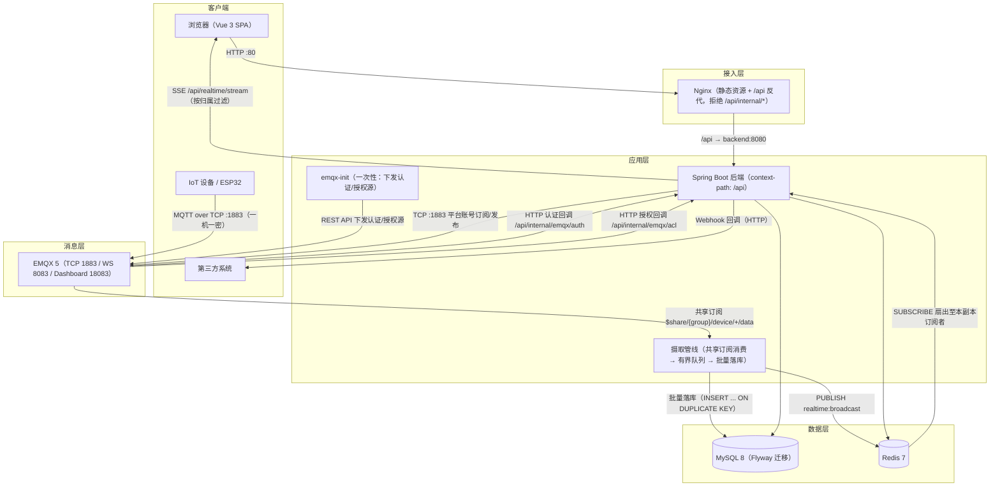

# MQTT云平台 - 系统架构文档

> 版本：v1.46　最后更新：2026-10-26
> 适用范围：`MQTT自建站点` 主项目（Spring Boot + Vue 3 + EMQX + MySQL + Redis）

---

## 目录

1. [系统概述](#1-系统概述)
2. [总体架构](#2-总体架构)
3. [部署拓扑与端口](#3-部署拓扑与端口)
4. [后端架构](#4-后端架构)（分层 / 控制器清单 / 关键组件 / 模块边界）
5. [前端架构](#5-前端架构)
6. [数据模型](#6-数据模型)（44 张表，与 `V1`~`V34` 对应）
7. [安全设计](#7-安全设计)
8. [外部依赖与配置](#8-外部依赖与配置)
9. [非功能性设计](#9-非功能性设计)
10. [相关文档](#10-相关文档)
11. [变更记录](#11-变更记录)

---

## 1. 系统概述

本系统是一个自部署的 MQTT 物联网云平台，围绕 **EMQX Broker** 构建，提供：

- 用户认证与 RBAC 权限（ADMIN / OPERATOR / VIEWER）
- 设备管理与在线状态监控
- MQTT 消息发布、实时订阅与历史查询
- 统计分析、API Key 与 Webhook 对外集成能力

设计原则：分层解耦（Controller → Service → Mapper）、配置外置（环境变量注入）、统一响应与统一异常、默认安全（鉴权前置）。

---

## 2. 总体架构



要点：

- **实时通道收敛到后端**：浏览器不再直连 Broker，改为订阅后端 SSE（`GET /api/realtime/stream`），由后端按设备归属与角色过滤后推送，前端不再持有任何 Broker 凭据。
- **EMQX 认证与授权外置到后端**：设备连接触发 `/api/internal/emqx/auth`，主题读写触发 `/api/internal/emqx/acl`，由后端按「产品 → 设备 → 一机一密」规则裁决；`emqx-init` 服务负责把这两个回调源写入 EMQX（幂等，可重复执行）。
- **Nginx 只代理 `/api`**：前端静态资源与 SPA 回退由 Nginx 承担；`/api/internal/*` 在网关层直接返回 403，仅允许容器网络内的 EMQX 直连后端。
- **摄取链路（R2-1~R2-3）**：平台以共享订阅 `$share/{group}/device/+/data` 消费设备上行数据，进入有界队列后由固定 worker 批量落库；同一份数据同时 `PUBLISH` 到 Redis Pub/Sub 频道，由各后端副本 `SUBSCRIBE` 后扇出给本副本持有的 SSE 连接。队列满或落库持续失败的消息进入 `ingest_dead_letter` 表待人工处置，不阻塞主链路。
- **下行命令链路（T-15）**：控制台 / 开放 API 下发命令 → 按物模型校验 → 落 `device_command_record`（`PENDING`）→ 平台账号发布到 `device/{deviceKey}/cmd/down`（QoS 1，置 `SENT`）→ 设备回执发布到 `device/{deviceKey}/reply` → 平台以共享订阅 `$share/{group}/device/+/reply` 消费，经摄取**第四路旁路**更新记录状态（`ACKED`/`FAILED`）。同步调用通过**轮询命令记录表**等待终态（跨副本正确），超时与长期停留由 `CommandTimeoutSweeper` 兜底置 `TIMEOUT`。
- **导出与实时推送（T-36）**：CSV 编码统一收敛在 `CsvWriter`，三个细节写死在实现里并逐条单测 —— **UTF-8 BOM**（不加则 Excel 打开中文乱码）、**公式注入防护**（`=`/`+`/`-`/`@` 开头的单元格前置单引号；设备 payload 不可控，`=HYPERLINK` 是经典钓鱼手法）、**RFC 4180 转义**。导出**必须有行数上限并如实标注截断**，因为不分页的导出天然无界，一次性拼进内存能把进程打挂。SSE 由单主题扩为**多主题**，空 topics = 全订阅（保持既有行为等价）；属性趋势流挂在 `append`（属性历史唯一写入点，不会漏推/重推）且整段 `try/catch` 静默 —— **推送失败绝不能让摄取主链路的落库失败**。
- **开放 API 的边界（T-35 / T-53）**：`/external/v1` 是唯一对外入口，控制器**只做三件事** —— API Key → `userId` 转换、响应裁剪、转发既有服务。归属隔离不靠控制器重复判断，而是**由各服务方法本身的 userId 校验承担**，因此新增能力域时只要复用服务就自动继承隔离。当前共 **44 个端点**：除命令下发与影子 desired 写入外，T-57 新增设备 / 规则 / 场景 12 个写端点（统一要求 `device:write`），其余为只读；T-53 批次二补分组 / 标签 / 点位表 / 规则执行 / 场景执行 / 看板只读端点，T-57 再补写端点。**不开放产品 / 物模型写、OTA 任务写与用户 / API Key 管理**（写操作的审计、回滚与幂等语义远比读复杂，控制台已完整覆盖）。
- **命令权限与配额（T-34）**：命令下发是**三层约束**，各管一件事、互不牵制 —— ① 角色闸门在 `SecurityConfig` 按路径限定 ADMIN/OPERATOR（改造前此处只有 `anyRequest().authenticated()`，VIEWER 可下发命令）；② 标识符 / 类型权限在 `CommandGuardService`，**只作用于外部来源**（规则 / OTA / 场景 / 点表是系统内部触发，其 `operatorId` 只是「谁配的这条自动化」，套角色判定会让「VIEWER 配的规则跑不起来」）；③ 调用配额在 `CommandQuotaService`，按 `operatorId` 的 Redis 固定窗口、**覆盖全部来源**（规则风暴同样要保护），`enabled=false` 时零 Redis 读写、`failOpen` 降级、TTL 仅在首次 INCR 设置。两者均在 `invoke` 入口**落库之前**判定。
- **规则多条件与多动作（T-33）**：规则模型由「单条件 + 单动作」扩为 `condition_logic` + `conditions_json` + `actions_json`，采用「**JSON 可选列 + 旧列回落**」而非子表 —— 规则评估是「按 `user_id` 拉全量 → 内存匹配」，条件与动作从不作为 SQL 过滤条件，JSON 不损失查询能力，却让存量规则与存量代码路径行为逐位不变。多条件按「一次上报批」求值（同一条件多次上报取任一满足、`AND` 下缺值即终止求值）；多动作采用「**执行粒度 = 动作粒度**」，一次命中落 N 条执行记录并各带配置快照，使重试 / 巡检重放 / 手动重试天然按动作隔离（`FORWARD_HTTP` 不会重复投递），冷却锚点仍按每次触发只占一次。
- **OTA 灰度与校验（T-32）**：升级任务可按 `batchMode=BATCHED` + `batchSize` 切批落 `ota_upgrade_batch`，建任务**只下发首批**；后续批次由巡检在「上一批已无非终态记录」且间隔到期后自动推进，控制台另有暂停 / 恢复 / 终止 / 手动推进。推进判定刻意读记录表而非可能滞后的批次 `status`，避免收口后被多压一轮巡检。任务状态 `PAUSED` / `ABORTED` 由**运维操作**产生而非记录聚合，故 `refreshCounters` 必须保留不被覆盖 —— 否则暂停会被下一次回传改回 `RUNNING`、终止被改回 `SUCCESS`，两个操作直接失效；`dispatched_count` 排除 `SKIPPED`、终止跳过数单列不并入失败。设备上行 `device/{key}/ota` 增可选 `fileMd5`，与 `ota_firmware.md5` 比对不一致即判失败；建任务期与下发期两处互斥校验保证同一台设备不会被两个任务同时升级。
- **场景上下线触发（T-43）**：设备状态**真实切换**时发布 `DeviceStatusChangedEvent`，`SceneStatusTriggerListener` 以 `@TransactionalEventListener(AFTER_COMMIT)` 桥接到 `SceneEvaluationService.onStatus`。事件必须由两条状态写入路径共同发布 —— 默认异步摄取在 `IngestPersistenceService` 内批量更新状态、绕过 `DeviceService`，只改 Service 会漏掉绝大多数上下线；legacy 同步链路与心跳超时巡检则走 `DeviceServiceImpl.updateDeviceStatus`。状态未变化与乱序旧事件都不发布事件。评估方法标注 `REQUIRES_NEW`：`AFTER_COMMIT` 回调发生在连接清理前，`REQUIRED` 会误加入已提交事务，导致执行记录不落库。
- **场景步骤分支与循环（T-44）**：`BRANCH` / `LOOP` 作为流程步骤（`target_type=NONE`）复用一行一步骤明细，不引入第二套流程引擎。分支只允许**向前跳转**（`trueSeq` / `falseSeq`，目标为空结束），循环是**有界计数循环**（`startSeq + times`，单循环 ≤20 次、展开 ≤200 步）。执行器用 `StepOutcome`（NEXT / JUMP / END / REPEAT）路由；循环未完成时 `resetLoopBody` 复位循环体、`resetLoopStep` 复位循环步骤并记录轮次，达到次数后正常前进。循环重放与终态收口都调用 `recountFinishedSteps` 按明细重算进度，终态先清理残留 `PENDING` 再置成功；`loop_iteration` / `flow_result` 仅保留最终轮次与结果，不保留逐轮历史。
- **场景影子变更触发（T-45）**：`DeviceShadowServiceImpl` 在 CAS 成功后对比目标侧前后快照，只把**实际变化**的属性放进 `DeviceShadowChangedEvent`。`reported` 来源为 `INGEST`，`desired` 携带命令来源；`SceneShadowTriggerListener` 在监听器入口跳过 `SCENE` / `RULE` 等内部自动化的 desired 变更，避免「场景写 desired → 影子再触发同一场景」的自触发循环。场景评估 `onShadow` 与上下线触发一致使用 `AFTER_COMMIT` + `REQUIRES_NEW`。值未变或 CAS 重试耗尽不发布事件，事件失败不影响影子写入。
- **看板大屏与跨用户分享（T-46）**：`dashboard_share` 把一个或多个看板组合为公开只读分享，令牌为 256 位随机数，库中只存 SHA-256 哈希与短前缀，明文仅创建 / 轮换时返回一次；轮换 / 停用 / 删除立即让旧链接失效。公开接口 `GET /public/dashboard-shares/{token}` 在 `SecurityConfig` 显式 `permitAll`，每次读取都重新校验看板与设备归属并过滤非创建者设备；前端 `/display/{token}` 为大屏深色布局，多看板按分享间隔轮播、面板数据每 60 秒刷新，`dark` / `refreshInterval` 仅从大屏页传入，工作台看板样式不变。
- **分组级权限共享（T-48）**：`device_group_member` 存 `VIEW` / `OPERATE` 两档成员权限，`OWNER` 仅作为判定结果不落库。`DeviceAccessService` 是分组 / 设备访问级别的唯一判定入口：分组沿 `parent_id` 祖先链逐级查成员表（最近祖先优先，最大 5 层），设备取所属分组最高权限；所有者与平台 ADMIN 短路 `OWNER`。读取路径**不缓存**，成员变更 / 分组移动立即生效。共享成员可查看分组子树与组内设备；`OPERATE` 可下发命令 / 写影子，但仍需叠加 ADMIN / OPERATOR 角色闸门。分组结构与成员管理仅所有者；共享分组只经 `includeShared=true` 进入分组管理页，场景 / 规则 / OTA 等目标选择器仍只展示本人分组。
- **场景步骤并行（T-49）**：`PARALLEL` 开始并行块、`JOIN` 汇合，普通动作步骤用 `parallel_seq` + `branch_index` 归属具体分支。`PARALLEL` 执行时为每个分支找到序号最小的步骤并同时排期；分支内按 `seq` 串行推进，分支结束后**按执行明细状态实时判断**所有分支是否完成，全部完成才排期 `JOIN`。不新增计数器，因此重试、进程重启与多副本不会计数漂移。并行块内只允许普通动作步骤，禁止 `BRANCH` / `LOOP` / 嵌套；手动重试若失败位于块内则从 `PARALLEL` 整体重置该块及之后的并行块。
- **Modbus 多从站与 64 位整型（T-50）**：`device_point_table.unit_id` 可为空（继承 `driver_config.unitId`），点位值优先；合并读键从「功能码」扩为「功能码 + unitId」，**不同从站相同地址绝不合并**。同一 TCP 连接顺序读取多个从站；批量读失败降级逐点读仍使用该分支的 unitId。`int64` / `uint64` 均占 4 个寄存器，`uint64` 用 `Long.toUnsignedString` 输出十进制字符串，再走既有 scale/offset 换算。
- **场景版本回滚（T-51）**：`scene_version` 保存每次创建 / 更新 / 回滚后的完整配置快照（定义 + 条件组 + 步骤流 + 启用状态），只追加不修改；每场景保留最近 20 个版本。回滚用 `LambdaUpdateWrapper` **显式 set 全部定义字段（含 null）**，再整体替换步骤，最后写入一个新的 `RESTORE` 版本；版本号在场景内递增，`(scene_id, version_no)` 唯一。
- **告警阈值窗口聚合（T-52）**：`alert_rule` 增加 `aggregate_type` / `window_seconds` / `min_samples`；窗口 0 保持既有最新值语义。`AlertWindowAggregator` 按 `(ruleId, deviceId)` 维护单副本内存滚动窗口，按**上报时间**淘汰样本、`anchor` 取最大已见时间，乱序样本不会拉长窗口；达到 `min_samples` 后才计算 AVG/MIN/MAX/SUM/COUNT 并参与比较。样本不足时既不触发也不恢复活动告警；告警触发值保存聚合值。窗口只在本副本内存，重启 / 重平衡会清空。
- **摘要指标优先**：设备最新状态与消息计数走 `updateStatusGuarded` 时间戳守卫写入，避免共享订阅 `round_robin` 分摊导致的乱序覆盖；严格有序场景留待 R5 引入 Kafka 按 `deviceKey` 分区解决。
- **平台治理（T-53）**：审计日志由 `AuditLogInterceptor` 统一记录写操作（POST / PUT / PATCH / DELETE）与认证事件，**只记录路径与结果、绝不读取请求体**（避免把设备密钥、API Key、证书私钥写进审计表）；登录 / 注册 / 登出由 `AuthController` 显式埋点，因为前两者在鉴权之前、登出会提前清空 SecurityContext。设备 CSV 导入逐行复用 `DeviceService.createDevice` 的独立事务，单行失败不阻断整批；HTTP 上报在**参数校验之后、入队之前**做设备级固定窗口限流与 `Idempotency-Key` 去重（Redis `SET NX EX`，TTL 默认 300 秒），非法报文不占配额、也不写幂等键。
- **OTA 固件版本与降级拦截（T-54）**：设备 OTA 成功回传后，`OtaProgressServiceImpl` 把 `payload.version` 回写 `device.firmware_version`；手工升级（无任务记录）的成功回传同样回写。默认 `app.ota.allow-downgrade=false`，建任务时 `OtaUpgradeServiceImpl` 用 `FirmwareVersionComparator` 跳过「当前版本高于目标版本」的设备，并在任务详情回传 `downgradeSkippedCount`；版本未知（NULL）的设备放行，避免老设备被永久卡住。版本回写做防回退：默认忽略低于平台记录的版本，显式允许降级后才按设备真实回传更新。
- **Payload Codec（T-55）**：产品可配置 `payload_codec` 声明式模板，把非 Alink 原始 JSON 映射成 Alink 后，再进入既有物模型解析链路 —— 属性最新值 / 事件 / 告警 / 规则 / 场景 / 历史**全部零改动**。模板只支持 `$` 只读路径与常量，不支持脚本；保存期由 `PayloadCodecValidator` 校验（≤16KB、深度 ≤10、节点 ≤500），运行期由 `PayloadCodecCache` 缓存（TTL = 物模型缓存 TTL），产品更新 / 删除后主动失效。映射失败默认回退原始载荷。
- **开放 API 写操作（T-57）**：`/external/v1` 在只读基础上新增设备 / 规则 / 场景 12 个写端点，全部复用既有服务与校验；scope 统一要求 `device:write`，设备写按 `deviceKey` 归属校验、规则 / 场景由服务层 `userId` 隔离，写操作同样受开放接口限流与审计日志覆盖。创建设备返回的一次性密钥只出现一次；未引入 `Idempotency-Key`，幂等由「先查后建 + 整体覆盖 + 调用方重试」保证。
- **TOTP 多因素认证（T-58）**：`sys_user` 增加 `mfa_enabled` / `mfa_secret`（AES-256-GCM 密文）/ `mfa_confirmed_at`；登录密码通过后，启用 MFA 的账号只拿到带 `mfa=true` 的 5 分钟二步令牌，动态口令通过才签发访问令牌并更新最后登录时间。`TotpUtil` 用 JDK 实现 RFC 6238（HMAC-SHA1 + Base32 + 动态截断，默认 30s / 6 位 / ±1 步）；`MfaCrypto` 负责密钥加密，密钥优先取 `MFA_ENCRYPTION_KEY`，否则由 `JWT_SECRET` 派生。`app.mfa.enabled=false` 时 MFA 端点 404、登录不要求二步，已绑定密钥保留。
- **Kafka 数据桥接（T-56）**：规则与场景新增 `FORWARD_KAFKA` 动作，由 `bridge.KafkaMessageForwarder` 出站到第三方 Kafka。Producer 懒创建、单例复用，发送同步等待确认（超时按失败走动作重试）；`app.bridge.kafka.enabled=false`（默认）不创建 Producer；`topic` 为空回落缺省 Topic，`key` 可选（建议按设备标识分区保证同设备有序），载荷为空时复用与 MQTT / HTTP 一致的默认载荷。**无新增表 / 迁移 / MQTT 主题 / ACL**。

---

## 3. 部署拓扑与端口

| 服务 | 镜像 | 容器名 | 宿主端口 | 说明 |
|------|------|--------|----------|------|
| MySQL | `mysql:8.0` | `mqtt-mysql` | 3306 | 业务数据；schema 由 Flyway 迁移管理（`db/migration/V*.sql`） |
| Redis | `redis:7-alpine` | `mqtt-redis` | 6379 | Token 黑名单、设备在线状态缓存 |
| EMQX | `emqx/emqx:5.0.26` | `mqtt-emqx` | 1883 / 8083 / 18083 | MQTT TCP / MQTT WebSocket / 管理后台（须带补丁号，Docker Hub 无 `5.0` 标签） |
| EMQX 初始化 | `curlimages/curl:8.8.0` | `mqtt-emqx-init` | — | 一次性：通过 REST API 下发 HTTP 认证与授权源（`restart: "no"`） |
| 后端 | `mqtt-cloud-backend:1.0.0` | `mqtt-backend` | 8080 | Spring Boot，健康检查 `/api/health` |
| 前端 | `mqtt-cloud-frontend:1.0.0` | `mqtt-frontend` | 80 | Nginx 托管 SPA，健康检查 `/health` |

- 编排文件：`docker/docker-compose.yml`；网络：`mqtt-network`（bridge）；命名卷：`mysql_data` / `redis_data` / `emqx_data` / `emqx_log` / `ota_firmware`（T-22：backend 写入、frontend 以只读挂载到 `/usr/share/nginx/html/firmware` 由 nginx 静态托管固件）。
- 启动依赖：`backend` 依赖 `mysql`/`redis`/`emqx` 均为 `service_healthy`；`emqx-init` 依赖 `emqx` 与 `backend` 为 `service_healthy`；`frontend` 依赖 `backend` 为 `service_healthy`。
- **环境变量注意**：compose 文件位于 `docker/`，而 `.env` 位于仓库根目录，执行时需显式 `--env-file .env`（详见 `docs/DEPLOYMENT.md`）。

---

## 4. 后端架构

### 4.1 分层结构

> 以下分层依赖由 ArchUnit 规则强制（`backend/src/test/java/com/mqtt/cloud/arch/LayeringRulesTest.java`），
> 违反会在 `mvn test` 阶段失败；逻辑模块划分见 [4.4 目标模块边界](#44-目标模块边界)。

```
com.mqtt.cloud
├── controller/     # 41 个控制器（39 个业务控制器 + internal/ 的 2 个 EMQX 回调），仅做参数校验与编排，统一返回 Result<T>
├── service/        # 业务接口 + impl/ 实现，事务边界所在
├── mapper/         # MyBatis-Plus Mapper（注解 SQL + Wrapper）
├── entity/         # 与表一一对应的实体（含 Product、Device）
├── dto/
│   ├── request/    # 入参对象（@Valid 校验）
│   └── response/   # 出参对象（不直接暴露 entity；DeviceCreatedDTO 承载一次性明文密钥）
├── mqtt/           # MqttClientManager / MqttMessageHandler / MqttProperties
├── bridge/         # KafkaMessageForwarder（T-56 数据桥接，纯出站）
├── filter/         # JwtAuthenticationFilter / ApiKeyAuthFilter / InternalTokenFilter / DeviceCredentialAuthFilter / UserPrincipal
├── config/         # Security / Redis / MyBatis-Plus / OpenAPI / Async / Schedule / RestTemplate / AccessControl / Realtime
├── common/         # Result / ResultCode / exception / security / constant
└── util/           # JwtUtil / TotpUtil / ApiKeyGenerator / FirmwareVersionComparator / PayloadCodec* / SceneValidator / RuleTemplateRenderer
```

### 4.2 控制器清单

| 控制器 | 前缀 | 职责 |
|--------|------|------|
| `AuthController` | `/auth` | 注册、登录、登出、当前用户、修改密码；登录对启用 MFA 的账号返回 `mfaRequired` 与二步令牌 |
| `MfaController` | `/auth/mfa` | TOTP 多因素认证（T-58）：状态 / 绑定 / 启用 / 停用 / 二步登录；`app.mfa.enabled=false` 时整组 404，`/verify` 免登录 |
| `DeviceController` | `/devices` | 设备 CRUD、状态查询、在线列表、禁用/启用（`enabled`，归属校验）；命令能力查询 / 下发 / 命令记录分页（T-15，归属校验 + `DeviceAccessGuard` 准入）；多设备影子聚合 `GET /shadow-summary`（T-42，默认本人设备、显式 ID 逐台鉴权、200 台上限）；影子查询（`GET .../shadow`）与期望值写入（`PUT .../shadow/desired`，T-16）；列表支持 `groupId`（含子分组）/ `tagId` 过滤并装配分组 / 标签摘要（T-18） |
| `MessageController` | `/messages` | 发布消息、最近消息 |
| `HistoryController` | `/history` | 按设备/时间/Topic 分页查询历史 |
| `AnalyticsController` | `/analytics` | 消息量趋势等统计 |
| `ApiKeyController` | `/api-keys` | API Key 的签发与吊销 |
| `WebhookController` | `/webhooks` | Webhook 配置 CRUD |
| `ExternalApiController` | `/external/v1` | 面向第三方的 API Key 鉴权接口；命令下发（`type/identifier/params/callType` 结构化契约，`source=OPEN_API`）与命令记录分页（T-15）、影子查询与期望值写入（T-16，`/external/v1/devices/{deviceKey}/shadow[/desired]`）、告警只读查询（T-17：`/external/v1/alerts`、`/alerts/{id}`、`/alerts/unread-count`、`/alerts/rules`）；T-35 补齐 12 个只读端点；T-53 批次二再补分组 / 标签 / 点位表 / 规则执行 / 场景执行 / 看板只读端点；T-57 再补设备 / 规则 / 场景 12 个写端点（统一 `device:write`，设备写按 deviceKey 归属校验） |
| `HealthController` | `/health` | 健康检查 |
| `ProductController` | `/products` | 产品（设备类型模板）CRUD、停用/启用（`status`，ADMIN）；删除时校验产品下是否仍有设备；物模型（TSL）查询 / 保存 / 清空 / 校验 / 导出 / 导入六端点（写操作 ADMIN）；驱动配置查询 `GET /{id}/driver-config`（ADMIN，T-31 P4） |
| `RealtimeController` | `/realtime` | SSE 实时数据流（按设备归属与角色过滤） |
| `EmqxAuthController` | `/internal/emqx` | EMQX HTTP 认证回调（内部，须 `X-Internal-Token`） |
| `EmqxAclController` | `/internal/emqx` | EMQX HTTP 授权回调（内部，须 `X-Internal-Token`） |
| `AlertController` | `/alerts` | 告警中心控制台（T-17）：规则 CRUD（`/alerts/rules`，按 `sourceType`/`enabled` 过滤）、告警记录分页与详情、确认（`/ack`）与人工恢复（`/recover`）、未读数（`/unread-count`）与最近活动告警（`/recent`），全部按登录用户隔离；T-27 新增**指派处理人 / 解除指派**（`POST /alerts/{id}/assign`，`notify=true` 时投递一次 `alert.escalated`） |
| `DeviceGroupController` | `/device-groups` | 设备分组控制台（T-18 / T-48）：分组树（含 `children`/`deviceCount`，可选 `includeShared`）/ 平铺列表 / 创建 / 详情（所有者或共享成员，`getAccessible`）/ 更新（重命名 / 描述 / 排序 / 移动父节点）/ 删除（仅空分组）/ 分组内设备分页（含后代，共享成员可读）/ 单台或批量加入与移出（仅所有者）/ 成员列表、添加、改权限、移除（仅所有者）；结构操作按登录用户隔离、越权 `403`，共享访问越权 `6310` |
| `DeviceTagController` | `/device-tags` | 设备标签控制台（T-18）：标签列表 / 创建 / 详情 / 更新 / 删除（自动解除关联）/ 标签内设备分页 / 单台或批量打标与去标，全部按登录用户隔离、越权 `403` |
| `DeviceBatchController` | `/devices/batch` | 设备批量操作（T-18）：批量下发命令（强制异步，逐台隔离）/ 批量启用 / 批量禁用（含踢线）/ 批量加入或移出分组 / 批量打标或去标；目标集合由「手选设备 ∪ 分组（含子分组）∪ 标签」去重并按用户二次过滤 |
| `RuleController` | `/rules` | 消息规则控制台（T-19）：规则 CRUD / 启停 / 分页（按 `sourceType`/`actionType`/`enabled`/`keyword` 过滤）/ **试运行干跑**（不落执行记录、不发送、不更冷却）/ 执行记录分页与详情 / 手动重试；`GET /rules/executions` 静态段置于 `GET /rules/{id}` 之前，规则与执行记录按登录用户隔离、越权 `403` |
| `DeviceLogController` | `/devices/{deviceId}/logs` | 设备统一日志时间线（T-20）：只读聚合，把报文 / 命令 / 事件 / 连接状态四类记录汇总为单设备时间线（查询时 `UNION ALL`），支持 `types[]` / `startTime` / `endTime` / `keyword` 过滤与分页（`occurred_at DESC, seq DESC`），命令与回执按 `correlationId` 自动关联；归属校验 + ADMIN 旁路，时间范围非法 `6223`、类型非法 `6224` |
| `PropertyHistoryController` | `/properties` | 属性时序（T-21）：`GET /properties/history` 单端点，按设备 + 一个或多个标识符 + 时间范围做分桶聚合查询，返回多条序列（时间点 + `avg`/`min`/`max`/`count`）；归属校验 + ADMIN 旁路，时间范围非法 `6225`、标识符未建模 `6226`、桶非法或点数超限 `6227` |
| `DashboardController` | `/dashboards` | 可保存看板（T-21）：列表 / 创建 / 详情 / 更新 / 删除五端点，全部按登录用户隔离；看板不存在或非本人 `6228`、配置非法 `6229`、看板数超限 `6230` |
| `DeviceDebugController` | `/devices/{deviceKey}/debug` | 设备调试中心（T-37）：调试上下文（连接参数 / Topic / 物模型投影 / 最新值）、模拟上行（data / heartbeat / lwt / reply / ota，走 `IngestPipeline` 与真机同链路）、属性代码生成（设备端 JS/Python/Java/Arduino、上位机端 JS/Python/Java）；模拟接口限定 ADMIN/OPERATOR，错误码 `6297`~`6299` |
| `HmiViewController` | `/hmi-views` | 快速上位机（T-38）：列表 / 创建 / 详情 / 更新 / 删除 / 按物模型生成草稿六端点，按登录用户隔离；非本人 `6300`、数量超限 `6301`、配置非法 `6302`、绑定非法 `6303`、控件类型非法 `6304` |
| `OtaFirmwareController` | `/ota/firmwares` | OTA 固件包管理（T-22）：上传（multipart）/ 列表（按 `productId` 过滤）/ 详情 / 下载（附件流）/ 删除五端点；操作者由登录态注入、请求体不传 `userId`，授权由 `SecurityConfig` 统一限定 `ADMIN`/`OPERATOR`；错误码 `6231`~`6235` |
| `OtaUpgradeController` | `/ota/tasks` | OTA 升级任务（T-22）：创建（解析目标集合、剔除与固件产品不一致设备并即时下发）/ 列表 / 详情（含目标快照）/ 逐台记录分页（按 `status` 过滤）/ 重投（`PENDING`/`FAILED`/`TIMEOUT` 重置）/ 删除六端点；授权同上；错误码 `6236`~`6238` |
| `DeadLetterController` | `/admin/dead-letters` | 摄取死信管理（`@Tag("死信管理")`）：ADMIN 分页查询死信（按 `status` 过滤），供人工处置摄取管线兜底落库的失败消息 |
| `HttpIngestController` | `/ingest` | HTTP 上报接入（T-24）：`POST /api/ingest/{deviceKey}/{messageType}`（`messageType ∈ {data, heartbeat, lwt}`）单端点；以**设备凭据 HTTP Basic**（`{productKey}.{deviceKey}:{deviceSecret}`，由 `DeviceCredentialAuthFilter` 前置校验）鉴权，构造与 MQTT **同形**的 `IngestRecord` 走 `IngestPipeline.submit` **唯一入口**（合成主题 `device/{deviceKey}/{messageType}`，`routeIndex` 只依赖 `deviceKey`，与 MQTT 同分片同顺序）；失败统一 `401` + `6246`（含 `WWW-Authenticate: Basic realm="mqtt-cloud-device"`），非法消息类型 `400` + `6247`，载荷超限 `413` + `6248`；`HTTP_INGEST_ENABLED=false` 时端点不注册（`404`） |
| `SceneController` | `/scenes` | 场景联动控制台（T-23）：场景列表 / 创建 / 详情 / 更新 / 删除 / 启停（`PUT /scenes/{id}/enabled`）、**试运行**（`POST /scenes/{id}/test`，干跑不落执行记录、不发送）、**手动触发**（`POST /scenes/{id}/run`）、执行记录分页（`GET /scenes/executions`）与详情（`GET /scenes/executions/{id}`）、失败重试（`POST /scenes/executions/{id}/retry`）共 11 端点；`GET /scenes/executions` 静态段声明在 `GET /scenes/{id}` 之前，全部按登录用户隔离（`SecurityUtils.requireUserId()`）、越权 `403`；错误码 `6240`~`6245` |
| `DeviceCertificateController` | `/devices` | 设备凭据扩展（T-25）：签发证书（`POST /devices/{deviceId}/certificate`，Bouncycastle 自签 CA，落 `device_certificate` 表）/ 吊销证书（`POST /devices/{deviceId}/certificate/revoke`，软吊销置 `revoked_at`，吊销即失效）/ 签发设备令牌（`POST /devices/{deviceId}/token`，jjwt HMAC-SHA256，密钥 `AUTH_JWT_SECRET`）；三端点授权统一 `ADMIN`，错误码 `6249` / `6251` / `6252` / `6253` |
| `DeviceTopologyController` | `/devices` | 设备拓扑（T-26）：创建子设备（`POST /devices/{gatewayId}/sub-devices`，一步建成即挂载）/ 挂载（`POST /devices/{gatewayId}/sub-devices/{subDeviceId}`，网关为 `DIRECT` 时自动提升 `GATEWAY`）/ 解绑（`DELETE .../sub-devices/{subDeviceId}`，子设备回落 `DIRECT`、网关角色保持）/ 列子设备（`GET .../sub-devices`，分页）/ 查父网关（`GET /devices/{subDeviceId}/parent`，无父返回空）/ 变更角色（`PUT /devices/{deviceId}/node-type`，有子设备时降级 `6259`）；六端点均按设备归属 + `ADMIN` 旁路校验，错误码 `6254`~`6260`，`app.device-topology.enabled=false` 时一律 `404` |
| `NotificationController` | `/notifications` | 站内信中心（T-27）：分页（`unreadOnly` 过滤，`created_at DESC`）/ 未读数 / 标记单条已读（幂等）/ 全部已读 / 删除单条 / 清空已读六端点，全部按登录用户隔离、越权 `403`；`app.notification.enabled=false` 时**读取与已读端点保留**，仅停止新增 |
| `NotificationChannelController` | `/notification-channels` | 通知渠道配置（T-27）：列表 / 创建 / 详情 / 更新 / 删除 / 连通性测试（`POST /{id}/test`）六端点，按登录用户隔离；`EMAIL`（SMTP）与 `SMS`（通用 HTTP 供应商）两类，敏感字段响应一律脱敏 `******`、更新留空表示保留原值；错误码 `6261`~`6264`；`app.notification.enabled=false` 时整组 `404` |
| `AlertEscalationController` | `/alert-escalations` | 告警升级策略（T-27）：列表 / 创建 / 详情 / 更新 / 删除五端点，按登录用户隔离；策略按 `severity`（`ALL`/`INFO`/`WARNING`/`CRITICAL`）匹配未确认告警，超 `after_seconds` 触发升级；错误码 `6265`/`6266`；`app.notification.enabled=false` 时整组 `404` |
| `DeviceRegistrationController` | `/device-registration` | 设备批量注册与激活（T-30）：批量按前缀 + 序号创建设备并逐台签发凭据、设备侧凭激活码自助激活、注册批次分页与详情；单台失败不阻断整批，凭据明文仅返回一次 |
| `DevicePointTableController` | `/devices/{deviceId}/points` | 设备点位表（T-31）：点位列表 / 批量保存 / 删除 / 边缘点表下发；EDGE 与 PLATFORM 执行方同一设备不可混用 |
| `ExportController` | 多路径 | CSV 导出（T-36 / T-53）：设备日志、属性时序、命令记录、告警记录、设备台账与审计日志；统一 `CsvWriter`（UTF-8 BOM / 公式注入防护 / RFC 4180），响应头 `X-Export-Truncated` 标注截断；审计导出仅 ADMIN |
| `DashboardShareController` | `/dashboard-shares` | 看板公开分享（T-46）：创建 / 列表 / 轮换 / 停用 / 删除；令牌只存 SHA-256 哈希与短前缀，明文仅创建 / 轮换时返回一次 |
| `PublicDashboardShareController` | `/public/dashboard-shares` | 公开大屏只读入口（T-46）：按分享令牌返回看板与设备数据，每次读取重新校验归属；`SecurityConfig` 显式 `permitAll` |
| `AuditLogController` | `/audit-logs` | 审计日志查询（T-53）：按用户 / 动作 / 资源 / 来源 / 结果 / 关键字 / 时间窗分页，仅 ADMIN；导出见 `ExportController` |
| `DeviceImportController` | `/devices` | 设备 CSV 导入（T-53 / T-54）：模板下载与批量导入；单次 ≤1000 行、2MB，逐行独立事务，一次性返回新设备凭据；可选 `firmwareVersion` 列 |

Swagger 由 `OpenApiConfig` 的 `GroupedOpenApi` bean 按路径前缀分组，当前共 **12 组**（认证管理 / 产品管理 / 实时数据 / 设备管理 / 消息管理 / 历史查询 / 统计分析 / API密钥 / Webhook / 外部API / 健康检查 / 告警中心），访问 `/api/swagger-ui.html`；控制器 / 方法上的 `@Tag`（如「设备分组」「设备标签」「消息规则」「设备日志」「属性时序」「看板」「OTA 固件包」「OTA 升级任务」「死信管理」「场景联动」「设备拓扑」）仅为接口展示标签、**不单独成组**，只随其路径命中的分组一并展示。T-20 **未新增 Swagger 分组**（设备日志端点位于 `/api/devices/{deviceId}/logs`，归入「设备管理」组）；T-21 **同样未新增 Swagger 分组**——属性时序（`/api/properties/**`）与看板（`/api/dashboards/**`）端点均**不匹配任何 `pathsToMatch`**，故不出现在任何分组中（设备日志经 `/api/devices/**` 前缀归入「设备管理」组，而 `/api/properties` 与 `/api/dashboards` 无对应组）；T-22 **亦未新增 Swagger 分组**——OTA 端点（`/api/ota/**`）同样不匹配任何 `pathsToMatch`，其 `@Tag`（「OTA 固件包」「OTA 升级任务」）仅作展示；T-24 **未新增 Swagger 分组**——HTTP 上报端点（`/api/ingest/**`）同样不匹配任何 `pathsToMatch`；T-23 **亦未新增 Swagger 分组**——场景端点（`/api/scenes/**`）同样不匹配任何 `pathsToMatch`，其 `@Tag`（「场景联动」）仅作展示；T-25 **亦未新增 Swagger 分组**——设备凭据端点（`/api/devices/{deviceId}/certificate`、`/certificate/revoke`、`/devices/{deviceId}/token`）命中既有 `/api/devices/**` 前缀，归入「设备管理」组，Swagger 仍 **12 组**；T-26 **亦未新增 Swagger 分组**——设备拓扑端点（`/api/devices/{gatewayId}/sub-devices/**`、`/api/devices/{subDeviceId}/parent`、`/api/devices/{deviceId}/node-type`）命中既有 `/api/devices/**` 前缀，归入「设备管理」组，其 `@Tag`（「设备拓扑」）仅作展示，Swagger 仍 **12 组**；T-27 **亦未新增 Swagger 分组**——站内信（`/api/notifications/**`）、通知渠道（`/api/notification-channels/**`）与升级策略（`/api/alert-escalations/**`）端点均**不匹配任何 `pathsToMatch`**，其 `@Tag`（「站内信」）仅作展示，Swagger 仍 **12 组**。`/internal/**` 为容器内部回调，不纳入 Swagger。

### 4.3 关键组件

- **`MqttClientManager`**：应用启动时按 `spring.mqtt.*` 建立到 EMQX 的 TCP 长连接，负责订阅通配 Topic 与发布下发指令。订阅使用 EMQX 共享订阅（`$share/{group}/device/+/...`），多副本同组分摊消息，避免每条上行被所有副本重复落库。
- **`MqttMessageHandler`**：消息回调入口，解析 payload → 落 `message` 表 → 更新设备在线状态 → 触发 Webhook 分发。订阅四类上行（`device/+/data`、`device/+/heartbeat`、`device/+/lwt`、`device/+/reply`）之外，T-22 新增 **`device/+/ota`**（OTA 进度回传），均以共享订阅 `$share/{group}/...` 注册；`ota` 类型与 `data`/`heartbeat` 同走 `updateStatusGuarded` 刷新在线态。
- **`IngestDispatcher`**：落库事务提交后 fan-out **六路**——Webhook / SSE / **物模型解析**（T-14）/ **命令回执**（T-15）/ **影子补发**（T-16，`ShadowDeliveryService.onIngest`）/ **OTA 进度回传**（T-22，`OtaProgressService.handle`）；解析、回执、补发与进度均为旁路，逐条隔离失败，不影响主摄取链路。OTA 进度回传另映射 Webhook 事件类型 `device.ota`。**HTTP 上报（T-24）不新增此处 fan-out 路**：`HttpIngestService` 合成与 MQTT 同形的 `IngestRecord` 后统一走 `IngestPipeline.submit` **唯一入口**，fan-out 段数保持 **六路**。
- **`ThingModelService`**：物模型（TSL）的校验 / 存储 / 导入导出，保存即版本号 +1 并失效**本副本**缓存；`getForProduct` 供解析链路与命令校验（T-15）、设备影子（T-16）复用。
- **`ThingModelValidator`**：纯函数式 TSL 校验（V1~V16：schemaVersion、标识符规范、数据类型约束、递归深度与数量上限），返回 `{path, message}` 列表，JSON 解析失败单独归类（错误码 6101）。
- **`ThingModelCache`**：物模型定义的进程内缓存（TTL + 主动失效），避免解析热路径频繁查库；**多副本收敛窗口 = TTL**（默认 60s，`THING_MODEL_CACHE_TTL_SECONDS` 可调，0 关闭）。
- **`PayloadCodecDefinition` / `PayloadCodecService` / `PayloadCodecCache` / `PayloadCodecValidator` / `PayloadCodecTransformer`**（T-55）：产品级 Payload Codec。`Product.payload_codec` 存声明式模板；`PayloadCodecValidator` 在保存时校验并规范化（≤16KB、template.method 必填、`$` 路径合法、深度 ≤10、节点 ≤500，非法 `6317`）；`PayloadCodecCache` 按产品缓存定义（TTL 复用物模型缓存），产品更新 / 删除后主动失效；`PayloadCodecTransformer` 在解析前把非 Alink JSON 渲染为 Alink（路径不存在字段省略，失败按 `fallbackToRaw` 回退原始载荷）；不执行脚本、不新增 `IngestDispatcher` 路。
- **`ThingModelInterpretService`**：上行 Alink JSON 解析（T-55 起先按产品 Payload Codec 把非 Alink 报文映射为 Alink）——按物模型把属性 upsert 到 `device_property_latest`（保留最新一条）、事件追加到 `device_event_record`；属性值按 `dataType` 校验与文本化，非法值跳过并计数；未建模 / 非 Alink 载荷兼容直存，不丢消息。解析完成后依次挂**五条内部旁路**（复用同一份归一化样本、各自 try-catch 隔离、异常逐条不冒泡到摄取链路）：T-16 影子收敛（`DeviceShadowService.applyReported`）→ T-17 阈值告警（`AlertEvaluationService`）→ T-19 消息规则（`RuleEvaluationService`，`onProperties` / `onEvents`）→ T-21 属性历史追加（`PropertyHistoryService.append`，批量 `INSERT ... VALUES (...),(...)`，异常只记 WARN、**不进死信**）→ T-23 场景评估（`SceneEvaluationService`，属性侧 `onProperties`、事件侧按设备分组后 `onEvents`）；**不新增 `IngestDispatcher` fan-out 路**。
- **`DeviceDataService`**：设备属性最新值 / 事件记录只读查询（按 `deviceKey` 归属校验、事件分页 `size` 上限 100）。
- **`DeviceCommandService`**：命令下发主链路（T-15）——按物模型校验参数（属性设置须命中 `rw` 属性、服务调用须命中服务且满足入参必填与类型），落 `PENDING` → 发布 QoS 1 → 置 `SENT`，发布异常置 `FAILED`；`callType=sync` **轮询命令记录表**等待终态（跨副本正确，不用进程内 `Future`）；`getCapability` 返回可下发能力供前端动态表单。T-22 新增**保留服务白名单** `SERVICE_OTA_UPGRADE`（`ota_upgrade`，免物模型声明即可下发，下行 method 仍为 `thing.service.ota_upgrade`），并新增来源 `SOURCE_OTA`，供升级任务复用命令链路（获得命令记录、回执、超时巡检与命令历史）。
- **`CommandReplyService`**：命令回执处理（T-15）——解析 Alink 回执，以 `id` 关联 `command_id`，`code=200` 置 `ACKED`（`result=data`）、否则 `FAILED`；**条件更新**（`WHERE command_id=? AND status IN ('PENDING','SENT')`）保证终态不可覆盖，重复 / 未知回执计数忽略。
- **`CommandTimeoutSweeper`**：定时巡检（`app.command.timeout-sweep-interval-ms`，0 关闭）——把长期停留 `PENDING/SENT` 的记录按同步 / 异步不同超时置 `TIMEOUT`，保证异步命令不会永远停在 `SENT`。
- **`ThingModelParamValidator`**：无状态参数校验器（T-15 从 T-14 解析逻辑提取）——`normalize` 供上行解析（返回文本或 `null`）、`validate` 供下行命令（返回错误原因），上下行**共用同一套 `dataType` 校验**，避免规则漂移。
- **`DeviceShadowService`**：设备影子（T-16）——维护 `device_shadow` 的 `desired`/`reported`/`delta` 三份状态与单调递增 `version`；`applyReported` 按标识符**回读 `device_property_latest` 权威最新值**合并 `reported`（继承 `upsertIfNewer` 时间戳守卫，乱序旧包天然不污染），`setDesired` 写入期望值并重算 `delta`；内部统一「读-改-写 + CAS」（`WHERE device_id=? AND version=?`），冲突重读重算最多 `app.shadow.cas-retry` 次，耗尽仅记 WARN 放弃（影子是最终一致的尽力视图，不阻断命令 / 上报主链路）。
- **`ShadowDeliveryService`**：离线补发（T-16）——`onIngest` 为 `IngestDispatcher` **第五路旁路**，从 `data`/`heartbeat` 事件识别刚上线的设备，先 `countQueued` 短路再 `flushQueued`（按 `next_attempt_at` 升序逐条重发 `cmd/down`，`QUEUED → SENT`，失败按指数退避重设 `next_attempt_at`）；全程逐条隔离异常，绝不冒泡。
- **`ShadowRetrySweeper`**：退避巡检（T-16，`SchedulingConfigurer`，间隔 `app.shadow.retry-sweep-interval-ms` 默认 `30000`、`0` 关闭）——周期选取 `next_attempt_at` 到期且设备在线 / 产品启用的 `QUEUED` 命令重发；`attempt_count >= app.shadow.retry-max-attempts`（默认 5）时置 `FAILED`（`error_message='补发重试次数耗尽'`），退避为 `now + min(base*2^(attempt-1), maxDelay)`。
- **`ShadowProperties`**：`@ConfigurationProperties(prefix = "app.shadow")`（风格对齐 `CommandProperties`）——承载补发总开关、重试上限、退避基数 / 封顶、巡检间隔、批量上限、CAS 重试、队列 TTL 等配置。
- **`AlertRuleService`**：告警规则管理（T-17 / T-52）——创建 / 更新 / 删除（逻辑删除）/ 列表 / 归属查询；按来源类型做完整校验（`sourceType`、`operator`、`eventType` 枚举与 `thresholdValue` 可解析性，非法抛 `6208`，设备非本人抛 `2003`，不存在 / 越权抛 `6207` / `403`）。T-28 起作用域校验由 `DeviceScopeService.validateAndNormalize` 统一承担（档位与字段一致性、分组 / 标签归属、数量上限，非法抛 `6268`），落库 `scope_type` 与 `ScopeJson.write(groupIds/tagIds)`，列表 / 详情读路径回填 `groupIds` / `tagIds` 瞬态视图。T-52 增加窗口校验：仅阈值规则允许窗口，窗口 >0 时聚合方式缺省 AVG、阈值必须为数字、最少样本 1~1000；非阈值来源强制窗口 0；更新 / 删除清理内存窗口。
- **`AlertEvaluationService`**：告警评估核心（T-17 / T-52）——`onProperties`（属性阈值，由 `ThingModelInterpretService` 旁路调用）/ `onEvents`（事件命中）/ `evaluateOffline`（供离线巡检）三入口共用 `raise` 四步：查活动告警 → 无则新建并通知 / 有则按抑制窗口判定「窗口内计数累加去重」或「超窗再次通知」→ 阈值未命中回落 `recover`；阈值按 `BigDecimal.compareTo`、`EQ`/`NE` 按归一化文本，不可解析值跳过（WARN）；全程逐条 try-catch 隔离，异常不冒泡到解析 / 巡检链路。T-28 把作用域从「单设备 / 全部设备」扩为四档：`AlertRuleMapper.selectEnabledForDevice` 按档位过滤（`ALL` / `DEVICE` 精确匹配 + `GROUP` / `TAG` 全取），返回结果中 `GROUP` / `TAG` 档再用 `ScopeMatcher` + 设备隶属二次过滤（`ALL` / `DEVICE` 档不再查隶属）；**评估四步与抑制窗口逻辑零改动**。T-52 在阈值比较前插入窗口分支：`AlertWindowAggregator` 返回聚合值时用聚合值比较，样本不足直接跳过（不恢复）；标题带窗口与聚合方式。
- **`AlertSweeperService`**：离线巡检主体（T-17）——取启用中 `OFFLINE` 规则（按 `sweepBatchSize` 分批）→ 查作用域内离线时长已达阈值的设备交评估触发；恢复分支用「当前在线设备集」差集判定（避免离线查询 `LIMIT` 截断误判），并对**已逻辑删除规则**的活动告警单独兜底置恢复。T-28 以 `DeviceScopeService.deviceIds` 解析作用域设备集（`sweepRule` 改调 `DeviceMapper.findOfflineDevicesForAlert` 的 `deviceIds` IN 变体，非 `ALL` 档空集直接返回不触发不恢复），`recoverOnline` 按作用域设备集过滤在线设备替代原单设备分支。
- **`AlertSweeper`**：离线巡检调度（T-17，`SchedulingConfigurer`，间隔 `app.alert.sweep-interval-ms` 默认 `30000`、`<=0` 或 `app.alert.enabled=false` 关闭）——每轮调用 `AlertSweeperService.sweep()`，异常不中断调度线程。
- **`AlertNotifier`**：告警通知（T-17；T-27 改造内部实现）——对外契约 `notifyTriggered` / `notifyRecovered` **不变**，内部改为委托 `NotificationDispatcher` 统一组织投递：载荷仍按 T-17 契约组装为字段映射（`alertId/ruleId/ruleName/sourceType/severity/identifier/title/triggerValue/triggerCount/firstTriggeredAt/lastTriggeredAt` 等，时间 ISO-8601）；`app.alert.notify-enabled` / `recover-notify-enabled` 分别控制触发 / 恢复通知（关闭即返回，保持既有语义）；通知异常只记 WARN，绝不冒泡到评估链路。
- **`AlertService`**：告警记录查询与状态流转（T-17）——分页（按 `status`/`sourceType`/`severity`/`deviceId` 过滤、`last_triggered_at` 倒序）、详情、`acknowledge`（仅 `TRIGGERED` 可确认，否则 `6210`）、`recover`（仅活动告警可恢复并通知）、未读数与最近活动告警（供顶栏）；T-27 新增 `assign`（指派 / 解除指派处理人，`assignee_id` 用 `ALWAYS` 更新策略使置空生效，处理人须为同租户用户否则 `6267`，`notify=true` 时投递一次 `alert.escalated`）。
- **`AlertProperties`**：`@ConfigurationProperties(prefix = "app.alert")`（风格对齐 `ShadowProperties`）——承载评估总开关、触发 / 恢复通知开关、全局默认抑制窗口、离线巡检间隔与批量上限。
- **`AlertConstants`**：告警中心共享常量（T-17）——集中来源 / 级别 / 状态 / 比较符 / 事件类型 / Webhook 事件名口径，避免评估、服务、通知三处字面量漂移。
- **`DeviceGroupService`**：分组树管理（T-18 / T-48）——树 / 平铺列表 / 创建 / 详情 / 更新（重命名 / 描述 / 排序 / 移动父节点）/ 删除（仅空分组，否则 `6216`）；校验同父重名、移动成环、层级上限（`MAX_DEPTH=5`，根为 1）与名称长度（`6213`），分组为**逻辑删除**。「按分组筛选含所有后代」由 `DeviceGroupMapper.selectDescendantIds` 的 **MySQL 8 递归 CTE**（`WITH RECURSIVE`）实现。T-48 增加 `includeShared` 树 / 列表、`getAccessible`（共享成员读分组详情与设备分页）与成员四方法（列表 / 添加 / 改权限 / 移除，仅所有者）；共享设备分页空分组范围直接返回空页，绝不退化为全表。
- **`DeviceAccessService`** / **`DeviceAccessServiceImpl`**：分组 / 设备访问级别判定（T-48）——`resolveGroup` 返回 `GroupAccess(group, level)`；`resolveGroupLevel` 沿父链逐级查成员；`resolveDeviceLevel` 对设备不存在 / 已删除返回 `NONE`，所有者与 ADMIN 短路 `OWNER`，否则取设备所属分组最高权限；`canViewDevice` / `canOperateDevice` 语义化封装；`sharedGroups` 按成员根分组展开子树、同组多来源取最高权限并标记 `shared` / `sharedPermission`。无缓存，成员变更立即生效。
- **`GroupPermission`**：权限级别常量（T-48，归 `common`）——`VIEW` / `OPERATE` / `OWNER` / `NONE`，提供 `SHARED` 集合、`rank`、`max`、`canView`、`canOperate`，供后端判定与前端展示共用，避免级别字面量漂移。
- **`DeviceTagService`**：标签管理（T-18）——列表 / 创建 / 详情 / 更新 / 删除（自动解除关联）；校验同用户重名、颜色 `^#[0-9A-Fa-f]{6}$` 与名称长度（`6215`），标签为**逻辑删除**；关联表为物理行（去关联即删行）。
- **`DeviceBatchService`**：设备批量操作（T-18）——`resolveTarget` 由「手选设备 ∪ 分组（含子分组）∪ 标签」去重并按当前用户二次过滤（空或超 `MAX_BATCH_SIZE=500` 抛 `6217`）；批量下发命令**强制异步、逐台隔离**（复用 `DeviceCommandService.invoke`），批量启停复用踢线，批量关联 `INSERT IGNORE` 幂等。
- **`DeviceGroupTagAssembler`**：设备列表分组 / 标签摘要装配（T-18）——分页后批量装配 `groups` / `tags`，避免逐条查询的 N+1。
- **`RuleService`**：规则管理（T-19）——规则 CRUD / 启停 / 分页 / **试运行干跑**；校验重名 `6219`、非法动作 `6220`、越权设备 `2003`、超上限 `6222`，`actionConfig` 与库中 `TEXT` 的序列化 / 反序列化失败抛 `6219` 且不落库；保存 / 启停 / 删除后主动失效**本副本**规则缓存。T-28 起作用域校验同口径由 `DeviceScopeService.validateAndNormalize` 承担（非法抛 `6269`），重名 / 动作 / 上限校验顺序不变。
- **`RuleEvaluationService`**：规则评估（T-19）——`onProperties` / `onEvents` 由 `ThingModelInterpretService` **内部旁路**调用（不新增 `IngestDispatcher` 路）；规则定义进程内缓存（`app.rule.cache-ttl-seconds`，0 关闭）；匹配顺序「作用域（`device_id` 为空 = 全部设备）→ 来源 → 标识符（`EVENT` 额外比对 `eventType`）→ 条件」；冷却窗口用进程内 `ConcurrentHashMap` 锚点（规则 ID → 上次触发时刻），命中后先占用锚点、**不在摄取线程读写库**；命中落 `rule_execution`（`PENDING`）并投递独立线程池 `ruleExecutor`（拒绝时记 WARN + 置 `FAILED`）；全程逐条 try-catch 隔离、异常不冒泡。T-28 把匹配首步的「作用域」由静态 `device_id` 判定改为 `ScopeMatcher.matches` 四档判定（`onProperties` / `onEvents` 内以 `DeviceScopeService.memberships` 解析一次隶属后逐规则匹配）；**规则缓存结构、失效逻辑与冷却锚点零改动**。
- **`RuleConditionMatcher`**：条件判定（T-19）——`GT`/`GTE`/`LT`/`LTE` 用 `BigDecimal.compareTo`（含小数与负数），`EQ`/`NE` 用 `trim()` 后文本比较（口径与告警一致），任一侧不可解析返回**不可判定（不命中）**。
- **`RuleActionExecutor`**：动作执行（T-19）——`execute(executionId)`：回填「最近触发」展示字段（失败只记 WARN）→ 读记录 → `RuleTemplateRenderer` 渲染 → 按 `actionType` 分派 → `markSuccess` / 失败按退避走重试；四类出口 —— `UPDATE_PROPERTY`（复用 `DevicePropertyLatestMapper.upsertIfNewer` 时间戳守卫，标识符须存在且可写）/ `SEND_COMMAND`（复用 `DeviceCommandService.invoke`，`source=RULE`、强制异步）/ `FORWARD_MQTT` / `FORWARD_HTTP`；转发类动作渲染成功后回填 `forward_payload` 快照。
- **`RuleExecutionService`**：执行记录查询与手动重试（T-19）——分页（按规则 / 设备 / 状态过滤）/ 详情 / 手动重试；仅 `FAILED` 可重试，`resetForRetry` 带 `status='FAILED'` 条件更新（乐观锁，防并发重复执行），`PENDING`/`SUCCESS` 重试返回 `409` + `6219`。
- **`RuleSweeperService`**：重试巡检主体（T-19）——`sweepRetries` 拾取 `status='PENDING' AND next_attempt_at <= now` 的到期记录逐条重放（首次执行记录 `next_attempt_at` 为 NULL、不被拾取）；`purgeExpired` 按 `execution-retention-days` 清理**终态**记录（`PENDING` 永不清理）。
- **`RuleSweeper`**：巡检调度（T-19，`SchedulingConfigurer`，间隔 `app.rule.sweep-interval-ms` 默认 `30000`、`0` 关闭）——每轮依次 `sweepRetries()` + `purgeExpired()`，异常不中断调度线程。
- **`RuleMqttForwarder`**：外部 MQTT 转发（T-19）——**独立 Paho 客户端**（`MqttClientManager` 的兄弟组件），纯出站、**不订阅任何主题**，连接参数取 `app.rule.mqtt.*`；`enabled=false` 时不建连、`publish` 直接失败（「外部 MQTT 转发未启用」）；自动重连 + 监督线程，`@PreDestroy` 关闭。
- **`RuleHttpForwarder`**：HTTP 转发（T-19）——按 `POST`/`PUT` 发送，头含 `Content-Type` / `X-Event-Type: rule.triggered` / `X-Rule-Id` / `X-Execution-Id` / `X-Signature: sha256=<hex>`（HMAC-SHA256，密钥 `app.rule.http-secret`，为空则不下发该头；`X-Execution-Id` 重试时不变、可作接收方幂等键）；不跟随重定向、非 2xx 视为失败。
- **`RuleTemplateRenderer`**：载荷模板渲染（T-19，静态纯函数）——**单次扫描**替换 `${ruleId}` `${ruleName}` `${executionId}` `${deviceId}` `${deviceKey}` `${deviceName}` `${deviceType}` `${sourceType}` `${identifier}` `${value}` `${reportedAt}` `${timestamp}`，替换值 JSON 转义、未知占位符保留原样（不递归）。
- **`RuleProperties`**：`@ConfigurationProperties(prefix = "app.rule")`（风格对齐 `AlertProperties` / `ShadowProperties`）——规则引擎总开关、规则数上限、缓存 TTL、执行线程池、重试退避与巡检、执行记录保留、HTTP 超时与签名密钥、外部 MQTT 转发（嵌套 `Mqtt` 静态类）等。
- **`RuleConstants`**：规则引擎共享常量（T-19）——来源 / 动作 / 状态 / 比较符常量与白名单、`NUMERIC_OPERATORS`、`EVENT_RULE_TRIGGERED="rule.triggered"`、占位符与上限常量（`MAX_RULES_PER_USER=200` / `MAX_COOLDOWN_SECONDS=86400`）。
- **`DeviceLogMapper`**：设备日志只读聚合（T-20）——**不继承 `BaseMapper`**，仅 `selectTimeline` / `countTimeline` 两个方法，在查询时以 `UNION ALL` 聚合四张既有表并把异构字段投影为统一列 `log_type` / `ref_id` / `occurred_at` / `seq` / `title` / `detail`（`message`→`MESSAGE`（`sent_at`）、`device_command_record`→`COMMAND`（`created_at`）、`device_event_record`→`EVENT`（`reported_at`）、`device_status_history`→`STATUS`（`timestamp`））；时间窗为半开区间（`>= startTime`、`< endTime`），类型与关键字过滤下推各子查询，`countTimeline` 对同一 UNION 子查询做 `SELECT COUNT(*)` 以保证计数与列表一致。
- **`DeviceLogService`** / **`DeviceLogServiceImpl`**：设备日志查询编排（T-20）——归属校验（不存在 `2002`、非本人 `2003`、ADMIN 旁路）与参数归一化 / 夹取（缺省近 24 小时、跨度上限 `max-range-days`、页大小上限 `max-page-size`），时间范围非法 `6223`、类型非法 `6224`；查询后**在 Java 侧回填关联键**：命令记录取 `command_id` 作 `correlationId` 并标 `REQUEST`，仅主题以 `/reply` 结尾的报文解析 `payload.id` 得 `REPLY` 关联（`message.payload` 为 `TEXT` 且可能非 JSON，故不在 SQL 侧 `JSON_EXTRACT`）；`total=0` 时短路，不再查列表。
- **`DeviceLogProperties`**：`@ConfigurationProperties(prefix = "app.device-log")`（风格对齐 `RuleProperties` / `AlertProperties`）——承载日志时间线单页上限（`max-page-size`）与查询跨度上限（`max-range-days`）。
- **`DeviceLogConstants`**：设备日志共享常量（T-20，归 `common`）——四类日志类型（`MESSAGE` / `COMMAND` / `EVENT` / `STATUS`）、投影前缀（`MSG-` / `CMD-` / `EVT-` / `STA-`）、回执关联角色（`REQUEST` / `REPLY`）与缺省窗口时长。
- **`DevicePropertyHistoryMapper`**：属性历史持久层（T-21，**注解接口 + XML**）——`insertBatch`（单条 `INSERT ... VALUES (...),(...)` 批量追加）、`aggregateByBucket`（`GROUP BY` 分桶聚合：按 `FLOOR(UNIX_TIMESTAMP(reported_at)/bucketSeconds)` 分桶后按 `numeric` 出 `AVG`/`MIN`/`MAX`/`COUNT`，非数值类型以 `<otherwise>` 只出 `COUNT`、`min/max/avg` 为 `NULL`）、`purgeBefore`（`DELETE ... WHERE reported_at < ? LIMIT ?` 分批硬删除，走 `idx_reported_at`）。
- **`PropertyHistoryService`** / **`PropertyHistoryServiceImpl`**：属性时序（T-21）——写入 `append`（总开关短路 → 组行 → 批量插入，**纯追加、无时间戳守卫、不去重**，异常由调用方 `appendHistory` 兜底）与只读 `query`（参数归一化 → 设备归属校验 → 标识符物模型校验 → 时间窗 / 桶 / 点数校验 → 按 `numeric` 拆两次 Mapper 调用 → 组装序列）；时间范围非法 `6225`、标识符未建模 `6226`、桶非法或桶数超 `max-points` `6227`；数值类型（`int`/`float`/`double`）方出 `min/max/avg`，文本类型仅 `count`；序列数上限按 `设备 × 标识符` 计。
- **`PropertyHistoryRetentionService`** / **`PropertyHistoryRetentionServiceImpl`**：属性历史保留清理（T-21）——与 `RuleSweeperServiceImpl` 同款分批循环：按 `reported_at < now - retention-days` 逐批硬删除，单批影响行数小于批量即视为清空；保留天数非正时不清理、批大小至少 1（配置缺失时兜底常量默认值）。
- **`PropertyHistorySweeper`**：保留清理巡检注册（T-21，`SchedulingConfigurer`，间隔 `PROPERTY_HISTORY_CLEANUP_INTERVAL_MS` 默认 `3600000`）——`cleanup-enabled=false` 或间隔 `<=0` 时**不注册**任务；清理异常 try-catch 隔离不中断调度线程。
- **`PropertyHistoryProperties`**：`@ConfigurationProperties(prefix = "app.property-history")`（风格对齐 `RuleProperties` / `DeviceLogProperties`）——承载属性历史总开关、查询跨度 / 序列数 / 点数上限、保留天数、清理开关 / 间隔 / 批大小。
- **`DashboardService`** / **`DashboardServiceImpl`**：可保存看板（T-21）——列表 / 创建 / 详情 / 更新 / 删除，`user_id` **服务端注入**（忽略客户端传值），查询 / 更新 / 删除统一走 `getOwned`（不存在或非本人一律 `6228`，刻意不区分以免探测）；`config` 在服务层用 `ObjectMapper` 解析为 `DashboardConfig` 后逐字段白名单校验（面板数 / 桶 / 图型 `line`|`bar` / 聚合 `avg`|`min`|`max`|`count` / 跨度），非法 `6229`，再以规范化 JSON 落库；列表不校验存量 `config`（`parseQuietly` 容错），**删除为硬删除**。
- **`DashboardProperties`**：`@ConfigurationProperties(prefix = "app.dashboard")`（风格对齐 `PropertyHistoryProperties`）——承载看板数上限（`max-count`）与单看板面板数上限（`max-panels`）。
- **`PropertyHistoryConstants`**：属性时序与看板共享常量（T-21，归 `common`）——集中「时间桶白名单与秒数映射（`1m`/`5m`/`15m`/`30m`/`1h`/`6h`/`1d`，默认 `5m`）、可聚合数值类型（`int`/`float`/`double`）、跨度 / 序列数 / 桶数上限兜底、保留清理默认值与看板图型 / 聚合白名单」，避免服务层校验、SQL 分桶、清理巡检三处字面量漂移。
- **`OtaFirmwareService`** / **`OtaFirmwareServiceImpl`**：固件包管理（T-22）——上传（校验产品存在 / 版本格式 / 文件大小，计算 `md5`，按 `{productId}/{version}/{fileName}` 落盘共享卷，同产品版本唯一）、列表（按 `productId` 过滤，按用户隔离）、详情、下载（附件流，服务层返回落盘路径）、删除（先查是否被升级任务引用，被引用 `6234`；删除记录并清理磁盘文件）；`app.ota.storage-dir` 落盘根目录须与 frontend 容器 nginx 共享卷一致。错误码 `6231`/`6232`/`6233`/`6234`/`6235`。
- **`OtaUpgradeService`** / **`OtaUpgradeServiceImpl`**：升级任务管理（T-22）——`createTask` 复用 `DeviceBatchService.resolveTarget`（手选 ∪ 产品 ∪ 分组 ∪ 标签）解析目标、剔除与固件产品不一致设备、按 `taskMaxDevices` 限流、落 `ota_upgrade_task` 与逐台 `ota_upgrade_record`（`PENDING`）并即时下发；`dispatchTask` 逐台复用 `DeviceCommandService.invoke`（`service`/`ota_upgrade`/`async`/`source=OTA`，入参 `{url,version,md5,size}`），单台失败只写 `message` 并**保持 `PENDING`** 等待补投；`sweepPending` 补投 `PENDING`、`sweepTimeout` 把 `COALESCE(last_report_at, dispatched_at)` 超阈的记录置 `TIMEOUT`；`retry` 重置 `PENDING`/`FAILED`/`TIMEOUT` 为 `PENDING`（进度归零、清空下发痕迹）、`remove` 物理删除（任务 `RUNNING` 时 `6238`）；任务计数 / 状态统一由 `OtaUpgradeTaskMapper.refreshCounters` 聚合记录重算。T-54 在目标解析后增加**降级拦截**：默认 `allow-downgrade=false` 时用 `FirmwareVersionComparator` 跳过当前 `firmware_version` 高于目标版本的设备，并在任务详情回传 `downgradeSkippedCount`；全部被拦截时返回 `6237`。
- **`OtaProgressService`** / **`OtaProgressServiceImpl`**：进度回传处理（T-22）——`IngestDispatcher` **第六路 fan-out** 旁路调用，只处理 `messageType=ota` 事件；解析 `device/{key}/ota` 报文 → 归位该设备最近一条非终态记录 → 版本比对 → 状态机推进（进度单调不减、状态仅前向迁移、`failed` 可从任意非终态直达 `FAILED`）→ 落库，终态时 `refreshCounters`；逐条 try-catch 隔离、异常绝不冒泡（冒泡会导致 worker 整批重试、消息重复落库），版本不一致 / 报文非法 / 无归属记录（手工升级）静默忽略。T-54 在记录进入 `SUCCESS` 或手工升级的 `success` 回传时，把 `payload.version` 回写 `device.firmware_version`；默认忽略低于平台记录的版本（防乱序旧包回退），显式允许降级后才按设备回传更新。
- **`OtaProgressPayload`**：`device/{key}/ota` 上行进度报文的只读模型（T-22）——`version`/`status` 必填、`status` 归一化小写后须在 `downloading`/`flashing`/`success`/`failed` 集合内、`progress` 显式给出时须为 `0~100`（缺省时仅 `success` 推算 `100`）、`message` 超长按 255 截断；任何非法（非 JSON 对象、必填缺失、状态未知、进度越界）一律返回 `null` 由调用方丢弃并记 WARN。
- **`OtaDispatchSweeper`**：升级巡检调度（T-22，`SchedulingConfigurer`，间隔 `app.ota.dispatch-interval-ms` 默认 `60000`）——每轮依次 `sweepPending`（补投 `PENDING`）+ `sweepTimeout`（标记超时），`enabled=false` 或间隔非正时不注册，`sweep()` 整体 try-catch 只记 WARN、绝不中断调度线程。
- **`OtaProperties`**：`@ConfigurationProperties(prefix = "app.ota")`（风格对齐 `PropertyHistoryProperties`）——承载总开关、固件落盘目录、设备侧下载基址、单文件大小上限、单任务设备数上限、补投 / 超时巡检间隔与批量、逐台记录超时阈值。
- **`OtaStatusValue`**：OTA 状态取值（T-22，归 `common`）——记录状态（`PENDING`/`DISPATCHED`/`DOWNLOADING`/`FLASHING`/`SUCCESS`/`FAILED`/`TIMEOUT`）、任务状态（`RUNNING`/`SUCCESS`/`PARTIAL`/`FAILED`）、设备上行状态字面量（`downloading`/`flashing`/`success`/`failed`）与 `NON_TERMINAL_STATUSES`/`TERMINAL_STATUSES` 集合，避免进度处理、巡检、前端展示三处字面量漂移。
- **`FirmwareVersionComparator`**：固件版本比较（T-54，归 `util`）——宽松语义化比较：数字段按数值、忽略 `v` 前缀与 `+build` 元数据、缺失数字段按 0、非数字后缀视为预发布；纯函数，供建任务降级拦截与进度回写防回退共用。
- **`HttpIngestService`** / **`HttpIngestServiceImpl`**：HTTP 上报编排（T-24）——校验 `messageType` 白名单（非法 `6247`）与载荷大小上限 `max-payload-bytes`（超限 `6248`），空 body 归一为 `""`，按 `messageType` 定 QoS（`heartbeat`→0、`data`/`lwt`→1）合成与 MQTT **同形**的 `IngestRecord`（合成主题恒为 `device/{deviceKey}/{messageType}`），统一交 `IngestPipeline.submit` 入摄取管线；**不新增 fan-out 路**、不直接落库、不触碰 ACL（设备发布权限由 `AclEvaluator` 天然覆盖）。
- **`HttpIngestProperties`**：`@ConfigurationProperties(prefix = "app.http-ingest")`（风格对齐 `OtaProperties`）——承载总开关（`enabled`，false 时 `HttpIngestController` 因 `@ConditionalOnProperty` 不注册）、单请求载荷上限（`max-payload-bytes`，默认 65536）与 `WWW-Authenticate` realm（`realm`，默认 `mqtt-cloud-device`）。
- **`DeviceCredentialAuthFilter`**：设备凭据认证过滤器（T-24，归 `filter`）——仅拦截 `/ingest/**`（`shouldNotFilter` 对其它路径放行），解析 `Authorization: Basic`（`{productKey}.{deviceKey}:{deviceSecret}`）复用 `DeviceSecretService` 校验，8 类失败统一 `401` + `6246` + `WWW-Authenticate: Basic`；注册在 `JwtAuthenticationFilter` **之前**，是 T-24 的**唯一安全改动点**（`SecurityConfig` 中 `/ingest/**` 为 `permitAll`）。
- **`DeviceCertificateService`** / **`DeviceCertificateServiceImpl`**：X.509 设备证书签发与吊销（T-25）——以 Bouncycastle 1.78.1 自签 CA（`AUTH_X509_CA_CERT` / `AUTH_X509_CA_KEY`）为设备签发客户端证书，落 `device_certificate` 表（`serial` 全局唯一、`device_id` 普通索引、`not_after` 有效期由 `AUTH_X509_VALIDITY_DAYS` 决定）；`revoke` 置 `revoked_at` 实现**软吊销**（行保留供审计、**吊销即失效**，认证回调据 `revoked_at` 判定）；签发 / 吊销失败分别 `DEVICE_CERTIFICATE_ISSUE_FAILED(6251)` / `DEVICE_CERTIFICATE_REVOKE_FAILED(6252)`。**CA 私钥与设备私钥均不入库、不落日志**。
- **`DeviceTokenService`** / **`DeviceTokenServiceImpl`**：设备令牌签发（T-25）——以 jjwt 0.12.7 用 `AUTH_JWT_SECRET`（**独立于平台 `JWT_SECRET`，不得复用**）做 HMAC-SHA256 签发，TTL 取 `AUTH_JWT_TTL_SECONDS`（默认 3600），`sub` 为设备标识；签发失败 `DEVICE_TOKEN_ISSUE_FAILED(6253)`。
- **`TopicPrefixResolver`**：主题前缀解析（T-25）——把产品 `topic_prefix` 模板代入 `{productKey}` / `{deviceKey}` 两个占位符，供 `AclEvaluator` 设备授权（订阅侧 `device/+` 通配由 `resolveForSubscription` 生成）与 `MqttMessageHandler` 五类共享订阅生成复用；默认模板下与既有 `device/+/...` 逐条一致，模板非法 `TOPIC_PREFIX_TEMPLATE_INVALID(6250)`。
- **`DeviceCertificate`** / **`DeviceCertificateMapper`**：`device_certificate` 表的实体与持久层（T-25，归 `entity` / `mapper`）——承载 `id`/`device_id`/`product_key`/`device_key`/`serial`/`subject`/`issued_at`/`not_after`/`revoked_at`/`revoke_reason`/`created_at`。
- **`DeviceMonitorService`**：定时任务（`ScheduleConfig` 启用），根据最近心跳时间判定设备在线/离线并写 `device_status_history`。
- **`WebhookDispatcher`**：基于 `RestTemplate`（`RestTemplateConfig`）向已配置 URL 推送事件。
- **`TokenBlacklistService`**：登出后把 Token 写入 Redis 黑名单，`JwtAuthenticationFilter` 据此拒绝已登出 Token。
- **`TotpUtil` / `MfaCrypto` / `MfaService` / `MfaController`**（T-58）：TOTP 多因素认证。`TotpUtil` 用 JDK 实现 RFC 6238 / RFC 4226（Base32、HMAC-SHA1、动态截断、常量时间比较）；`MfaCrypto` 用 AES-256-GCM 加密 TOTP 密钥（`MFA_ENCRYPTION_KEY` 优先，否则由 `JWT_SECRET` 派生，任意长度收敛为 32 字节）；`MfaServiceImpl` 负责绑定 / 启用 / 停用 / 二步登录，未确认绑定保持 `mfa_enabled=0`；`MfaController` 暴露 `/auth/mfa/**`，`verify` 免登录、其余需登录；`JwtUtil` 增签 `mfa=true` 的 5 分钟二步令牌。
- **`KafkaMessageForwarder` / `BridgeProperties`**（T-56）：Kafka 数据桥接。规则 / 场景 `FORWARD_KAFKA` 动作的公共出口；`BridgeProperties`（`app.bridge.kafka`）承载开关、Bootstrap、Topic、acks、超时、SASL；`KafkaMessageForwarder` 懒创建 `KafkaProducer`（只依赖 `kafka-clients`），同步发送并按 `max-block-ms` 等待确认，失败抛 `6323` 由动作重试兜底；`@PreDestroy` 关闭 Producer。纯出站、不订阅、不落库。
- **`AsyncConfig`**：为落库/通知等旁路逻辑提供线程池，避免阻塞 MQTT 回调线程；T-19 新增 `ruleExecutor` 线程池（`app.rule.executor-*`）承载规则动作的异步执行，与摄取 / 回调线程解耦。
- **`AuditLogInterceptor` / `AuditLogService` / `AuditLogSweeper` / `AuditLogProperties` / `AuditActionResolver` / `AuditRequestInfo` / `AuditLogController`**（T-53）：审计日志全链路。`AuditLogInterceptor`（`HandlerInterceptor`，在 DispatcherServlet 内、鉴权之后执行）只记录写方法 `POST/PUT/PATCH/DELETE`，`afterCompletion` 取最终状态码与异常；`AuditActionResolver` 从方法 + 路径推导 `action` / `resourceType` / `resourceId`；`AuditRequestInfo` 提取 IP（`X-Forwarded-For` → `X-Real-IP` → remoteAddr）与 UA，并**只读请求头、不读请求体**；认证事件由 `AuthController` 显式记录（登录 / 注册在鉴权前、登出会清空上下文）；`AuditLogSweeper` 按保留天数分批清理，间隔 `<=0` 不注册。查询与导出仅 ADMIN。
- **`DeviceImportService` / `CsvReader` / `DeviceImportProperties` / `DeviceImportController`**（T-53）：设备台账 CSV 导入。`CsvReader` 逐字符状态机解析 BOM / 引号 / 换行 / 转义，与 `CsvWriter` 配对；导入按表头定位列，逐行复用 `DeviceService.createDevice` 的独立事务，单行失败只记 `failedItems`；`deviceKey`/`deviceName`/`productKey` 必填，`deviceType` 缺省 `sensor`、`topic` 缺省 `device/{deviceKey}/data`；单次 ≤1000 行、2MB，凭据一次性返回。
- **`HttpIngestGuard` / `HttpIngestGuardImpl`**（T-53）：HTTP 上报限流与幂等。在 `HttpIngestServiceImpl` 的参数校验之后、`IngestPipeline.submit` 之前执行：限流按设备固定 60 秒窗口 Redis `INCR`（默认关闭，Redis 故障按 `rateLimitFailOpen` 放行或拒绝）；幂等按 `Idempotency-Key` 做 `SET NX EX`（键值存首次受理时间，TTL 默认 300 秒），重复请求返回 `accepted=false` 且不入队；Redis 幂等故障一律放行，避免缓存故障阻断全部设备上报。
- **`DeviceSecretService`**：一机一密凭据的生成 / 哈希 / 校验（BCrypt），并负责 `{productKey}.{deviceKey}` 用户名的拼装解析与平台账号 `PLATFORM` 的识别。
- **`DeviceAccessGuard`**：认证回调与授权回调**共用的准入判定入口**——`resolve` 缓存优先解析产品 / 设备元数据（未命中回源查库并回填，否定结果不缓存），`isPermitted` 要求产品 `ENABLED` 且设备 `enabled=1`。两个回调只有一处判定，避免「认证拒绝连接、授权放行收发」的语义分叉。
- **`EmqxAuthService`**：EMQX 连接认证裁决（T-25 扩展为五参签名 `username` / `password` / `clientId` / `certSubject` / `certCommonName`）——经 `DeviceAccessGuard` 判定准入后，按产品 `auth_mode` 分派：`SECRET` 走 BCrypt 密钥哈希校验、`X509` 以回调 `certCommonName` 反查设备并校验 `device_certificate` 未吊销、`JWT` 用 `AUTH_JWT_SECRET` 独立密钥验签并校验有效期与 `sub`；`auth_mode` 不受 `AUTH_X509_ENABLED` / `AUTH_JWT_ENABLED` 开关影响（开关仅约束产品能否选该模式与签发接口），`ACCESS_CONTROL_ENFORCE_AUTH=false` 时一律放行（迁移期双轨）。
- **`AclEvaluator`**：主题级授权裁决——设备先经 `DeviceAccessGuard` 判定准入（禁用 / 停用后已连接会话的收发同样被拒），再校验主题：设备只能读写自身 `topic_prefix` 解析出的主题空间（默认 `device/{deviceKey}/**`，前缀由 `TopicPrefixResolver` 代入模板）且禁止发布到自身 `cmd/`；平台账号可订阅全部设备主题、仅可发布 `cmd/`；未匹配默认拒绝。T-26 新增**委托判定分支**（`allowDelegated`）：当主题落在自身命名空间之外时，由 `TopicPrefixResolver.resolveTarget` 从主题反解目标设备键（目标键等于自身键则直接拒绝），要求委托方 `AuthMeta.nodeType = GATEWAY` 且 `deviceId` 非空、目标设备 `nodeType = SUB` 且准入通过、且目标 `parentId` 恰为委托方 `deviceId`，通过后以目标前缀复用同一套 `cmd/` 例外语义放行；为此 `DeviceAuthCacheService.AuthMeta` 扩展 `nodeType` / `parentId` 两字段承载拓扑快照（**不另建拓扑缓存**，拓扑变更由变更方失效两侧缓存）。
- **`EmqxClientKicker`**：EMQX 管理面踢线客户端（R3-6）——禁用设备 / 停用产品后按 `{productKey}.{deviceKey}` 用户名调用 `DELETE /api/v5/clients/{clientid}` **立即断开**已连接会话，把连接态收敛从「下次认证」压到「立即」；先 `POST /login` 换 Bearer token（按 JWT `exp` 缓存），踢线经 `AfterCommit` 在业务事务提交后执行，全路径失败只记 WARN 并降级为 `ACL_CACHE_TTL` 收敛（`EMQX_KICK_ENABLED=false` 可整体关闭）。
- **`RealtimeStreamService`**：维护 SSE 订阅者，按设备 `ownerId` 与用户角色过滤后推送，替代前端直连 Broker。
- **`InternalTokenFilter`**：校验 `/internal/**` 的 `X-Internal-Token` 请求头，防止 EMQX 回调接口被外部调用（用 `getServletPath()` 判断，避免 context-path 干扰）。
- **`SceneService`** / **`SceneServiceImpl`**：场景定义管理（T-23 / T-51）——列表 / 创建 / 详情 / 更新 / 删除 / 启停 / 版本列表 / 版本回滚；`user_id` 服务端注入、统一 `getOwned` 归属校验（不存在或非本人越权 `403`）；创建 / 更新经 `SceneValidator` 校验触发源、条件组与步骤流（步数 / 条件数 / 目标设备数 / 延时上限，超限 `6244`）；**更新采用「整体替换步骤」语义**——原步骤行物理删除后重建（故 `scene_step_run.step_id` 刻意不建外键）；错误码 `6240`（不存在 `404`）/ `6241`（参数非法 `400`）/ `6242`（步骤动作不支持 `400`）/ `6245`（触发源不支持 `400`）/ `6312`（版本不存在 `404`）。T-51 起创建 / 更新 / 回滚后写版本快照，回滚前校验归属与重名，恢复后生成新的 RESTORE 版本。
- **`SceneSnapshot`** / **`SceneVersion`** / **`SceneVersionMapper`**：场景版本快照模型（T-51）——`SceneSnapshot` 只保存可恢复配置（定义字段 + 步骤快照），不含主键与时间戳；`SceneVersion` 存版本号、变更类型、列表摘要与完整 JSON；`SceneVersionMapper` 提供倒序列表、最大版本号与旧版本清理。
- **`SceneEvaluationService`** / **`SceneEvaluationServiceImpl`**：场景评估（T-23，`ThingModelInterpretServiceImpl` 内**第 5 条内部旁路**）——`onProperties`（属性侧）/ `onEvents`（事件侧）入口，统一按「来源 → 作用域 → 标识符（事件源额外比对事件类型）→ 触发条件 → 条件组」匹配；命中后**冷却判定**（走 `SceneCooldownRegistry`，先占用再执行）→ `SceneExecutionLauncher` 落执行记录 + 初始化步骤流 + 投递动作线程池；按 `userId` 缓存启用场景不可变快照（`app.scene.cache-ttl-seconds`，多副本收敛窗口 = 该值）；落库失败只记 WARN + 指标 `scene_trigger_total`，**不冒泡、不进死信**（这是场景引擎在摄取线程上的唯一一次落库事务）；条件组判定与触发匹配复用 `SceneMatcher`，与试运行 / 定时巡检同一份口径。
- **`SceneMatcher`**：触发条件与 `AND`/`OR` 条件组的统一匹配器（T-23）——被评估、试运行、定时巡检三处共用，避免判定口径漂移。
- **`SceneCooldownRegistry`**：场景冷却登记（T-23）——「先占用再执行」防止同一冷却窗口内重复触发。
- **`SceneExecutionService`** / **`SceneExecutionServiceImpl`**：执行记录与步骤流编排（T-23 / T-49）——执行记录分页 / 详情 / 手动重试（仅 `FAILED` 可重试，非 `FAILED` `409`；越权 `403`）、步骤状态机推进与失败传播（前一步重试耗尽转 `FAILED` 后，后续步骤置 `SKIPPED`）。T-49 起手动重试若失败步骤位于并行块内，从 `PARALLEL` 步骤整体重置该块及之后的并行块，避免只重放单分支导致汇合条件永不满足。
- **`SceneExecutionLauncher`**：执行落库与投递（T-23）——在评估线程内落 `scene_execution`（`PENDING`）与逐步骤 `scene_step_run`，初始化步骤流后投递 `sceneExecutor` 线程池。
- **`SceneActionExecutor`** / **`SceneActionExecutorImpl`**：四类动作出口执行器（T-23 / T-49）——`UPDATE_PROPERTY` / `SEND_COMMAND` / `FORWARD_MQTT` / `FORWARD_HTTP` **全部复用既有能力**（属性设置、命令链路、MQTT 出站、HTTP 转发），单步失败按指数退避重试（`app.scene.retry-*`，锚点 `next_attempt_at` 落库），重试耗尽置 `FAILED`。T-49 增加 `PARALLEL` 分叉（同时排期各分支首步）与 `JOIN` 汇合；分支步骤成功后只推进同分支下一步，分支结束时按明细状态判断全部完成后才排期汇合，执行已失败时不再排期后续步骤。
- **`SceneExecutionFinalizer`**：执行终态收敛（T-23）——步骤流全部结束或失败传播完成后汇总执行状态（`SUCCESS`/`FAILED`/`PARTIAL`）并落 `finished_at`。
- **`SceneSweeperService`** / **`SceneSweeperServiceImpl`**：到期步骤补投（T-23）——按 `scene_step_run.next_attempt_at` 与非终态状态分批拾取到期步骤续跑；`SceneSweeper`（`SchedulingConfigurer`，间隔 `app.scene.sweep-interval-ms`）注册巡检，`app.scene.enabled=false` 或间隔 `<=0` 时**不注册**，单轮异常只记 WARN、绝不中断调度线程。
- **`SceneTimerSweeperService`** / **`SceneTimerSweeperServiceImpl`**：定时触发调度（T-23）——对 `TIMER` 触发源按 `cron` 表达式（时区 `app.scene.timer-zone`）判定到期并**按分钟去重**触发；`SceneTimerSweeper` 同款注册巡检。
- **`SceneTestService`** / **`SceneTestServiceImpl`**：场景试运行（T-23）——干跑匹配与条件组判定，**不落执行记录、不发送任何动作**，返回命中结论与逐步诊断。
- **`SceneProperties`**：`@ConfigurationProperties(prefix = "app.scene")`（风格对齐 `OtaProperties` / `RuleProperties`）——承载总开关、场景 / 步骤 / 条件 / 目标设备 / 延时上限、缓存 TTL、执行线程池参数、重试退避、双巡检间隔与批量、步骤超时、执行记录保留天数与定时触发时区。
- **`SceneConstants`**：场景引擎共享常量（T-23，归 `common`）——集中触发源（`PROPERTY`/`EVENT`/`TIMER`）、条件组（`AND`/`OR`）、动作类型（`UPDATE_PROPERTY`/`SEND_COMMAND`/`FORWARD_MQTT`/`FORWARD_HTTP`）与执行 / 步骤状态字面量，避免评估、执行、巡检与前端展示多处漂移。
- **`SceneValidator`**：场景定义校验器（T-23，归 `util`）——触发源 / 条件组 / 步骤流的结构与取值白名单校验，创建 / 更新与试运行共用。
- **`SceneDefinitionMapper`** / **`SceneStepMapper`** / **`SceneExecutionMapper`** / **`SceneStepRunMapper`**：场景四表持久层（T-23）——对应实体 `SceneDefinition` / `SceneStep` / `SceneExecution` / `SceneStepRun`（归 `entity`）；`scene_step_run.step_id` 刻意不建外键（步骤更新整体替换）。
- **`DeviceTopologyService`** / **`DeviceTopologyServiceImpl`**：多级子设备拓扑编排（T-26 / T-47）——`attach`（父可为 `GATEWAY` 或已挂载的 `SUB` 子网关；仅允许挂载**叶子设备**；父为 `DIRECT` 时首次挂载**自动提升为 `GATEWAY`**；深度沿 `parent_id` 父链实时计算，默认上限 5；跨产品 `DEVICE_PRODUCT_MISMATCH`、深度 / 子树移动超限 `DEVICE_TOPOLOGY_DEPTH_EXCEEDED`、单父节点数量超限 `DEVICE_SUBDEVICE_LIMIT_EXCEEDED`；重挂载额外失效旧父缓存）、`detach`（叶子子设备回落 `DIRECT`；带下级的子网关收敛为根 `GATEWAY`，保留子树；原父网关**角色不回落**）、`listSubDevices`（分页）、`findParent`（无父返回空）、`changeNodeType`（仅支持 `DIRECT`↔`GATEWAY`，`SUB` 与其它取值拒绝，有子设备时降级 `DEVICE_HAS_SUBDEVICES(6259)`）；父设备不存在 `DEVICE_PARENT_NOT_FOUND`；每次拓扑变更后失效相关设备认证缓存。
- **`DeviceTopologyController`**：设备拓扑六端点（T-26）——`/devices` 前缀，端点与错误码见 §4.2；构造注入 `DeviceTopologyService` / `DeviceService` / `DeviceTopologyProperties`，`requireEnabled()` 在 `enabled=false` 时抛 `ResultCode.NOT_FOUND`，`checkDeviceOwnership` 对设备不存在 / 已逻辑删除抛 `DEVICE_NOT_FOUND`、对非归属且非 `ADMIN` 抛 `DEVICE_NOT_OWNED`。
- **`DeviceTopologyProperties`**：`@ConfigurationProperties(prefix = "app.device-topology")`（风格对齐 `OtaProperties` / `AuthExtensionProperties`）——承载总开关 `enabled`（false 时拓扑端点一律 `404`、授权委托分支不生效，用于现场回滚）、深度上限 `maxDepth`（默认 5，低于 2 视为仅允许 `DIRECT`、不接受任何挂载）、单父节点子设备数上限 `maxSubDevicesPerGateway`。
- **`DeviceNodeType`**：拓扑角色取值（T-26，归 `common`）——`DIRECT` / `GATEWAY` / `SUB` 三个字面量，被 `device.node_type`、`AclEvaluator` 委托判定与前端展示共用，避免字面量在多层漂移。
- **`Device`** / **`DeviceMapper`**：设备实体新增 `nodeType`（映射 `device.node_type`）与 `parentId`（自引用 `device.parent_id`，仅 `SUB` 非空）两字段；`DeviceMapper` 新增 `findByParentId`（按网关分页列子设备）与 `countByParentId`（挂载前数量上限校验）两方法，均由复合索引 `idx_device_parent (parent_id, deleted)` 支撑。
- **`DeviceService.createSubDevice`** / **`CreateSubDeviceDTO`**：子设备创建（T-26）——`DeviceServiceImpl.createSubDevice(gatewayId, dto)` 带 `@Transactional`，先校验父网关存在（不存在抛 `DEVICE_PARENT_NOT_FOUND`），复用既有设备创建逻辑一步建成并挂载，凭据签发位置与直连设备一致（同为设备创建响应一次性返回明文密钥）。
- **`NotificationDispatcher`**：通知统一分发器（T-27）——告警触发 / 恢复 / 升级的**唯一分发入口**：把一次事件组装为渠道无关的 `NotificationMessage`，按固定顺序「站内信 → 内置 Webhook → 邮件 → 短信」逐渠道投递并写投递记录。内置通道（`INAPP`/`WEBHOOK`）**同步投递**（站内信必达需在事件返回前落库），配置型通道（`EMAIL`/`SMS`）逐配置行在 `notificationDeliveryExecutor` 线程池上**异步投递**（行内钉 `channelId`，使渠道与重试精确定位原配置行）；逐渠道 try-catch 隔离，任一渠道异常只记 WARN 并写 `FAILED` 记录，不冒泡到评估链路；事件未匹配（渠道返回 `skipped` 或无命中配置行）**不写记录**；`app.notification.enabled=false` 时只保留内置 `WEBHOOK`（T-17 既有行为在任何配置下原样成立）。另提供 `onlyChannelIds` 重载供升级通知精确投递到策略指定渠道。
- **`NotificationChannel`** / **`NotificationMessage`** / **`ChannelSendResult`**：渠道抽象与载体（T-27，归 `service.notification`）——`channelType()` 返回 `INAPP`/`EMAIL`/`SMS`/`WEBHOOK` 之一、`send(NotificationMessage)` 返回「成功 / 失败（带错误摘要与下次重试锚点）/ 跳过」三态；`NotificationMessage` 承载 `userId`/`eventType`/`channelId`/`level`/`title`/`content`/`refType`/`refId`/`device`/`payloadJson`。
- **`InAppChannel`**：站内信通道（T-27，内置必达）——落库 `notification` 一行即返回成功，受 `inapp-enabled` 控制；写入与投递记录**同事务边界外**（先落库必达，再异步写 `notification_delivery`，后者失败不影响前者）。
- **`WebhookChannelAdapter`**：既有 Webhook 出口适配器（T-27，内置）——内部转发既有 `WebhookDispatcher.dispatch`，命中订阅该事件的活动 Webhook 时记 `SUCCESS`、无命中返回 `skipped`；**不改 `webhook_config` 表、不改 `WebhookController`、不改投递语义 / 签名 / 重试**，仅把既有出口纳入统一投递记录。
- **`EmailChannel`** / **`MailSenderFactory`**：邮件渠道（T-27，配置型）——以 `JavaMailSender` 发送，SMTP 参数**渠道行 `config` 优先于全局 `spring.mail.*`**；收件人默认取登录用户 `sys_user.email`，渠道行 `to` 给出时覆盖，均缺失记 `FAILED`（错误摘要「无收件人」）。
- **`SmsChannel`**：短信渠道（T-27，配置型）——以 `RestTemplate` 走**通用 HTTP 供应商**（`url` + `method` + `headers` + `bodyTemplate` + `successKeyword`），按成功关键字判定成败；收件人默认取 `sys_user.phone`、`phones` 覆盖；不做厂商 SDK 适配。
- **`NotificationService`** / **`NotificationServiceImpl`**：站内信读写（T-27）——`page` / `unreadCount` / `markRead`（幂等）/ `markAllRead` / `deleteOne` / `clearRead` / `create`；一律按 `user_id` 隔离，越权 `403`；超出 `inapp-retention-per-user` 时清理最旧已读条目。
- **`NotificationDeliveryService`** / **`NotificationDeliveryServiceImpl`**：投递留痕与重试（T-27）——`record` 落一次「事件 × 渠道」尝试（`SUCCESS`/`FAILED` + `attempt_count` + `error_message`，只落错误摘要不落请求体）、`retryDue`（取到期重试集）、`purgeBefore`（按 `delivery-retention-days` 清理）；失败按 `backoffSeconds × 2^(n-1)` 退避重设 `next_attempt_at`，达 `max-attempts` 置终态停止。
- **`NotificationChannelConfigService`** / **`NotificationChannelConfigServiceImpl`**：渠道配置管理（T-27）——`EMAIL`/`SMS` 两类配置行 CRUD 与连通性测试；校验矩阵对齐设计 §7（类型与 `config` 字段、同用户重名、单用户渠道数上限），命中即抛 `6261`~`6264`；`config`/`events` 以 JSON 文本映射，敏感字段（`password`/`secret`/`token`/`apiKey`/`headers`）响应统一脱敏为 `******`、更新留空或回填脱敏串表示保留原值。
- **`NotificationSweeper`** / **`NotificationSweeperService`** / **`NotificationSweeperServiceImpl`**：投递重试与保留清理巡检（T-27，`SchedulingConfigurer`，间隔 `app.notification.delivery.sweep-interval-ms` 默认 `60000`、`<=0` 关闭）——每轮 `retryDue` + `purgeBefore`，批量取 `batch-size`；`app.notification.enabled=false` 或间隔非正时**不注册**，单轮异常只记 WARN、不中断调度线程。
- **`AlertEscalationService`** / **`AlertEscalationServiceImpl`**：升级策略管理（T-27）——CRUD（逻辑删除）+ `listEnabled` + `escalate(AlertRecord, AlertEscalationPolicy)`；校验矩阵对齐设计 §7（`severity` 枚举、`after_seconds` 正数、处理人合法性、渠道归属、单用户策略数上限），非法抛 `6265`/`6266`。
- **`AlertEscalationSweeper`** / **`AlertEscalationSweeperService`** / **`AlertEscalationSweeperServiceImpl`**：告警升级巡检（T-27，`SchedulingConfigurer`，间隔 `app.notification.escalation.sweep-interval-ms` 默认 `60000`、`<=0` 关闭）——按启用策略拉取候选（`status='TRIGGERED'` 且按 `severity` 过滤，基准时间 `last_escalated_at` 为空时用 `first_triggered_at`），超 `after_seconds` 未确认则 `escalation_level + 1`、按需指派处理人并投递 `alert.escalated`；升级动作以 `WHERE id = ? AND escalation_level = ?` **条件更新**落地（受影响行数 0 视为并发已升级、跳过，多副本同一级只升一次）；达 `max-escalation-level` 只刷新 `last_escalated_at` 不再通知；`app.notification.enabled=false` 时不注册。
- **`NotificationProperties`**：`@ConfigurationProperties(prefix = "app.notification")`（风格对齐 `AlertProperties`/`RuleProperties`）——承载总开关、三通道开关、两项上限、最大升级级数、站内信保留上限，以及 `delivery`（重试 / 巡检 / 保留 / 线程池 / 超时）与 `escalation`（巡检间隔与批量）两组子配置。
- **`NotificationConstants`**：通知渠道扩展共享常量（T-27，归 `common`）——集中渠道类型（`INAPP`/`EMAIL`/`SMS`/`WEBHOOK`）、可配置渠道集合、通知事件白名单、敏感字段名与脱敏串 `MASK`、投递状态口径，避免分发、渠道实现与投递留痕三处字面量漂移。
- **`DeviceScopeService`** / **`DeviceScopeServiceImpl`**：规则与告警作用域解析（T-28）——作用域的**唯一解析入口**，提供「设备 → 隶属」与「作用域 → 设备集合」双方向：`memberships(userId, deviceId)` 取设备直接分组后按 `parent_id` 映射内存上溯祖先，再取标签，得 `DeviceMemberships`；`deviceIds(userId, ruleScope)` 按档位展开设备集（`ALL` 返回空集表示「不限」、`DEVICE` 单元素、`GROUP` 经 `descendantIds` + `deviceIdsByGroupIds` 展开含后代分组、`TAG` 经 `deviceIdsByTagIds`），统一去重；`validateAndNormalize(userId, ruleScope, resultCode)` 校验档位与字段一致性、逐项 `getOwned` 归属（越权 `403`）、去重与数量上限（超 `app.scope.max-targets` 抛调用方传入的 `6268` / `6269`），返回规范化 `RuleScope`；`toScope(持久化字段)` 供评估侧装配 `RuleScope`，JSON 文本统一走 `ScopeJson`。分组档**不落库预展开**（不存「自身 + 后代」全集），改由匹配时上溯祖先，使作用域与分组树变更解耦；**只读复用**分组 / 标签查询与归属校验，**不改分组与标签写路径**。
- **`ScopeMatcher`**：四档作用域纯函数判定（T-28，静态无状态）——`matches(RuleScope, deviceId, DeviceMemberships)`：`ALL` 恒命中、`DEVICE` 按 `deviceId` 相等、`GROUP` 取隶属分组（含祖先）与 `groupIds` 交集、`TAG` 取隶属标签与 `tagIds` 交集；被规则推评估与告警推评估共用，避免判定口径漂移。
- **`RuleScope`** / **`DeviceMemberships`**：作用域值对象（T-28，不可变）——`RuleScope` 承载 `scopeType` / `deviceId` / `groupIds` / `tagIds`，`DeviceMemberships` 承载某设备的 `groupIds`（含祖先）/ `tagIds` 隶属集合。
- **`ScopeJson`**：作用域 JSON 文本工具（T-28，归 `util`）——`toIdList` 对空值 / 非法 JSON / 非数值项降级为空列表并记 WARN（**不抛异常**，避免脏数据击穿评估链路），`write` 序列化时过滤 `null` 并去重；评估层**禁止另写一份解析**。
- **`ScopeProperties`**：`@ConfigurationProperties(prefix = "app.scope")`（T-28，风格对齐 `AlertProperties` / `RuleProperties`）——仅 `maxTargets`（缺省 50），跨「消息规则」与「告警规则」两域共享故不挂任一域前缀；**不设独立总开关**（作用域是既有能力的粒度扩展，迁移只加列，应用回滚后新列被忽略、存量行按回填的 `ALL` / `DEVICE` 继续旧语义）。
- **`AlertRule`** / **`RuleDefinition`**（实体）与 **`AlertRuleMapper`** / **`RuleDefinitionMapper`**：两实体新增 `scopeType` 持久字段与 `groupIds` / `tagIds`（`@JsonIgnore` 文本列）及同名 `@TableField(exist=false)` 瞬态视图（沿用 `RuleDefinition.actionConfigView` 口径）；`AlertRuleMapper.xml` 的 `selectEnabledForDevice` 换为档位判定、`DeviceMapper.findOfflineDevicesForAlert` 换为 `deviceIds` IN 变体、`RuleDefinitionMapper.xml` 的 `ruleColumns` 补作用域三列使规则缓存加载带出作用域字段。

- **`ModbusCollectSweeper` / `ModbusCollectService` / `ModbusCollectServiceImpl`**（T-31 P4）：到期 PLATFORM 点位 → 按设备提交**独立阻塞 IO 线程池**（`modbusCollectExecutor`，CallerRuns 降速），在途设备去重；采集结果不直写属性表，而是组装 Alink `data` 报文投入 `IngestPipeline`。
- **`ModbusPointCollector` / `ModbusMasterRegistry` / `ModbusPointDispatch` / `ModbusValueConverter` / `ModbusConnectionConfig`**（T-31 P4，T-40 扩字序与 32 位整型，T-50 扩多从站与 64 位整型，归 `collect/modbus`）：`driverId=modbus-tcp`；每轮建连、批量读、finally 关闭；合并键为 `(功能码, unitId)`，连续地址合并读，失败降级逐点读；点位 `unitId` 覆盖驱动默认值，不同从站绝不共享合并读；换算式 `工程值 = 原始值 * scale + offset`，int 有符号 16 位、int32/uint32 32 位、int64/uint64 64 位（uint64 无符号十进制）、float/double IEEE-754、bool `!=0`、string 单寄存器 ASCII；`driver_config.wordOrder` 支持 ABCD/CDAB/BADC/DCBA，按字节级重排 32/64 位数值。
- **`PointRunRecorder`**（T-31 P4）：把 OK / FAILED / SKIPPED 三态批量写入 `device_point_run`；未到周期的点位不写行，避免日志爆炸。
- **`ModbusCollectProperties` / `ModbusCollectExecutorConfig`**（T-31 P4）：`app.modbus.*` 配置与采集专用线程池；`min-interval-ms` 在到期 SQL 内钳制，防止点表误配打爆现场总线，采集扩展包仍不依赖 mapper（ArchUnit）。

### 4.4 目标模块边界

分层的「技术维度」之外，后端按业务能力划分为四个**逻辑模块**。当前仍为单 Maven 模块，
边界由 ArchUnit 在测试期强制；**物理拆分推迟到触发条件满足时**（后端代码 > 2 万行，
或某逻辑模块需独立部署/伸缩），以避免无独立部署收益时徒增构建与调试成本。

| 逻辑模块 | 现有包 | 职责 |
|---------|-------|------|
| `ingest` | `ingest`、`mqtt` | 接入摄取、批量落库、分发 |
| `device` | `entity.Device` / `entity.Product`、`service.Device*` / `Product*`、`controller.Device*` / `Product*` | 设备与身份 |
| `telemetry` | `entity.Message` / `HistoryRecord`、`service.Message*` / `History*`、`controller.Message*` / `History*` / `Analytics*` | 遥测写入与查询 |
| `platform` | `service.User*` / `ApiKey*` / `TokenBlacklist*`、`controller.Auth*` / `ApiKey*`、`filter`、`config` | 认证、API Key、Webhook 等平台能力 |

T-14 新增能力的模块归属：`ThingModel*`（物模型校验 / 存储 / 缓存）归 `device`（产品语义的一部分），`ThingModelInterpretService` 归 `ingest`（上行解析旁路），`DeviceDataService` 只读查询归 `telemetry`。

T-15 新增能力的模块归属：`DeviceCommandService` 与 `ThingModelParamValidator` 归 `device`（命令与参数校验属设备能力），`CommandReplyService` 归 `ingest`（回执走摄取旁路），命令记录分页查询归 `telemetry`。

T-16 新增能力的模块归属：`DeviceShadowService` 归 `device`（影子是设备状态语义的一部分），`ShadowDeliveryService` 归 `ingest`（上线补发走摄取旁路），`ShadowRetrySweeper` 与 `ShadowProperties` 归 `config`（与 `CommandTimeoutSweeper` / `CommandProperties` 同侧），影子查询 / 写期望值端点分别挂 `DeviceController` 与 `ExternalApiController`。

T-17 新增能力的模块归属：`AlertRuleService` / `AlertService` / `AlertEvaluationService` / `AlertSweeperService` 与 `AlertNotifier` 归 `platform`（告警是平台侧业务编排，通知复用 `WebhookDispatcher`），`AlertSweeper` / `AlertProperties` 归 `config`（与 `ShadowRetrySweeper` / `CommandTimeoutSweeper` 同侧），`AlertConstants` 归 `common`。评估由 `ThingModelInterpretService` **旁路调用**（不新增 `IngestDispatcher` fan-out 路），故 `ingest` 无新增类；告警端点挂 `AlertController` 与 `ExternalApiController`。

T-18 新增能力的模块归属：`DeviceGroupService` / `DeviceTagService` / `DeviceBatchService` 与 `DeviceGroupTagAssembler` 归 `device`（分组 / 标签 / 批量均属设备能力），分组树递归查询由 `DeviceGroupMapper` 承载；分组 / 标签端点分别挂 `DeviceGroupController` / `DeviceTagController`，批量端点挂 `DeviceBatchController`。**不新增 `IngestDispatcher` 路、不新增 MQTT 主题、不改 ACL**，批量命令复用既有命令链路。

T-19 新增能力的模块归属：`RuleService` / `RuleEvaluationService` / `RuleActionExecutor` / `RuleExecutionService` / `RuleSweeperService` / `RuleHttpForwarder` 归 `platform`（规则是平台侧业务编排，HTTP 转发对齐 `WebhookDispatcher`），`RuleMqttForwarder` 归 `mqtt`（出站到第三方 Broker，受 ArchUnit「`mqtt` 包不得依赖 mapper」约束），`RuleSweeper` / `RuleProperties` 归 `config`（与 `AlertSweeper` / `CommandTimeoutSweeper` 同侧），`RuleConstants` 归 `common`，`RuleTemplateRenderer` 归 `util`。评估由 `ThingModelInterpretService` **内部旁路调用**（不新增 `IngestDispatcher` fan-out 路），故 `ingest` 无新增类；规则端点挂 `RuleController`。

T-20 新增能力的模块归属：`DeviceLogService` / `DeviceLogServiceImpl` 归 `telemetry`（设备日志是对遥测与运行记录的只读查询），`DeviceLogMapper` 归持久层、`DeviceLogProperties` 归 `config`，`DeviceLogConstants` 归 `common`，日志端点挂 `DeviceLogController`。**无新表、无新迁移、无写入路径改动、无 MQTT 主题 / ACL 改动**：四源均为既有表，`correlationId` 在 Java 侧回填（SQL 未做 `JSON_EXTRACT`）。

T-21 新增能力的模块归属：`PropertyHistoryService` / `PropertyHistoryServiceImpl`、`PropertyHistoryRetentionService` / `PropertyHistoryRetentionServiceImpl` 与 `DevicePropertyHistoryMapper` 归 `telemetry`（属性时序是遥测数据的写入 / 查询与生命周期清理，与 `DeviceDataService` / `DeviceLogService` 同侧；`DevicePropertyHistoryMapper` **不继承 `BaseMapper`**，只暴露 `insertBatch`/`aggregateByBucket`/`purgeBefore` 三个定制方法），`DashboardService` / `DashboardServiceImpl` 与 `DashboardMapper` 归 `platform`（可保存看板是用户归属的平台侧业务编排，与告警 / 规则同侧），`PropertyHistorySweeper` / `PropertyHistoryProperties` / `DashboardProperties` 归 `config`（与 `RuleSweeper` / `AlertSweeper` / `CommandTimeoutSweeper` 同侧），`PropertyHistoryConstants` 归 `common`；摄取改动为 `ThingModelInterpretServiceImpl` 的**第 4 条内部旁路**（`appendHistory`，复用同一份归一化样本、异常只记 WARN **不进死信**），**不新增 `IngestDispatcher` fan-out 路**，故 `ingest` 无新增类；属性时序端点挂 `PropertyHistoryController`（`/properties`），看板端点挂 `DashboardController`（`/dashboards`）。

T-22 新增能力的模块归属：`OtaFirmwareService` / `OtaFirmwareServiceImpl`、`OtaUpgradeService` / `OtaUpgradeServiceImpl` 归 `device`（固件包与升级任务属设备能力，复用 `DeviceBatchService.resolveTarget` 与 `DeviceCommandService.invoke`），`OtaProgressService` / `OtaProgressServiceImpl` 与 `OtaProgressPayload` 归 `service`（进度回传走摄取旁路，由 `IngestDispatcher` **第六路** fan-out 调用，故 `ingest` 无新增类），`OtaDispatchSweeper` / `OtaProperties` 归 `config`（与 `PropertyHistorySweeper` / `RuleSweeper` / `CommandTimeoutSweeper` 同侧），`OtaStatusValue` 归 `common`；端点挂 `OtaFirmwareController`（`/ota/firmwares`）与 `OtaUpgradeController`（`/ota/tasks`）。**新增上行主题 `device/{key}/ota`（不改 ACL、不新增下行主题）**，固件地址复用既有 `/cmd/down` 命令通道下发；固件文件落盘共享卷由 frontend 容器 nginx 以 `location ^~ /firmware/` 静态托管（设备侧无 JWT，直连拉取，不经后端鉴权）。

T-24 新增能力的模块归属：`HttpIngestService` / `HttpIngestServiceImpl` 归 `ingest`（HTTP 上报是与 MQTT 等价的接入摄取入口，复用同一 `IngestPipeline.submit`），`DeviceCredentialAuthFilter` 归 `filter`（与 `JwtAuthenticationFilter` / `ApiKeyAuthFilter` 同侧，属 `platform` 模块），`HttpIngestProperties` 归 `config`（与 `OtaProperties` 同侧），端点挂 `HttpIngestController`（`/ingest`）。**零 DDL（`V1`~`V12` 零改动、无 `V13`）、零摄取改动（不新增 `IngestDispatcher` fan-out 路）、零 MQTT 改动（ACL / `emqx-init` / `MqttMessageHandler` 零改动，设备发布权限由 `AclEvaluator` 天然覆盖）**，唯一安全改动点为 `SecurityConfig`（`/ingest/**` permitAll + `DeviceCredentialAuthFilter` 注册于 JWT 过滤器之前）。

T-23 新增能力的模块归属：`SceneService` / `SceneServiceImpl`、`SceneEvaluationService` / `SceneEvaluationServiceImpl`、`SceneMatcher` / `SceneCooldownRegistry`、`SceneExecutionService` / `SceneExecutionServiceImpl` / `SceneExecutionLauncher` / `SceneExecutionFinalizer`、`SceneActionExecutor` / `SceneActionExecutorImpl`、`SceneSweeperService` / `SceneSweeperServiceImpl`、`SceneTimerSweeperService` / `SceneTimerSweeperServiceImpl`、`SceneTestService` / `SceneTestServiceImpl` 归 `platform`（场景联动是平台侧业务编排，四类动作出口复用既有属性设置 / 命令 / MQTT / HTTP 能力），`SceneSweeper` / `SceneTimerSweeper` / `SceneProperties` 归 `config`（与 `RuleSweeper` / `AlertSweeper` / `OtaDispatchSweeper` 同侧），`SceneConstants` 归 `common`，`SceneValidator` 归 `util`，四张表由 `SceneDefinitionMapper` / `SceneStepMapper` / `SceneExecutionMapper` / `SceneStepRunMapper` 承载。评估由 `ThingModelInterpretServiceImpl` 的**第 5 条内部旁路**调用（属性侧 `onProperties`、事件侧按设备分组后 `onEvents`；逐条 try-catch 隔离、异常只记 WARN **不进死信**），**不新增 `IngestDispatcher` fan-out 路（保持六路）**；端点挂 `SceneController`（`/scenes`，11 端点）。**新增 `V12__scene_automation.sql` 四表（只加表、不改既有表）、不新增任何自有 MQTT 主题、不改 ACL**。**注**：场景相关 Java 类**未收敛为独立 `scene` 子包**，仍沿用既有 `service` / `service.impl` / `controller` / `entity` / `mapper` / `dto` / `config` / `common` / `util` 包结构（见 §4.3）。

T-25 新增能力的模块归属：`DeviceCertificateService` / `DeviceCertificateServiceImpl` 与 `DeviceTokenService` / `DeviceTokenServiceImpl` 归 `device`（设备证书与设备令牌属设备身份凭据，与 `device` 表的一机一密密钥同侧），`TopicPrefixResolver` 归 `util`（主题前缀模板解析为文本变换，与 `RuleTemplateRenderer` / `SceneValidator` 同侧），`DeviceCertificate` / `DeviceCertificateMapper` 归 `entity` / `mapper`（`device_certificate` 表持久层），`AuthExtensionProperties` 归 `config`（与 `OtaProperties` / `SceneProperties` 同侧，`app.auth-extension` 前缀），端点挂 `DeviceCertificateController`（`/devices`，三端点）。认证裁决改动落在 `EmqxAuthServiceImpl`（按产品 `auth_mode` 分派 `SECRET` / `X509` / `JWT`，`SECRET` 链路行为不变）与 `AclEvaluator`（设备主题空间改用 `topic_prefix` 解析，默认模板下与既有 `device/+/...` 一致）。**不新增 `IngestDispatcher` fan-out 路（保持六路）、不改 `emqx-init` 除请求体占位符外的调用契约、不改平台自身登录与 `JWT_SECRET`**；`ACCESS_CONTROL_ENFORCE_AUTH=false` 时认证与授权一律放行（迁移期双轨）。

T-26 新增能力的模块归属：`DeviceTopologyService` / `DeviceTopologyServiceImpl` 归 `device`（网关与子设备拓扑属设备能力，与 `DeviceService` 同侧，复用既有设备创建逻辑），`DeviceTopologyProperties` 归 `config`（与 `OtaProperties` / `AuthExtensionProperties` 同侧，`app.device-topology` 前缀），`DeviceNodeType` 归 `common`（拓扑角色字面量的唯一来源），`CreateSubDeviceDTO` 归 `dto.request`，端点挂 `DeviceTopologyController`（`/devices`，六端点）。授权侧改动落在 `AclEvaluator` 的 `allowDelegated` 委托分支与 `DeviceAuthCacheService.AuthMeta`（扩 `nodeType` / `parentId` 两字段，**不另建拓扑缓存**），持久层改动落在 `Device` 实体（补 `nodeType` / `parentId`）与 `DeviceMapper`（补 `findByParentId` / `countByParentId`），安全配置改动仅 `SecurityConfig` 四条拓扑路径置 `authenticated()`（归属与角色由控制器按 `ownerId` / `ADMIN` 裁决，故不能整体 `permitAll`）。**零摄取改动（不新增 `IngestDispatcher` fan-out 路，保持六路）、零 MQTT 改动（不新增 MQTT 主题、不改 `emqx-init.sh` / 不改 `MqttMessageHandler` / 不改 `ThingModelInterpretServiceImpl` / 不改 `DeviceCommandServiceImpl`）**——子设备上行沿用与直连设备同形的 `device/{subKey}/data` / `heartbeat` / `lwt` / `reply` / `ota` 五类主题，下行沿用 `device/{subKey}/cmd/down`，主题形状与既有 ACL 判定路径完全一致；`SECRET` 认证与平台自身登录不受影响，`app.device-topology.enabled=false` 时全部新行为退化为空操作（拓扑端点 404、委托分支不生效）。

T-27 新增能力的模块归属：`NotificationDispatcher`、`NotificationService` / `NotificationServiceImpl`、`NotificationDeliveryService` / `NotificationDeliveryServiceImpl`、`NotificationChannelConfigService` / `NotificationChannelConfigServiceImpl`、`AlertEscalationService` / `AlertEscalationServiceImpl`、`AlertEscalationSweeperService` / `AlertEscalationSweeperServiceImpl` 与四个渠道实现（`InAppChannel` / `WebhookChannelAdapter` / `EmailChannel` / `SmsChannel`）归 `platform`（通知与告警升级是平台侧业务编排，Webhook 出口经适配器复用既有 `WebhookDispatcher`，与告警 / 规则同侧），渠道抽象 `NotificationChannel` / `NotificationMessage` / `ChannelSendResult` 归 `service.notification` 子包，`NotificationSweeper` / `AlertEscalationSweeper` / `NotificationProperties` 归 `config`（与 `RuleSweeper` / `AlertSweeper` / `CommandTimeoutSweeper` 同侧），`NotificationConstants` 归 `common`，持久层由 `Notification` / `NotificationChannelConfig` / `NotificationDelivery` / `AlertEscalationPolicy` 实体与各自 `Mapper` 承载（归 `entity` / `mapper`），端点分别挂 `NotificationController`（`/notifications` 6 端点）、`NotificationChannelController`（`/notification-channels` 6 端点）与 `AlertEscalationController`（`/alert-escalations` 5 端点），告警指派端点挂在既有 `AlertController`（`POST /alerts/{id}/assign`）。**零摄取改动（不新增 `IngestDispatcher` fan-out 路，保持六路）、零 MQTT 改动（不新增主题、不改 `emqx-init.sh` / `MqttMessageHandler`）、零告警评估改动（`AlertNotifierImpl` 对外契约不变，仅内部改委托 `NotificationDispatcher`）**——`webhook_config` 表与 `WebhookController` 零改动，Webhook 出口经适配器纳入投递记录；`app.notification.enabled=false` 时本链路新增能力（站内信新增、邮件、短信、升级巡检）停用、渠道与升级端点 `404`，站内信读取与已读保留，**既有 Webhook 告警通知不受影响**。

T-53 新增能力的模块归属：`AuditLogService` / `AuditLogServiceImpl`、`DeviceImportService` / `DeviceImportServiceImpl` 与 `DeviceImportResultDTO` 归 `platform` / `device`（审计是平台治理；设备导入属设备能力），`AuditLogInterceptor` 归 `filter`（与 `JwtAuthenticationFilter` / `ApiKeyAuthFilter` 同侧，拦截器依赖 Service 属既有惯例），`AuditActionResolver` / `AuditRequestInfo` / `CsvReader` 归 `common`（纯函数 / 纯解析，无状态），`AuditLog` / `AuditLogMapper` 归 `entity` / `mapper`，`AuditLogProperties` / `AuditLogSweeper` / `AuditLogWebConfig` / `DeviceImportProperties` 归 `config`，`HttpIngestGuard` / `HttpIngestGuardImpl` 归 `service`；端点挂 `AuditLogController`（`/audit-logs`）、`DeviceImportController`（`/devices/import`、`/devices/import-template`），导出端点并入 `ExportController`。**新增 `V31__audit_log.sql` 单表（只加表）；设备导入与 HTTP 限流 / 幂等零 DDL；不新增 `IngestDispatcher` fan-out 路（保持六路）、不改 MQTT 主题 / ACL；幂等与限流键均在 Redis，Multi-replica 天然共享。**

T-54 新增能力的模块归属：`FirmwareVersionComparator` 归 `util`（纯函数，与 `RuleTemplateRenderer` / `SceneValidator` 同侧），`Device.firmwareVersion` / `OtaUpgradeTask.downgradeSkippedCount` 与 `DeviceMapper` 列投影归 `entity` / `mapper`，`DeviceService.updateFirmwareVersion` 归 `device`，`OtaProgressServiceImpl`（成功回写 + 防回退）与 `OtaUpgradeServiceImpl`（建任务降级拦截 + 计数持久化）沿用 `service`，`OtaProperties.allowDowngrade` 归 `config`；端点无新增（设备详情 / 开放 API 设备投影带出 `firmwareVersion`，任务列表 / 详情 / 外部 API 带出 `downgradeSkippedCount`）。**新增 `V32__device_firmware_version.sql` 两列（只加列）**；不新增 MQTT 主题、不改 ACL、不新增 `IngestDispatcher` 路（仍六路）。

T-55 新增能力的模块归属：`PayloadCodecDefinition` / `PayloadCodecService` / `PayloadCodecServiceImpl` / `PayloadCodecCache` 归 `service` / `service.impl`（产品级解析配置属设备能力，缓存与物模型缓存同侧），`PayloadCodecValidator` / `PayloadCodecTransformer` 归 `util`（纯函数 / 纯渲染，无状态），`Product.payloadCodec` 归 `entity`，`ProductServiceImpl` 负责创建 / 更新校验与缓存失效，`ThingModelInterpretServiceImpl` 在解析前应用 Codec；前端改动 `ProductFormDialog` / `ProductList` 与文档站。**新增 `V33__product_payload_codec.sql` 单列（只加列）**；无新增环境变量（缓存 TTL 复用 `THING_MODEL_CACHE_TTL_SECONDS`），不新增 MQTT 主题 / ACL / `IngestDispatcher` 路。

T-57 新增能力的模块归属：改动集中在 `controller.ExternalApiController`（开放面）与文档站数据，**不新增 service / entity / 迁移**——所有写操作转发既有 `DeviceService` / `RuleService` / `SceneService`，归属与校验沿用既有服务口径；`ExternalApiControllerTest` 补写操作透传与越权测试。**零 DDL、零 MQTT / ACL 改动、零 `IngestDispatcher` 路新增**；scope 判定仍由 `ApiKeyScopeService` 承担（非 GET 统一 `device:write`）。

T-58 新增能力的模块归属：`MfaService` / `MfaServiceImpl` 归 `platform`（账号安全能力，与 `UserService` 同侧），`TotpUtil` / `JwtUtil` 归 `util`，`MfaCrypto` 归 `common.security`（与 `RestSecurityExceptionHandler` / `SecurityUtils` 同侧），`MfaProperties` 归 `config`，`MfaController` 归 `controller`，`User.mfa*` 与 `V34` 归 `entity` / 迁移；登录改动落在 `UserServiceImpl.login` 与 `LoginResponseDTO`，二步端点 `/auth/mfa/verify` 在 `SecurityConfig` 显式 `permitAll`。**新增 `V34__user_mfa.sql` 三列（只加列）**；不新增 MQTT 主题 / ACL / `IngestDispatcher` 路；`app.mfa.enabled=false` 时全部新行为退化为空操作（端点 404、登录不要求二步）。

T-56 新增能力的模块归属：`KafkaMessageForwarder` / `BridgeProperties` 归 `bridge` / `config`（与 `collect` 同侧，纯出站桥接），`RuleConstants` / `SceneConstants` 归 `common`（动作字面量），`RuleActionExecutorImpl` / `SceneActionExecutorImpl` 归 `service.impl`（各加一个 case，复用重试与载荷快照），前端 `utils/rule.js` / `utils/scene.js` 与两个编辑器同步。**零 DDL、零 MQTT / ACL 改动、零 `IngestDispatcher` 路新增**；`app.bridge.kafka.enabled=false` 时新动作退化为失败（`6323`），既有动作不受影响。

**可执行边界**（`backend/src/test/java/com/mqtt/cloud/arch/LayeringRulesTest.java`）

| 规则 | 含义 |
|------|------|
| 分层依赖单向 | `Controller → Service → Mapper`；Mapper 不得访问 Service，任何层不得访问 Controller；**同层互调允许**（Service 之间编排是常规形态） |
| 摄取层不得依赖控制层 | `ingest` 不感知 HTTP 层 |
| 回调线程所在包不得直接依赖 Mapper | `mqtt` 回调只做解析与投递，落库交给 `ingest` —— P0-1 的结构性防线 |
| 服务接口包不得直接依赖 Mapper | 持久化细节只出现在 `service.impl`，防止 `getBaseMapper()` 之类的"借道"泄漏到接口包 |

> 规则失败只允许两种处理：修正越界代码，或调整规则使其反映真实架构；**不得用 `@ArchIgnore` 绕过**。

---

## 5. 前端架构

### 5.1 目录与职责

```
frontend/src
├── api/          # axios 实例与按域拆分的接口封装（auth/device/product/message/history/stats/realtime/alert/deviceGroup/deviceTag/rule/deviceLog/propertyHistory/dashboard/ota/scene/auditLog/deviceImport）
├── stores/       # Pinia：auth（令牌与用户）、device（设备列表与在线态）、ui（布局/视口/实时通道）
├── router/       # Vue Router：公开站 / 工作台分区、登录态与角色守卫、旧路径 301
├── components/
│   ├── common/   # PageHeader、AppBreadcrumb、EmptyState、BrandLogo、Icon（SVG 精灵）
│   ├── layout/   # 骨架：SiteLayout / DocsLayout / WorkbenchLayout + TopBar / LeftNav / NavMenu / ContextRail / StatusBar
│   ├── site/     # 官网区块：Hero / Features / Scenarios / Devices / Stats / Trust / Cta / Footer
│   ├── docs/     # 文档站：DocsNav / DocsToc / DocArticle / ApiEndpoint / CodeBlock
│   ├── rail/     # 右上下文栏面板：RailDeviceSummary / RailTopicFilter / RailQuickLinks
│   └── dashboard/ device/ product/ history/ chart/ scene/ hmi/   # 工作台业务组件（`dashboard/` 含看板面板 `BoardPanel` 与面板编辑器 `BoardPanelEditor`、`chart/` 含属性趋势图 `PropertyTrendChart`，`product/` 含物模型表格、递归类型编辑器与产品表单（含 Payload Codec 编辑），`device/` 含凭据面板 `DeviceCredentialPanel`、证书 / 令牌弹窗 `CertificateDialog`、`TokenDialog` 与 CSV 导入对话框 `DeviceImportDialog`，`scene/` 含场景表单 `SceneFormDialog`、条件编辑器 `SceneConditionEditor`、步骤编辑器 `SceneStepEditor`、执行详情抽屉 `SceneExecutionDrawer` 与试运行对话框 `SceneTestDialog`，`hmi/` 含 12 栅格 `HmiGrid`、八类控件 `HmiWidget`、服务参数弹窗 `HmiServiceDialog` 与编辑抽屉 `HmiEditorDrawer`）
├── views/
│   ├── site/     # 公开站：home/HomePage、docs/*（快速开始/设备接入/消息与数据/开放API/平台运维）、NotFound
│   ├── auth/     # Login / Register
│   └── workbench/ # 工作台：dashboard / device / message / history / access / product / alert / rule / board / ota / scene / hmi / system（审计日志）
├── composables/  # useDeviceList / useHistoryQuery / useProductList / useThingModel / useDeviceData / useAlerts / useDeviceGroups / useDeviceBatch / useRules / useDeviceLog / usePropertyHistory / useDashboards / useScenes / useSceneExecutions / useDeviceCredentials 等页面状态逻辑
├── assets/       # css 设计令牌 + svg/icons 图标库
└── utils/        # echarts 按需封装
```

### 5.2 数据流

- **请求类**：组件 → `api/*.js` → `api/axios.js`（统一 baseURL `/api`、注入 `Authorization`、统一错误提示）→ 后端；附件请求显式带 `returnFullResponse`，绕过 Result 解包以读取 `Content-Disposition` 与 `X-Export-Truncated`。
- **导出类（T-39）**：`api/export.js` 调 T-36 的四个 CSV 端点，`utils/download.js` 解析文件名、触发 Blob 下载并在截断时提示。T-53 新增设备台账导出与审计日志导出（同样走 `exportApi` 与 `downloadResponse`）。
- **导入类（T-53）**：`api/deviceImport.js` 以 `multipart/form-data` 上传 CSV；结果对话框一次性展示新设备凭据，并复用 `buildCredentialsCsv` / `downloadTextFile` 导出凭据。
- **审计类（T-53）**：审计页只调用 `GET /api/audit-logs` 与 `/audit-logs/export`，仅 ADMIN 可见；前端不参与审计写入，留痕完全在后端拦截器完成。
- **实时类**：应用级单连接。SSE 事件保留 `eventName`（`device-data` / `device-log` / `property-trend`）；T-41 的 `device-log` 只携带设备标识作为「有更新」信号，日志页按信号刷新查询，不构造第二份日志投影。`stores/ui.js` 启动时调用 `api/realtime.js` 的 `subscribeRealtime()`，以 `fetch` 流式读取 `GET /api/realtime/stream`（SSE，携带 `Authorization`），把连接状态与事件流汇聚到 store；`views/workbench/message/MessageMonitor.vue` 等页面从 store 消费共享事件，不再各自建连（全站仅一条 SSE 连接）。
- **图表类**：`utils/echarts.js` 按需引入 ECharts，用于统计页与 **T-21** 的属性趋势图（`components/chart/PropertyTrendChart.vue`，多序列折线 / 柱状，图型 `line`|`bar`、聚合 `avg`|`min`|`max`|`count`，由 `usePropertyHistory` 取 `GET /api/properties/history` 后渲染）。

> 前端不再依赖 `mqtt.js`，也不再持有任何 Broker 账号：实时数据一律经后端 SSE 通道下发。

### 5.3 构建优化

- **Element Plus 按需引入**：不使用官方 `ElementPlusResolver`（它在 element-plus ≥1.1.0-beta.1 下会硬编码回退到 barrel 入口 `element-plus/es`，从而把全部组件与 `makeInstaller([...])` 一起拉入依赖图）。改为在 `vite.config.js` 内实现细粒度 resolver `ElementPlusOnDemand()`，把 `<el-*>` 标签与命令式 API 直接指向 `element-plus/es/components/<dir>/index.mjs`，并按需注入 `element-plus/es/components/base/style/css` 与 `element-plus/es/components/<dir>/style/css` 副作用样式。目录别名归并：`option`/`option-group` → `select`、`menu-item`/`sub-menu` → `menu`、`dropdown-item`/`dropdown-menu` → `dropdown`。
- **样式引入**：命令式 API（`ElMessage` / `ElMessageBox`）由 `unplugin-auto-import` 经同一 resolver 注入，样式随 `style/css` 副作用一并打包；应用未使用 `v-loading` / `ElNotification` / `ElLoading`，故不注入其样式。
- **图标按需**：`main.js` 仅注册模板中实际使用的图标（当前仅 `ArrowDown`），替代原先 `import * as ElementPlusIconsVue`（整包约 230KB）。
- **效果（构建产物）**：R4-1 基线为 `element-plus` chunk 由 949.03 kB（gzip 292.31 kB）降至 170.62 kB（gzip 55.41 kB），保留组件目录由 99 个收敛至 27 个。T-13 引入公开站 / 文档站 / 工作台五区骨架后组件面扩大（`el-drawer`、`el-menu`、`el-table`、`el-pagination`、`el-form`、`el-dialog`、`el-date-picker`、`el-dropdown`、`el-badge`、`el-tag`、`el-breadcrumb`、`el-tooltip`、`el-empty` 等），chunk 回升至约 380 kB（gzip 约 119 kB）；经核验按需解析器仍生效——未使用组件（Transfer / Calendar / Carousel / Cascader / ColorPicker / Upload / Timeline 等）均未进入产物，未回退到 barrel。
- **Node 版本要求**：`unplugin@3.x` 声明 `engines.node: ^20.19.0 || >=22.12.0`，因此 `frontend/package.json` 声明 `engines.node >=20.19.0`，前端镜像构建阶段基础镜像为 `node:22-alpine`。
- `manualChunks` 拆分 vendor，入口 chunk 已从 1.25MB 降至约 63KB。
- 运行时配置通过 `VITE_` 前缀变量在构建期注入（Vite 仅暴露该前缀变量）。
- **开发代理**：dev server 的 `/api` 代理使用正则键 `'^/api/'` 精确匹配，避免把 SPA 路由 `/api-docs` 一并转发到后端；目标地址默认 `http://localhost:8080`，可用 `VITE_DEV_PROXY_TARGET` 覆盖（例如后端未映射宿主机端口时指向 nginx `http://localhost:80`）。

### 5.4 信息架构与工作台骨架

- **站点分区**：公开站（官网 `/`、文档站 `/docs`、登录 `/login`、注册 `/register`）与工作台（`/workbench/**`，需登录）分离。旧路径（`/landing`、`/dashboard`、`/devices`、`/devices/:id`、`/messages`、`/history`、`/api-docs`、`/settings/api-keys`、`/settings/webhooks`）保留 301 重定向兼容。
- **工作台五区骨架**：顶栏（`TopBar`：导航开关 / 面包屑 / 实时状态 / 通知中心 / 用户菜单）+ 左导航（`LeftNav` + `NavMenu`：分组菜单、可折叠、按角色过滤）+ 内容区 + 右上下文栏（`ContextRail`：按路由挂载设备摘要 / 主题过滤 / 快捷入口面板）+ 底部状态栏（`StatusBar`：实时通道与在线设备）。
- **告警中心（T-17）**：左导航「告警」组含「告警列表」（`/workbench/alerts`）与「告警规则」（`/workbench/alerts/rules`）；顶栏通知中心以 `useAlertUnreadCountQuery` 驱动未读角标（30s 轮询），下拉展示最近 10 条活动告警并跳转告警列表；规则页按来源类型动态表单，列表页支持状态 / 来源过滤、分页、详情与确认 / 恢复。
- **设备分组与标签（T-18 / T-48）**：左导航「监控」组含「分组管理」（`/workbench/devices/groups`，分组树 + 标签管理 + 分组内设备分页）；设备列表（`/workbench/devices`）支持按分组（含子分组）/ 标签筛选，多选后出现批量操作栏（批量下发命令 / 启用 / 禁用 / 加入移出分组 / 打标去标）与批量结果抽屉。T-48 起分组管理页合并被共享分组并标注「共享·只读 / 共享·可操作」，共享节点隐藏结构编辑、成员入口、批量与移出；所有者通过成员对话框按用户名 / 邮箱添加 VIEW / OPERATE 成员；共享设备详情隐藏调试 / 点位 / HMI / 日志 / 凭据 / 拓扑与导出，命令与影子写操作按 `canOperate` 禁用。

- **消息规则（T-19）**：左导航「监控」组含「消息规则」（`/workbench/rules`，`RuleCenter` 两页签：规则定义 / 执行记录）；规则编辑器按触发源与动作类型动态切换表单（三段式：触发源 → 条件 → 动作），底部「试运行」干跑展示命中结论与诊断；执行记录页支持规则 / 设备 / 状态过滤、详情（含 `forwardPayload` 快照）与手动重试（仅 `FAILED`）。
- **多设备影子聚合（T-42）**：左导航「监控」组新增「设备影子」（`/workbench/shadows`，`ShadowOverview.vue`）；表格展示设备 / 状态 / 物模型 / 版本 / delta 数量，展开查看 desired / reported / delta 完整 JSON；默认本人设备，显式 `deviceIds` 最多 200 台。
- **设备日志实时流（T-41）**：日志页新增「实时」开关；`DeviceLogNotifier` 在摄取管线落库后（按设备去重）与控制台命令入队/下发/同步终态后发布 `device-log`；前端第 1 页 800ms 防抖刷新，非第 1 页只提示「有 N 条新日志」，不打断阅读。
- **设备日志（T-20）**：设备详情页提供「设备日志」入口，进入 `/workbench/devices/:id/logs`（`DeviceLog.vue` + `DeviceLogTimeline.vue`，数据由 `useDeviceLog` 驱动）；页面为单设备统一时间线，默认「近 24 小时」，支持按类型（报文 / 命令 / 事件 / 状态）/ 时间范围 / 关键字过滤与分页，条目可展开查看明细，命令与回执按 `correlationId` 归并展示。
- **属性时序与可视化（T-21）**：设备详情页提供「属性趋势」入口（`components/device/DevicePropertyTrend.vue` + `PropertyTrendChart.vue`，由 `usePropertyHistory` 驱动：选标识符 → 选时间桶 / 聚合 / 图型 → 调 `GET /api/properties/history` 渲染多序列）；左导航「监控」组另含「数据看板」（`/workbench/boards`，`BoardList.vue` 卡片列表，进入 `/workbench/boards/:id` 的 `BoardDetail.vue`，`BoardPanel` 展示面板、`BoardPanelEditor` 编辑面板；看板由 `useDashboards` 驱动，全部按登录用户隔离、可保存复用）。
- **导出与趋势实时（T-39）**：设备日志、属性趋势、命令记录、告警列表四个页面提供「导出 CSV」；设备属性趋势面板新增「实时追加」开关，消费全局 SSE 的 `property-trend.samples`，与历史分桶按时间合并、同时间点实时值优先、最多保留 600 点；切换属性或关闭开关清空实时层。实时流需服务端开启 `PROPERTY_HISTORY_STREAM_ENABLED`。
- **设备调试中心（T-37）**：设备详情页新增「调试」入口，进入 `/workbench/devices/:id/debug`（`DeviceDebug.vue`），四页签为连接信息 / 上行模拟 / 实时报文 / 属性代码；模拟上行经 `POST /api/devices/{deviceKey}/debug/simulate` 注入摄取管线，实时报文消费应用级 SSE 并按 `deviceKey` 过滤，属性代码由 `GET /debug/code` 生成后交给 `CodeBlock` 高亮。
- **快速上位机（T-38）**：左导航「开发接入」组新增「上位机」（`/workbench/hmi`，`HmiList.vue`）；新建向导 `/workbench/hmi/new`（`HmiCreate.vue`：选设备 → 生成草稿 → 预览 → 命名保存）；运行页 `/workbench/hmi/:id`（`HmiDetail.vue`：`HmiGrid` 渲染 12 列控件，SSE 刷新值，写值走影子，服务按钮按入参弹 `HmiServiceDialog`，`HmiEditorDrawer` 编辑控件）；设备详情页「上位机」入口携带 `deviceId` 直达向导。
- **OTA 固件升级（T-22）**：左导航「设备」组含「固件管理」（`/workbench/ota/firmwares`，`FirmwareList.vue`：上传（multipart）/ 按产品过滤列表 / 下载 / 删除，`api/ota.js` + vue-query 驱动）与「升级任务」（`/workbench/ota/tasks`，`UpgradeTasks.vue`：任务列表 + 新建任务抽屉，目标按「产品 / 分组（含子分组）/ 标签 / 手选设备」并集选择，复用 `useDeviceGroupTreeQuery` / `useTagListQuery`）；任务列表进入 `/workbench/ota/tasks/:id`（`UpgradeTaskDetail.vue`：任务聚合计数 + 目标快照 + 逐台记录分页（按状态过滤）+ 重投 / 删除）。三页均限定 `ADMIN`/`OPERATOR` 角色（`meta.roles`），OTA 视图**不新增 composable**，状态逻辑内联于 `useQuery` / `useQueryClient`。T-54 起设备详情展示 `firmwareVersion`（未上报显示「未上报」），任务详情展示「降级拦截」台数。
- **场景联动（T-23 / T-49 / T-51）**：左导航新增「自动化」分区（位于「监控」与「告警」之间，仅一项），含「场景联动」（`/workbench/scenes`，`SceneCenter.vue` 两页签：场景定义 / 执行记录）；场景定义页以 `SceneFormDialog` 三段式表单编辑（触发源 → 条件 → 动作步骤，`SceneConditionEditor` 编 `AND`/`OR` 条件组、`SceneStepEditor` 编顺序步骤流与延时），底部「试运行」经 `SceneTestDialog` 干跑展示命中结论；执行记录页以 `SceneExecutionDrawer` 展示步骤明细并支持手动重试（仅 `FAILED`）。T-49 起步骤编辑器支持 `PARALLEL` / `JOIN` 与块内「并行分支」选择，画布从并行开始向各分支首步绘制分叉边、从各分支末步绘制汇合边，执行抽屉展示分支归属与并行流程结果；T-51 起场景行新增「版本」入口，`SceneVersionDialog` 展示版本列表、当前版本标记与回滚确认；由 `useScenes` / `useSceneExecutions` 驱动，全部按登录用户隔离。
- **可视化编排（T-29）**：消息规则与场景编辑器提供「表单 / 画布」视图切换，表单仍为默认视图。画布由 `@vue-flow/core` 渲染，场景与规则分别由 `views/workbench/{scene,rule}/orchestration.js` 从既有 `form` 投影节点和语义连线，节点编辑直接回写同一份表单状态；不持久化节点坐标，不改变请求体、校验、后端或数据库。`OrchestrationCanvas.vue` 按需加载，构建时单独输出 `vue-flow` chunk。
- **认证方式扩展（T-25）**：产品表单新增认证方式 `auth_mode`（`SECRET` / `X509` / `JWT`）与 `topic_prefix` 模板编辑；设备详情页内嵌「证书与令牌」面板（`components/device/DeviceCredentialPanel.vue`），按产品认证方式分支——`X509` 提供签发 / 吊销证书（`CertificateDialog.vue` 一次性展示 `subject` / `serial` / 证书链 / 私钥，均可复制）、`JWT` 提供签发设备令牌（`TokenDialog.vue` 一次性展示 `username` / `token` / 有效期）、`SECRET` 提示一机一密无需签发；由 `useDeviceCredentials` 驱动（经 `productId` 反查产品 `auth_mode`），`api/device.js` 的 `issueCertificate` / `revokeCertificate` / `issueToken` 三函数调后端，签发结果仅存内存、仅管理员可操作。
- **产品接入协议（T-31 P4）**：产品表单新增「接入协议 / 驱动标识 / 驱动配置」，MODBUS 产品编辑时经 ADMIN 专用端点 `GET /products/{id}/driver-config` 读取驱动配置；产品列表只展示协议标签，不把 `driver_config`（含现场内网地址）暴露给所有登录用户。
- **审计日志与设备台账（T-53）**：左导航新增「系统管理」分区，仅 ADMIN 可见「审计日志」（`/workbench/system/audit-logs`，`AuditLogList.vue`：多条件筛选、详情抽屉与 CSV 导出）。设备管理页新增「导入 / 导出」：导入对话框 `DeviceImportDialog.vue` 支持模板下载、结果统计、失败行明细与一次性凭据导出；导出按当前筛选条件下载设备台账（不含密钥）。导入按钮仅 ADMIN / OPERATOR 可见。
- **Payload Codec（T-55）**：产品表单新增「Payload Codec（JSON）」编辑区，带示例占位与保存前 JSON / template 校验；产品列表新增「数据解析」列（`Codec` / `Alink`）。产品更新后后端主动失效本副本 Codec 缓存，其他副本收敛窗口 = 物模型缓存 TTL。
- **开放 API 写操作与 SDK（T-57）**：文档站「开放 API」新增「写操作（设备 / 规则 / 场景）」分组与读写边界说明；工作台无新页面（写能力面向第三方）。最小 SDK 示例见 `docs/D6_开放API写操作与SDK示例.md`。
- **TOTP MFA（T-58）**：登录页在密码通过后展示动态口令二步验证；「开发接入 → 安全设置」新增 MFA 管理页（`SecuritySettings.vue`：状态 / 绑定 / 启停），左导航新增「安全设置」。
- **Kafka 数据桥接（T-56）**：规则编辑器与场景步骤编辑器新增「转发 Kafka」动作（Topic / Key / 载荷模板），附加动作同步支持；`utils/rule.js` / `utils/scene.js` 增加文案、选项、摘要与校验，表单与画布口径一致。
- **公开站骨架**：站点头（`SiteLayout`）+ 内容 + 站脚；文档站复用 `DocsLayout`（左目录 + 正文 + 右侧页内锚点）。
- **响应式四档**：≥1440px 宽屏（三栏齐备）、1024–1439px 紧凑屏（右栏收为抽屉）、768–1023px 平板（左导航强制图标态、右栏抽屉）、<768px 手机（左导航与右栏均为抽屉，顶栏 / 状态栏精简）。断点由 `WorkbenchLayout` 以 `matchMedia` 监听并写入 `ui` store 的 `viewport`，抽屉开关状态同由 `ui` store 承载。
- **内容容器职责**：`.page` 唯一提供内边距（`--content-padding`）与超宽居中（`--content-max-width`），`.page--narrow` 供阅读型页面，`.site-container` 供公开站（`--site-max-width`）；消除页面级双重内边距导致的错位。

---

## 6. 数据模型

| 表 | 说明 |
|----|------|
| `sys_user` | 用户与角色（ADMIN/OPERATOR/VIEWER）、BCrypt 密码；T-58 新增 `mfa_enabled` / `mfa_secret`（AES-GCM 密文）/ `mfa_confirmed_at` |
| `product` | 产品（设备类型模板）：`product_key`、认证方式、Topic 模板、载荷格式、**Payload Codec（`payload_codec`，T-55）**、状态 |
| `device` | 设备档案（所属产品、名称、Topic、所属用户、一机一密密钥哈希、连接许可 `enabled`、最近心跳；T-26 新增拓扑角色 `node_type`（`DIRECT`/`GATEWAY`/`SUB`，默认 `DIRECT`）与父网关 `parent_id`（自引用 `device.id`，仅 `SUB` 非空，`ON DELETE SET NULL`）；T-54 新增 `firmware_version`（当前固件版本，OTA 成功后回写，NULL=未知）） |
| `device_status_history` | 设备在线状态变更流水 |
| `message` | 设备上报/平台发布的消息 |
| `history_record` | 历史查询用归档记录 |
| `api_key` | 第三方接入密钥（哈希存储） |
| `webhook_config` | Webhook 目标地址与事件订阅 |
| `ingest_dead_letter` | 摄取管线死信（`V3` 新增）：记录 `device_key`/`topic`/`message_type`/`payload`/`qos`/`received_at`，以及失败原因（`queue_full`/`persist_failed`）、尝试次数与处置状态（`PENDING`/`REPLAYED`/`DISCARDED`） |
| `device_property_latest` | 设备属性最新值（`V4` 新增，T-14 解析产物）：唯一键 `(device_id, identifier)`，只保留每个标识符的最新一条；`value_text` 统一文本化、按 `data_type` 解释；`reported_at` 毫秒精度、外键级联删除 |
| `device_event_record` | 设备事件记录（`V4` 新增，T-14 解析产物）：**追加型不去重**（去重属告警中心 L4 的抑制窗口职责）；`event_type` 取落库时的物模型定义（`info`/`alert`/`fault`）；索引 `(device_id, reported_at)`、外键级联删除 |
| `device_command_record` | 命令记录（`V5` 新增，T-15）：命令全生命周期的唯一载体。`command_id` 唯一（UUID，回执关联键）、`device_id` 外键级联、`command_type`（`property_set`/`service`）、`identifier`（属性设置为 NULL）、`params`、`status`（`PENDING`/`SENT`/`ACKED`/`FAILED`/`TIMEOUT`/`QUEUED`）、`call_type`（`sync`/`async`）、`source`（`CONSOLE`/`OPEN_API`）、`operator_id`、`result`（回执 `data`）、`error_message`、`next_attempt_at`/`attempt_count`（T-16 补发退避与重试计数）、`created_at`/`sent_at`/`finished_at`（毫秒精度，用于耗时计算）；索引 `uk_command_id` / `idx_device_created` / `idx_status_created`（超时巡检用） |
| `device_shadow` | 设备影子（`V6` 新增，T-16）：唯一键 `device_id`（外键级联删除），`desired`/`reported`/`delta` 三份 JSON，`version` 单调递增（CAS 乐观锁），`updated_at`；懒创建、无行时按空影子处理（`version=0`） |
| `alert_rule` | 告警规则（`V7` 新增，T-17）：`user_id`（归属用户）、`device_id`（作用设备，NULL = 该用户全部设备，外键级联删除）、`source_type`（`THRESHOLD`/`OFFLINE`/`EVENT`）、`severity`（`INFO`/`WARNING`/`CRITICAL`）、`identifier`、`operator`（`GT`/`GTE`/`LT`/`LTE`/`EQ`/`NE`）、`threshold_value`（归一化文本）、`aggregate_type` / `window_seconds` / `min_samples`（T-52 窗口聚合，窗口 0 = 实时）、`event_type`（`info`/`alert`/`fault`）、`offline_seconds`、`suppress_window_seconds`（0 = 用全局默认）、`enabled`、`deleted`（**逻辑删除**）；索引 `idx_rule_user` / `idx_rule_source` / `idx_rule_device` |
| `alert_record` | 告警记录（`V7` 新增，T-17）：**无逻辑删除**（历史留痕）。`device_key`/`rule_name`/`source_type`/`severity` 为触发时快照，`status`（`TRIGGERED`/`ACKNOWLEDGED`/`RECOVERED`）、`trigger_count`（抑制窗口内累加）、`first_triggered_at`/`last_triggered_at`（窗口基准）/`notified_at`、`acknowledged_at`/`acknowledged_by`、`recovered_at`；索引 `idx_alert_user_status` / `idx_alert_device_status` / `idx_alert_rule_open`，外键级联删除。T-27（`V15`）追加 `assignee_id`（处理人，NULL = 未指派，**刻意不加外键**，保留历史指派痕迹）/ `escalation_level`（已升级次数，默认 0）/ `last_escalated_at`（最近升级时间，作为下一级升级基准）三列 |
| `device_group` | 设备分组（`V8` 新增，T-18）：自引用树，`parent_id`（`NULL` = 根分组，深度上限 5）、`user_id`（归属用户）、`name`、`description`、`sort_order`、`deleted`（**逻辑删除**）；同父下重名 / 移动成环 / 超层由服务校验（`6213`），「按分组筛选含所有后代」由 MySQL 8 递归 CTE 实现 |
| `device_tag` | 设备标签（`V8` 新增，T-18）：`user_id`、`name`、`color`（`#RRGGBB`）、`deleted`（**逻辑删除**）；同用户下重名 / 颜色格式由服务校验（`6215`） |
| `device_group_relation` | 分组-设备关联（`V8` 新增，T-18）：分组与设备多对多，**物理行**（去关联即删行），`INSERT IGNORE` 保证幂等 |
| `device_group_member` | 分组成员共享（`V26` 新增，T-48）：`group_id` + `user_id` 唯一（`uk_group_member`），`permission VARCHAR(16)` 仅 `VIEW` / `OPERATE`，`created_at` / `updated_at`；`idx_group_member_user (user_id, updated_at)` 支撑「我的共享分组」查询；`group_id` / `user_id` 外键均 `ON DELETE CASCADE`；**`OWNER` 不落库**，所有者身份始终来自 `device_group.user_id` |
| `device_tag_relation` | 标签-设备关联（`V8` 新增，T-18）：标签与设备多对多，**物理行**，`INSERT IGNORE` 幂等 |
| `rule_definition` | 规则定义（`V9` 新增，T-19）：`user_id`（归属用户）、`device_id`（作用设备，`NULL` = 该用户全部设备，外键级联删除）、`source_type`（`PROPERTY`/`EVENT`）、`identifier`、`operator`（`GT`/`GTE`/`LT`/`LTE`/`EQ`/`NE`）、`threshold_value`、`event_type`、`action_type`（`UPDATE_PROPERTY`/`SEND_COMMAND`/`FORWARD_MQTT`/`FORWARD_HTTP`）、`action_config`（JSON TEXT）、`cooldown_seconds`、`last_triggered_at`、`enabled`、`deleted`（**逻辑删除**）；索引 `idx_rule_user` / `idx_rule_match` / `idx_rule_device` |
| `rule_execution` | 规则执行记录（`V9` 新增，T-19）：**无逻辑删除**（历史留痕）。冗余 `user_id` + 规则 / 设备 / 触发快照（`rule_name`/`device_key`/`device_name`/`source_type`/`identifier`/`trigger_value`）、`action_type`、`status`（`PENDING`/`SUCCESS`/`FAILED`）、`attempt_count`、`next_attempt_at`（`NULL` = 已投递待首次执行或已终态，巡检只拾取非空到期）、`error_message`、`forward_payload`、`created_at`/`finished_at`；索引 `idx_exec_user_status` / `idx_exec_rule` / `idx_exec_device` / `idx_exec_retry` |
| `device_property_history` | 设备属性历史（`V10` 新增，T-21）：**追加型不去重、无时间戳守卫**（由摄取第 4 条旁路批量追加写）。`device_id`（外键级联删除）、`identifier`、`data_type`、`value_text`（统一文本化，按 `data_type` 解释；数值类型 `int`/`float`/`double` 才参与 `min`/`max`/`avg`，文本仅 `count`）、`reported_at DATETIME(3)`（毫秒精度，**保留清理依据**）、`created_at DATETIME(3)`；复合索引 `idx_device_identifier_time (device_id, identifier, reported_at)`（分桶聚合）、清理索引 `idx_reported_at`（按时间分批硬删） |
| `dashboard` | 可保存看板（`V10` 新增，T-21）：`user_id`（归属创建者，`ON DELETE CASCADE`）、`name VARCHAR(64)`、`config JSON`（面板数组：设备 / 标识符 / 图型 / 聚合 / 桶 / 跨度）、`created_at`/`updated_at`（`ON UPDATE`）；索引 `idx_user`；**硬删除、无逻辑删除列** |
| `hmi_view` | 快速上位机（`V21` 新增，T-38）：`user_id`（归属创建者，`ON DELETE CASCADE`）、`device_id`（绑定设备，`ON DELETE CASCADE`）、`name VARCHAR(64)`、`config JSON`（标题 + 控件数组：类型 / 绑定标识符 / 跨度 / 单位 / 数值边界）、`created_at`/`updated_at`；索引 `idx_user_updated`/`idx_device`；**硬删除、无逻辑删除列**；与看板分离，单 HMI 固定单设备 |
| `ota_firmware` | OTA 固件包（`V11` 新增，T-22）：`user_id`（归属用户，`ON DELETE CASCADE`）、`product_id`（外键级联）、`version VARCHAR(64)`、`file_name VARCHAR(255)`、`file_path VARCHAR(512)`（相对共享卷路径，下载地址 `{public-base-url}/{file_path}`）、`file_size BIGINT`、`md5 CHAR(32)`、`description VARCHAR(255) NULL`、`created_at`/`updated_at`（`ON UPDATE`）；唯一键 `uk_product_version (product_id, version)`，索引 `idx_user` / `idx_product`；**无逻辑删除列**（删除走物理删除 + 磁盘文件清理） |
| `ota_upgrade_task` | OTA 升级任务（`V11` 新增，T-22）：`user_id`（外键级联）、`firmware_id`（外键**不级联**，被引用固件禁止删除）、`product_id`（冗余）、`name VARCHAR(64)`、`target_json JSON`（创建时目标快照）、`total_count`/`dispatched_count`/`success_count`/`failed_count`/`downgrade_skipped_count`（T-54，建任务时降级拦截台数）、`status VARCHAR(16)`（`RUNNING`/`SUCCESS`/`PARTIAL`/`FAILED`）、`created_at`/`updated_at`；索引 `idx_user` / `idx_firmware`；**无逻辑删除列**（计数 / 状态由 `refreshCounters` 聚合记录重算） |
| `ota_upgrade_record` | OTA 逐台升级记录（`V11` 新增，T-22）：`task_id`（外键级联）、`device_id`（外键级联）、`firmware_id`、`version VARCHAR(64)`（冗余，与上行进度比对）、`status VARCHAR(16)`（`PENDING`/`DISPATCHED`/`DOWNLOADING`/`FLASHING`/`SUCCESS`/`FAILED`/`TIMEOUT`）、`progress INT`（0~100，单调不减）、`message VARCHAR(255) NULL`、`command_id VARCHAR(64) NULL`、`dispatched_at DATETIME(3) NULL`、`last_report_at DATETIME(3) NULL`（超时判定基线 `COALESCE(last_report_at, dispatched_at)`）、`created_at`/`updated_at`；唯一键 `uk_task_device (task_id, device_id)`，索引 `idx_device` / `idx_status` / `idx_task_status`；**无逻辑删除列** |
| `scene_definition` | 场景定义（`V12` 新增，T-23）：`user_id`（归属用户，外键级联删除）、`device_id`（作用设备，`NULL` = 该用户全部设备，外键 `ON DELETE CASCADE`）、`name`、`trigger_type`（`PROPERTY`/`EVENT`/`TIMER`）、`identifier`、`operator`、`threshold_value`、`event_type`、`cron`（定时触发表达式）、`condition_group`（`AND`/`OR`）、`cooldown_seconds`、`enabled`、`deleted`（**逻辑删除**）；索引 `idx_scene_user` / `idx_scene_trigger` / `idx_scene_device` / `idx_scene_timer`；外键 `fk_scene_definition_device ON DELETE CASCADE` |
| `scene_step` | 场景步骤（`V12` 新增，T-23）：`scene_id`（外键 `fk_scene_step_scene` 级联）、`seq`（顺序号）、`action_type`（`UPDATE_PROPERTY`/`SEND_COMMAND`/`FORWARD_MQTT`/`FORWARD_HTTP`/`BRANCH`/`LOOP`/`PARALLEL`/`JOIN`）、`action_config`（JSON TEXT）、`parallel_seq` / `branch_index`（T-49 并行归属，非并行块为 NULL）、`delay_seconds`（**相对前一步完成时刻**）；唯一键 `uk_scene_step_seq (scene_id, seq)`；**更新采用整体替换（物理删重建）** |
| `scene_execution` | 场景执行记录（`V12` 新增，T-23）：**无逻辑删除**（历史留痕）。冗余 `user_id` 与场景 / 设备触发快照、`trigger_type`、`status`（`PENDING`/`RUNNING`/`SUCCESS`/`FAILED`/`PARTIAL`）、`created_at`/`finished_at`；索引 `idx_scene_exec_user_status` / `idx_scene_exec_scene` / `idx_scene_exec_device`；外键 `fk_scene_execution_scene` / `fk_scene_execution_device` 级联 |
| `scene_step_run` | 场景步骤运行记录（`V12` 新增，T-23）：`execution_id`（外键 `fk_scene_step_run_execution` 级联）、`step_id`（**刻意无外键**——场景更新整体替换步骤）、`seq`、`parallel_seq` / `branch_index`（T-49 并行归属快照）、`action_type`、`status`、`attempt_count`、`scheduled_at`/`next_attempt_at`（延时与重试锚点，均由巡检拾取）、`loop_iteration` / `flow_result`（T-44）、`error_message`、`started_at`/`finished_at`；索引 `idx_scene_step_run_exec (execution_id, seq)`（步骤明细）/ `idx_scene_step_run_due (status, next_attempt_at)`（到期补投） |
| `scene_version` | 场景版本快照（`V29` 新增，T-51）：`scene_id`（外键级联）、`version_no`（场景内递增）、`change_type`（`CREATE`/`UPDATE`/`RESTORE`）、`scene_name`/`trigger_type`/`step_count`（列表摘要）、`snapshot`（完整 JSON）、`operator_id`、`created_at`；唯一键 `uk_scene_version (scene_id, version_no)`；只追加，每场景保留最近 20 条 |
| `device_certificate` | 设备证书（`V13` 新增，T-25）：X.509 证书生命周期（签发 + 吊销）。`device_id`（所属设备，**无外键**、普通索引 `idx_device_cert_device` 支撑「按设备查当前有效证书」的吊销热路径）、`product_key`/`device_key`（冗余，供审计与模板比对）、`serial`（十六进制序列号，**全局唯一 `uk_device_cert_serial`**）、`subject`（主体 DN，形如 `CN={productKey}.{deviceKey},O=MQTT Cloud`）、`issued_at`/`not_after`（毫秒精度）、`revoked_at`（**NULL = 未吊销**，非空即已吊销、**吊销即时生效**——EMQX 5.0.26 的 SSL 监听器无 `crl_check`/`crl_file`，改由后端认证回调查询本表拒绝）、`revoke_reason`（不超过 64 字符）、`created_at`；**不存私钥**（设备私钥仅随签发响应返回一次、CA 私钥只从文件系统读取），已吊销行保留不删供审计，同设备重签写新行、旧证书由运维按需显式吊销 |

| `device_reg_batch` | 设备注册批次（`V17` 新增，T-30）：`batch_no`（对外唯一）、`product_id`、`owner_id`、`prefix` / `name_pattern` / `start_index`（deviceKey 生成规则）、`total_count` / `succeeded_count` / `failed_count`、`failed_items`（失败明细 JSON）、`credentials`（一次性凭据明文 JSON，**仅创建 / 查询时返回**）、`created_at` |
| `device_point_table` | 设备点表（`V18` 新增，T-31）：`device_id`、`point_key`（映射物模型标识符）、`point_type`（寄存器 / 线圈 / DB / TAG / 节点）、`address`、`unit_id`（`V28` 新增，Modbus 从站地址，NULL = 继承 `driver_config.unitId`）、`data_type`（`int`/`float`/`double`/`bool`/`string`，`V28` 起支持 `int32`/`uint32`/`int64`/`uint64`）、`scale` / `offset`（工程值 = 原始值 × scale + offset）、`unit`、`executor`（`EDGE` 下发边缘 / `PLATFORM` 平台主站采集，同设备不可混用）、`read_interval_ms`、`enabled`；同一设备下 `point_key` 唯一 |
| `device_point_run` | 点位运行日志（`V18` 新增，T-31）：`point_id` / `device_id`、`status`（`OK`/`FAILED`/`SKIPPED`）、`raw_value` / `value`（换算前后）、`error_message`、`collected_at`；未到周期的点位不写行，避免日志爆炸 |
| `ota_upgrade_batch` | OTA 灰度批次（`V19` 新增，T-32）：`task_id`、`batch_no`（从 1 起）、`device_count` / `dispatched_count` / `success_count` / `failed_count` / `skipped_count`、`status`、`scheduled_at`（排期参考，**不作为自动推进判定依据**）、`started_at` / `finished_at`；自动推进以「上一批记录全部收口 + 间隔到期」为准，刻意不读批次 `status` |
| `notification` | 站内信（`V15` 新增，T-27）：`user_id`、`event_type`（如 `alert.triggered`）、`level`（`INFO`/`WARNING`/`CRITICAL`）、`title` / `content`、`ref_type` / `ref_id`（当前为 `ALERT`）、`read_at`（NULL = 未读）、`created_at`；按用户隔离，超出保留上限清理最旧已读 |
| `notification_channel` | 通知渠道配置（`V15` 新增，T-27）：`user_id`、`channel_type`（`EMAIL` / `SMS`）、`name`、`config`（JSON，SMTP / HTTP 供应商参数）、`events`（订阅事件数组）、`is_active`、`last_triggered_at`、`failure_count`；敏感字段响应脱敏 `******`，更新留空表示保留原值 |
| `notification_delivery` | 通知投递记录（`V15` 新增，T-27）：`user_id`、`channel_id`（内置通道为 NULL）、`channel_type`（`INAPP`/`EMAIL`/`SMS`/`WEBHOOK`）、`event_type`、`target`（脱敏摘要）、`title`、`status`（`SUCCESS`/`FAILED`）、`attempt_count`、`next_attempt_at`（指数退避锚点）、`error_message`；按 `delivery-retention-days` 清理 |
| `alert_escalation_policy` | 告警升级策略（`V15` 新增，T-27）：`user_id`、`name`、`severity`（`ALL`/`INFO`/`WARNING`/`CRITICAL`）、`after_seconds`（未确认阈值）、`assignee_id`（升级时指派处理人）、`channel_ids`（额外通知渠道）、`enabled`、`deleted`（**逻辑删除**）；升级以 `WHERE id=? AND escalation_level=?` 条件更新落地，多副本同一级只升一次 |
| `dashboard_share` | 看板大屏分享（`V25` 新增，T-46）：`user_id`（创建者）、`name`（大屏标题）、`token_hash`（SHA-256，**不存明文**）、`token_preview`（前缀，仅列表识别）、`dashboard_ids`（看板 ID JSON 数组，按轮播顺序）、`interval_seconds`（轮播间隔）、`enabled`；轮换 / 停用 / 删除立即使旧链接失效 |
| `audit_log` | 平台审计日志（`V31` 新增，T-53）：**只追加不修改**。`user_id` 刻意不加外键（用户删除后保留操作痕迹）；`source`（`CONSOLE`/`OPEN_API`/`DEVICE`/`ANONYMOUS`）、`http_method`、`path`、`action`（`CREATE`/`UPDATE`/`DELETE`/`COMMAND`/`ACK`/`LOGIN`…）、`resource_type`、`resource_id`、`status_code`、`success`、`error_message`（截断摘要，不含请求体）、`ip`、`user_agent`、`duration_ms`、`created_at`；索引 `idx_audit_user_time` / `idx_audit_time` / `idx_audit_action_time` / `idx_audit_resource`；按 `AUDIT_LOG_RETENTION_DAYS` 分批硬删除 |

三层关系：**产品（模板）→ 设备（实例，`deviceKey` 在产品内唯一）→ 凭据（`deviceSecret` 仅存 BCrypt 哈希于 `device`）**。产品另持有**物模型（TSL）**：属性 / 事件 / 服务定义 + 版本号，是上行数据语义化的依据。

Schema 由 **Flyway** 管理：`backend/src/main/resources/db/migration/V1__baseline.sql`（基线）、`V2__product_and_device_identity.sql`（产品表 + 设备表改造）、`V3__ingest_dead_letter.sql`（摄取死信表）、`V4__thing_model.sql`（物模型字段 + 两张派生表，T-14）、`V5__device_command.sql`（命令记录表，T-15）、`V6__device_shadow.sql`（设备影子表，T-16）、`V7__alert_center.sql`（告警规则 + 告警记录两表，T-17，**只加表**）、`V8__device_group_and_tag.sql`（分组 + 标签 + 两张关联表，T-18，**只加表**）、`V9__rule_engine.sql`（规则定义 + 执行记录两表，T-19，**只加表**）、`V10__property_history.sql`（属性历史 + 可保存看板两表，T-21，**只加表**）、`V11__ota_firmware.sql`（固件包 + 升级任务 + 逐台记录三表，T-22，**只加表、无 `ALTER`、无自动清理**）、`V12__scene_automation.sql`（场景定义 + 场景步骤 + 执行记录 + 步骤运行四表，T-23，**只加表、不改既有表**）与 `V13__device_certificate.sql`（设备证书单表，T-25，**只加表、不改既有表**）、`V14__device_topology.sql`（`device` 表加 `node_type` / `parent_id` 两列 + `idx_device_parent` 索引 + `fk_device_parent` 外键，T-26，**只加列与索引、不改既有列**）。存量库通过 `baseline-on-migrate` 记为 V1 后仅执行 V2+。
T-15~T-52 对应的 `V5`~`V30` 迁移（命令 / 影子 / 告警 / 分组 / 规则 / 属性历史 / OTA / 场景 / 证书 / 拓扑 / 通知 / 作用域 / 批次注册 / 点表 / 灰度 / 多条件 / 看板 HMI / 场景触发 / 分支循环 / 影子触发 / 分享 / 分组成员 / 并行 / 多从站 / 版本 / 告警窗口）均已在库，逐条说明见各 T-xx 实施计划与 `总督促文档.md`。T-53 新增 `V31__audit_log.sql`（**只加表**）；T-54 新增 `V32__device_firmware_version.sql`（`device` 加 `firmware_version`、`ota_upgrade_task` 加 `downgrade_skipped_count`，**只加列**）；T-55 新增 `V33__product_payload_codec.sql`（`product` 加 `payload_codec` 单列，**只加列**）；T-58 新增 `V34__user_mfa.sql`（`sys_user` 加 `mfa_enabled` / `mfa_secret` / `mfa_confirmed_at` 三列，**只加列**）。
原计划用于 `message` 分区改造的迁移**未执行**：按前置门槛（`SELECT COUNT(*) FROM message` < 500 万且月增速 < 200 万）判定当前数据量未达阈，已在 R1 阶段决策推迟到 R5，并记录于 `docs/总督促文档.md`；该分区迁移**从未落盘**，故与 T-14 的 `V4__thing_model.sql` 不存在版本号冲突。字段级设计与索引见 `docs/T-01_数据库设计与Schema初始化_开发文档.md`。

T-20（设备日志与诊断）**未新增表、未新增迁移**：设备日志时间线是对既有 `message` / `device_command_record` / `device_event_record` / `device_status_history` 四表的**查询时 `UNION ALL` 只读投影**，不落任何新数据；权限沿用设备归属校验，无需 DDL。

---

## 7. 安全设计

- **认证方式**
  - 管理面：JWT（`JwtUtil` 签发，`JwtAuthenticationFilter` 校验），登出走 Redis 黑名单。
  - 开放面：API Key（`ApiKeyAuthFilter` 校验，`ApiKeyGenerator` 生成），仅放行 `/api/external/v1/**`。
  - 设备面：`SECRET` / `X.509` / `JWT` 三种方式并存，统一入口为 EMQX 单条 HTTP 认证器回调 `/api/internal/emqx/auth`（请求体含 `clientid` / `username` / `password` / `cert_subject` / `cert_common_name` 五个占位符），由 `EmqxAuthServiceImpl` 按产品 `auth_mode` 分派：
    - `SECRET`（默认）：一机一密。设备以 `{productKey}.{deviceKey}` 为用户名、`deviceSecret` 为密码连接 EMQX；密钥仅存 BCrypt 哈希，明文只在创建设备/重置密钥时返回一次。
    - `X.509`：设备经 8883 mTLS 监听器（`verify_peer`）携带客户端证书接入，后端由回调的 `cert_common_name` 反查设备并校验 `device_certificate` 未吊销；CA 私钥与设备私钥均不入库、不落日志。
    - `JWT`：设备持 `POST /devices/{deviceId}/token` 签发的设备令牌连接，签名密钥 `AUTH_JWT_SECRET` 与控制台 `app.jwt.secret` 严格隔离。
    认证回调失败统一返回 `deny`，不新增同义错误码。
- **授权模型**
  - 管理面：基于角色的 RBAC，`SecurityConfig` 声明各路径所需角色，`@PreAuthorize` 做方法级细化（`@EnableMethodSecurity`）。
  - 设备面：主题级 ACL，EMQX 回调 `/api/internal/emqx/acl`，由 `AclEvaluator` 按「设备只能读写自身 `topic_prefix` 解析出的主题空间（默认 `device/{deviceKey}/**`）、平台账号可订阅全量且仅可发布 `cmd/`」裁决，未匹配默认拒绝；前缀模板由 `TopicPrefixResolver` 代入 `{productKey}` / `{deviceKey}` 两个占位符，订阅侧 `device/+` 通配由 `resolveForSubscription` 生成，默认模板下与既有 `device/+/...` 逐条一致。T-26 追加**委托判定**：主题落在自身 `topic_prefix` 命名空间之外时进入 `allowDelegated`——由 `TopicPrefixResolver.resolveTarget` 反解主题中的目标设备键（目标键等于自身键则直接拒绝），要求委托方为 `GATEWAY` 且 `deviceId` 非空、目标为同产品未禁用且未停用的 `SUB`、且目标 `parentId` 恰为委托方 `deviceId`，通过后按目标前缀复用同一套 `cmd/` 例外语义（发布禁 `cmd/`、订阅仅 `cmd/`）放行；拓扑变更后两侧认证缓存即时失效。
- **内部接口防护**：`/internal/**` 在 Spring Security 放行后由 `InternalTokenFilter` 校验 `X-Internal-Token`；网关侧 Nginx 对 `/api/internal/` 直接返回 403，仅容器网络内的 EMQX 可直连后端。
- **实时数据隔离**：SSE 通道按设备 `ownerId` 与用户角色过滤，前端不再持有 Broker 凭据，避免越权订阅全量 Topic。
- **审计与可追溯**：T-53 起所有管理端 / 开放 API 写操作与认证事件写入 `audit_log`，记录操作者、来源 IP、路径、动作、资源与结果，**不记录请求体**；仅 ADMIN 可查询与导出，默认保留 180 天。审计写入失败只记 WARN，不影响业务请求。
- **错误码精确化**：过滤器把具体失败原因（如 Token 失效 / Token 过期 / API Key 无效）写入请求属性，由 `RestSecurityExceptionHandler` 映射为对应 `ResultCode`，避免一律返回笼统 401。
- **统一出口**：`GlobalExceptionHandler` 收敛 `BusinessException` 与参数校验异常，统一为 `Result<T>` 结构。
- **密钥管理**：`JWT_SECRET` / `INTERNAL_TOKEN` / `PLATFORM_SECRET` 均由 `.env` 提供（compose 使用 `:?` 强校验），`scripts/deploy.sh` 会在缺失或仍为占位值时自动生成；T-25 新增的 `AUTH_X509_CA_CERT` / `AUTH_X509_CA_KEY`（CA 私钥）与 `AUTH_JWT_SECRET`（设备令牌密钥，严禁与平台 `JWT_SECRET` 复用）同理由 `.env` 提供，CA 材料经 `docker/certs` 只读挂载进后端与 EMQX 容器（投放约定见 `docker/certs/README.md`）；`.env` 与 `*.pem/*.key` 已在 `.dockerignore` 中排除，`docker/certs/*` 亦在 `.gitignore` 中排除，避免进入镜像与版本库。

---

## 8. 外部依赖与配置

| 依赖 | 配置项（环境变量） | 默认值 |
|------|-------------------|--------|
| MySQL | `DB_HOST`/`DB_PORT`/`DB_USERNAME`/`DB_PASSWORD`/`DB_NAME` | localhost:3306 / root / root_password / mqtt_cloud |
| Redis | `REDIS_HOST`/`REDIS_PORT`/`REDIS_PASSWORD` | localhost:6379 |
| EMQX | `MQTT_HOST`（须为 `tcp://host:port`）/`MQTT_USERNAME`（固定 `PLATFORM`）/`MQTT_PASSWORD`（取 `PLATFORM_SECRET`） | tcp://localhost:1883 / PLATFORM / 无默认 |
| 接入访问控制 | `INTERNAL_TOKEN` / `PLATFORM_SECRET` / `FRONTEND_SECRET` | 无默认，必须显式配置（`deploy.sh` 自动生成） |
| 迁移期开关 | `ACCESS_CONTROL_ENFORCE_AUTH`（false=双轨放行）/ `DIRECT_FRONTEND_ENABLED` / `STREAM_TIMEOUT_MS` | false / true / 0 |
| 物模型（T-14 / T-55） | `THING_MODEL_INTERPRET_ENABLED`（false=解析链路整体退化为只落原始消息）/ `THING_MODEL_CACHE_TTL_SECONDS`（0 关闭缓存；多副本收敛窗口 = 该值，Payload Codec 缓存同用）/ `THING_MODEL_MAX_SIZE_BYTES`；Payload Codec 无新增环境变量 | true / 60 / 262144（256 KB） |
| 告警中心（T-17） | `ALERT_ENABLED`（false=不评估、离线巡检不注册）/ `ALERT_NOTIFY_ENABLED`（false=落库但不投递 `alert.triggered`）/ `ALERT_RECOVER_NOTIFY_ENABLED` / `ALERT_SUPPRESS_WINDOW_SECONDS`（全局默认抑制窗口）/ `ALERT_SWEEP_INTERVAL_MS`（离线巡检间隔，0 关闭）/ `ALERT_SWEEP_BATCH_SIZE` | true / true / true / 300 / 30000 / 200 |
| 命令下发（T-15） | `COMMAND_SYNC_TIMEOUT_MS` / `COMMAND_POLL_INTERVAL_MS` / `COMMAND_TIMEOUT_SWEEP_INTERVAL_MS`（0 关闭）/ `COMMAND_ASYNC_TIMEOUT_MS` / `COMMAND_MAX_PARAMS_BYTES` | 5000 / 200 / 30000 / 60000 / 16384 |
| 设备影子（T-16） | `SHADOW_RESEND_ENABLED`（false=仍写 `desired` 但不补发）/ `SHADOW_RETRY_MAX_ATTEMPTS` / `SHADOW_RETRY_BASE_DELAY_MS` / `SHADOW_RETRY_MAX_DELAY_MS` / `SHADOW_RETRY_SWEEP_INTERVAL_MS`（0 关闭）/ `SHADOW_RESEND_BATCH_SIZE` / `SHADOW_CAS_RETRY` / `SHADOW_QUEUE_TTL_MS`（0=不过期） | true / 5 / 5000 / 300000 / 30000 / 200 / 3 / 0 |
| 设备分组与标签（T-18） | **无新增环境变量**：分组深度上限（`MAX_DEPTH=5`）与批量上限（`MAX_BATCH_SIZE=500`）以服务常量固化 | — |
| 消息规则（T-19） | `RULE_ENABLED`（false=不做条件判定）/ `RULE_MAX_RULES_PER_USER` / `RULE_CACHE_TTL_SECONDS`（0 关闭缓存；多副本收敛窗口 = 该值）/ `RULE_EXECUTOR_CORE_SIZE` / `RULE_EXECUTOR_MAX_SIZE` / `RULE_EXECUTOR_QUEUE_CAPACITY` / `RULE_RETRY_MAX_ATTEMPTS` / `RULE_RETRY_BASE_DELAY_MS` / `RULE_RETRY_MAX_DELAY_MS` / `RULE_SWEEP_INTERVAL_MS`（0 关闭，同时关闭保留清理）/ `RULE_SWEEP_BATCH_SIZE` / `RULE_EXECUTION_RETENTION_DAYS`（0=不清理）/ `RULE_HTTP_TIMEOUT_MS` / `RULE_HTTP_SECRET`（HMAC 签名密钥，空则不下发 `X-Signature`）/ `RULE_MAX_PAYLOAD_BYTES` / `RULE_MQTT_ENABLED`（false=`FORWARD_MQTT` 直接 `FAILED`）/ `RULE_MQTT_BROKER_URL` / `RULE_MQTT_CLIENT_ID` / `RULE_MQTT_USERNAME` / `RULE_MQTT_PASSWORD` / `RULE_MQTT_QOS` / `RULE_MQTT_KEEPALIVE` / `RULE_MQTT_CONNECT_TIMEOUT` | true / 200 / 60 / 2 / 8 / 500 / 3 / 5000 / 300000 / 30000 / 200 / 30 / 5000 / 空 / 16384 / false / 空 / mqtt-rule-forwarder / 空 / 空 / 1 / 60 / 10 |
| 设备日志（T-20） | `DEVICE_LOG_MAX_PAGE_SIZE`（时间线单页上限）/ `DEVICE_LOG_MAX_RANGE_DAYS`（查询跨度上限，天） | 100 / 31 |
| 属性时序（T-21） | `PROPERTY_HISTORY_ENABLED`（false=不追加历史，保留清理亦不注册）/ `PROPERTY_HISTORY_MAX_RANGE_DAYS`（跨度上限，天）/ `PROPERTY_HISTORY_MAX_SERIES`（序列数上限，`deviceIds × identifiers`）/ `PROPERTY_HISTORY_MAX_POINTS`（单序列点数上限）/ `PROPERTY_HISTORY_RETENTION_DAYS`（保留天数，0=不清理；**R5 门槛复核输入**）/ `PROPERTY_HISTORY_CLEANUP_ENABLED` / `PROPERTY_HISTORY_CLEANUP_INTERVAL_MS`（清理巡检间隔，0 关闭）/ `PROPERTY_HISTORY_CLEANUP_BATCH_SIZE`（单批删除行数） | true / 31 / 20 / 500 / 30 / true / 3600000 / 1000 |
| 可保存看板（T-21） | `DASHBOARD_MAX_COUNT`（每用户看板数上限）/ `DASHBOARD_MAX_PANELS`（单看板面板数上限） | 20 / 12 |
| 设备调试中心（T-37） | `DEBUG_ENABLED`（false=调试端点不注册，404）/ `DEBUG_PUBLIC_BROKER_HOST`（浏览器可达的 Broker 主机名或 IP）/ `DEBUG_MQTT_WS_PATH` / `DEBUG_MAX_PAYLOAD_BYTES`；端口复用 `MQTT_PORT`/`MQTT_TLS_PORT`/`MQTT_WS_PORT` | true / localhost / /mqtt / 65536 |
| 快速上位机（T-38） | `HMI_MAX_COUNT`（每用户 HMI 数上限）/ `HMI_MAX_WIDGETS`（单 HMI 控件数上限） | 20 / 30 |
| 平台侧 Modbus 主站（T-31 P4） | `MODBUS_COLLECT_ENABLED`（默认关闭）/ `MODBUS_SWEEP_INTERVAL_MS` / `MODBUS_BATCH_LIMIT` / `MODBUS_ENABLED_DEVICE_LIMIT` / `MODBUS_MAX_CONNECTIONS` / `MODBUS_CONNECT_TIMEOUT_MS` / `MODBUS_READ_TIMEOUT_MS` / `MODBUS_RETRY` / `MODBUS_MIN_INTERVAL_MS` / 采集线程池 3 项 / `MODBUS_DEFAULT_HOST`/`PORT`/`UNIT_ID` | false / 1000ms / 200 / 50 / 8 / 3000ms / 3000ms / 1 / 1000ms / 2-4-200 / 空-502-1 |
| OTA 固件升级（T-22 / T-32 / T-54） | `OTA_ENABLED`（false=固件上传 / 建任务直接拒绝 `6232`，巡检不注册）/ `OTA_STORAGE_DIR`（固件落盘根目录，须与 nginx 共享卷一致）/ `OTA_PUBLIC_BASE_URL`（设备侧下载基址，下发 url = `{base}/{file_path}`）/ `OTA_MAX_FILE_SIZE`（单文件上限，字节；`spring.servlet.multipart.max-file-size` 须不小于该值）/ `OTA_TASK_MAX_DEVICES`（单任务设备数上限）/ `OTA_DISPATCH_INTERVAL_MS`（补投 / 超时巡检间隔，0 关闭）/ `OTA_DISPATCH_BATCH_SIZE`（单轮补投上限）/ `OTA_TASK_TIMEOUT_MS`（逐台记录超时阈值）/ `OTA_ALLOW_DOWNGRADE`（false=建任务跳过当前固件版本高于目标版本的设备） | true / /var/lib/mqtt/ota / http://localhost/firmware / 33554432（32 MiB）/ 500 / 60000 / 200 / 86400000（24h）/ false |
| HTTP 上报（T-24 / T-53） | `HTTP_INGEST_ENABLED`（false=端点不注册，`/ingest/**` 返回 404）/ `HTTP_INGEST_MAX_PAYLOAD_BYTES`（单请求载荷上限，字节，超限 `6248`）/ `HTTP_INGEST_REALM`（`WWW-Authenticate` realm）/ `HTTP_INGEST_RATE_LIMIT_ENABLED`（设备级限流开关）/ `HTTP_INGEST_RATE_LIMIT_PER_MINUTE`（60 秒窗口上限）/ `HTTP_INGEST_RATE_LIMIT_FAIL_OPEN` / `HTTP_INGEST_RATE_LIMIT_KEY_PREFIX` / `HTTP_INGEST_IDEMPOTENCY_TTL_SECONDS`（幂等键有效期）/ `HTTP_INGEST_IDEMPOTENCY_KEY_PREFIX` | true / 65536 / mqtt-cloud-device / false / 600 / true / mqtt:ratelimit:ingest: / 300 / mqtt:ingest:idem: |
| 审计日志（T-53） | `AUDIT_LOG_ENABLED`（总开关）/ `AUDIT_LOG_RETENTION_DAYS`（保留天数，0=不清理）/ `AUDIT_LOG_SWEEP_INTERVAL_MS`（清理间隔，0 关闭）/ `AUDIT_LOG_PURGE_BATCH_SIZE`（单批删除行数） | true / 180 / 3600000 / 1000 |
| 设备 CSV 导入（T-53） | `DEVICE_IMPORT_MAX_FILE_BYTES`（文件大小上限）/ `DEVICE_IMPORT_MAX_ROWS`（数据行数上限） | 2097152 / 1000 |
| 场景联动（T-23） | `SCENE_ENABLED`（false=不评估场景、双巡检不注册）/ `SCENE_MAX_SCENES_PER_USER` / `SCENE_MAX_STEPS_PER_SCENE` / `SCENE_MAX_CONDITIONS_PER_SCENE` / `SCENE_MAX_TARGET_DEVICES` / `SCENE_MAX_STEP_DELAY_SECONDS` / `SCENE_CACHE_TTL_SECONDS`（0 关闭缓存；多副本收敛窗口 = 该值）/ `SCENE_EXECUTOR_CORE_SIZE` / `SCENE_EXECUTOR_MAX_SIZE` / `SCENE_EXECUTOR_QUEUE_CAPACITY` / `SCENE_RETRY_MAX_ATTEMPTS` / `SCENE_RETRY_BASE_DELAY_MS` / `SCENE_RETRY_MAX_DELAY_MS` / `SCENE_SWEEP_INTERVAL_MS`（到期步骤补投巡检，0 关闭）/ `SCENE_SWEEP_BATCH_SIZE` / `SCENE_STEP_TIMEOUT_MS` / `SCENE_EXECUTION_RETENTION_DAYS`（执行记录保留天数，0=不清理）/ `SCENE_TIMER_ZONE`（定时触发 cron 时区） | true / 100 / 20 / 10 / 500 / 86400 / 60 / 2 / 8 / 500 / 3 / 5000 / 300000 / 1000 / 200 / 300000 / 30 / Asia/Shanghai |
| 认证方式扩展（T-25） | `AUTH_X509_ENABLED`（false=产品不允许选 X.509、签发接口报错）/ `AUTH_X509_CA_CERT` / `AUTH_X509_CA_KEY` / `AUTH_X509_VALIDITY_DAYS`（签发有效期天数）；`AUTH_JWT_ENABLED`（false=产品不允许选 JWT、令牌接口报错）/ `AUTH_JWT_SECRET`（设备令牌签名密钥，不得与平台 `JWT_SECRET` 复用，启用必填）/ `AUTH_JWT_TTL_SECONDS`（设备令牌有效期）。**分流依据是产品 `auth_mode`，与开关无关**：开关关闭时 `SECRET` 认证与平台自身登录不受影响 | false / 空 / 空 / 365 / false / 空 / 3600 |
| MQTT TLS（T-25，X.509 前置） | `MQTT_TLS_PORT`（8883 宿主映射）/ `MQTT_TLS_ENABLED`（false=8883 仍映射但不监听）/ `MQTT_TLS_CERTFILE` / `MQTT_TLS_KEYFILE` / `MQTT_TLS_CACERTFILE`（emqx 容器内路径，默认取镜像演示证书）/ `MQTT_TLS_VERIFY`（须为 `verify_peer` 才向客户端索证；`fail_if_no_peer_cert` 固定 false 以兼容 SECRET / JWT 设备） | 8883 / true / etc/certs/cert.pem / etc/certs/key.pem / etc/certs/cacert.pem / verify_peer |
| 设备拓扑（T-26） | `DEVICE_TOPOLOGY_ENABLED`（false=拓扑端点一律返回 404、授权委托分支不生效，用于现场回滚）/ `DEVICE_TOPOLOGY_MAX_DEPTH`（拓扑深度上限；低于 2 视为仅允许 `DIRECT`、不接受任何挂载）/ `DEVICE_TOPOLOGY_MAX_SUB_DEVICES_PER_GATEWAY`（单网关子设备数上限） | true / 2 / 200 |
| 数据桥接（T-56） | `BRIDGE_KAFKA_ENABLED`（false=FORWARD_KAFKA 动作直接失败）/ `BRIDGE_KAFKA_BOOTSTRAP_SERVERS` / `BRIDGE_KAFKA_TOPIC` / `BRIDGE_KAFKA_CLIENT_ID` / `BRIDGE_KAFKA_ACKS` / `BRIDGE_KAFKA_MAX_BLOCK_MS` / `BRIDGE_KAFKA_SECURITY_PROTOCOL` / `BRIDGE_KAFKA_SASL_MECHANISM|USERNAME|PASSWORD` | false / 空 / 空 / mqtt-cloud-bridge / all / 5000 / PLAINTEXT / 空 |
| 服务 | `SERVER_PORT` | 8080 |
| 安全 | `JWT_SECRET` | 无默认，必须显式配置 |
| 多因素认证（T-58） | `MFA_ENABLED`（false=端点 404 且登录不要求二步）/ `MFA_TIME_STEP_SECONDS` / `MFA_ALLOWED_WINDOW` / `MFA_DIGITS` / `MFA_SECRET_LENGTH` / `MFA_ISSUER` / `MFA_ENCRYPTION_KEY`（留空由 `JWT_SECRET` 派生） | true / 30 / 1 / 6 / 20 / MQTT云平台 / 空 |

配置集中定义于 `backend/src/main/resources/application.yml` 与根目录 `.env.example`。

---

## 9. 非功能性设计

- **性能**：HikariCP 连接池（最大 20）、Redis Lettuce 池化、MQTT 批量/异步处理；前端按需引入与分包；后端镜像多阶段构建（448MB）、前端镜像 97.4MB。
- **可观测**：SLF4J + Logback 分级日志；`/api/health` 供容器健康检查；Spring Boot Actuator 提供运行时指标——`/actuator/health`、`/actuator/prometheus` 公开，`/actuator/info`、`/actuator/metrics` 仅 ADMIN（见 `SecurityConfig`），Prometheus 抓取指标由 `micrometer-registry-prometheus` 输出；EMQX Dashboard 观察连接与吞吐。
- **可扩展**：新增设备类型仅需扩展 `device` 表字段与对应 Service；新增 MQTT Topic 在配置侧注册；新增页面在 `router` 注册并复用 Layout；对接第三方通过 Webhook 或 `/api/external/v1`。
- **多副本与消息顺序**：上行订阅采用 EMQX 共享订阅（`$share/{group}/{产品模板解析后的前缀}{messageType}`，默认 `$share/{group}/device/+/data`），多副本同组按 `round_robin`（EMQX 默认策略）分摊消息，**不保证同一设备消息跨副本的到达顺序**；设备状态的正确性由 `updateStatusGuarded` 的时间戳守卫保证（乱序旧事件被丢弃，R1-6）。若业务需要严格单设备有序，须在 R5 引入按 `deviceKey` 分区的消息队列（如 Kafka）。
- **数据持久化**：全部状态数据落在命名卷，`docker compose down`（不带 `-v`）不丢数据。

---

## 10. 相关文档

- 部署与运维：[`docs/DEPLOYMENT.md`](DEPLOYMENT.md)
- MQTT 主题与 ACL 权威规范：[`docs/D1_MQTT主题与ACL规范.md`](D1_MQTT主题与ACL规范.md)
- 设备接入协议权威规范：[`docs/D2_设备接入协议规范.md`](D2_设备接入协议规范.md)
- 数据库设计：[`docs/T-01_数据库设计与Schema初始化_开发文档.md`](T-01_数据库设计与Schema初始化_开发文档.md)
- 后端各模块：[`docs/T-02`](T-02_后端项目基础架构搭建_开发文档.md) ~ [`docs/T-05`](T-05_后端消息管理与历史查询_开发文档.md)
- 前端各模块：[`docs/T-06`](T-06_前端项目基础架构与设计系统_开发文档.md) ~ [`docs/T-08`](T-08_前端实时消息与历史页面_开发文档.md)
- 集成测试：[`docs/T-09_API集成与端到端测试_开发文档.md`](T-09_API集成与端到端测试_开发文档.md)
- 设备接入：[`docs/ESP32_接入手册.md`](ESP32_接入手册.md)

---

## 11. 变更记录

| 版本 | 日期 | 变更摘要 |
|------|------|----------|
| v1.1 | 2026-09-28 | 初版：分层结构、部署拓扑、安全设计与外部依赖基线。 |
| v1.2 | 2026-09-29 | 补充目标模块边界映射与 ArchUnit 可执行边界（R3-2）。 |
| v1.3 | 2026-09-29 | 补充共享订阅顺序性权衡与 `updateStatusGuarded` 守卫说明（R1-6）。 |
| v1.4 | 2026-09-30 | 更新前端构建优化说明：Element Plus 按需引入（自定义 resolver）与 `manualChunks` 分包实测数据（R4-1）。 |
| v1.5 | 2026-09-30 | R4-6 收口：§2 运行时拓扑补入摄取链路（共享订阅 → 摄取管线 → 批量落库 → Redis Pub/Sub → SSE 扇出）；§6 数据模型补 `ingest_dead_letter` 表与 `V3` 迁移，并如实标注 `V4` 因未过数据量门槛推迟到 R5；新增本节变更记录。 |
| v1.6 | 2026-09-30 | R3-6 踢线收口：§4.3 新增 `EmqxClientKicker`（禁用 / 停用后调 EMQX `DELETE /api/v5/clients/{clientid}` 立即断开已连接会话，`AfterCommit` 事务提交后执行、失败降级为 ACL TTL 收敛）；禁用 / 停用生效语义由「收发收敛 + 连接等下次认证」升级为「连接与收发同时立即收敛」（`EMQX_KICK_ENABLED` 可关闭）。 |
| v1.7 | 2026-10-02 | T-13 前端信息架构收口：§5.1 目录更新为公开站 / 工作台分层与 `layout`/`site`/`docs`/`rail` 组件域；§5.2 实时数据改为应用级单连接（`ui` store 汇聚 SSE）；新增 §5.4 站点分区、工作台五区骨架、响应式四档与内容容器职责。 |
| v1.8 | 2026-10-02 | T-14 物模型与数据解析收口：§4.2 `ProductController` 补物模型六端点；§4.3 新增 `IngestDispatcher` 第三路分发、`ThingModelService`/`Validator`/`Cache`/`InterpretService` 与 `DeviceDataService`；§4.4 补 T-14 模块归属；§6 数据模型新增 `device_property_latest`/`device_event_record` 两表与 `V4__thing_model.sql` 迁移（并澄清与推迟的 `message` 分区迁移无版本号冲突）；§8 新增物模型配置项。 |
| v1.9 | 2026-10-02 | T-15 命令下发与服务调用收口：§4.2 `DeviceController`/`ExternalApiController` 补命令能力查询 / 下发 / 命令记录分页端点（含 `/external/v1` 结构化契约）；§4.3 新增 `DeviceCommandService`/`CommandReplyService`/`CommandTimeoutSweeper`/`ThingModelParamValidator` 与 `IngestDispatcher` 第四路（命令回执）；§4.4 补 T-15 模块归属；§6 数据模型新增 `device_command_record` 表与 `V5__device_command.sql`。 |
| v1.10 | 2026-10-02 | T-16 设备影子收口：§4.2 `DeviceController`/`ExternalApiController` 补影子查询与期望值写入端点；§4.3 新增 `DeviceShadowService`/`ShadowDeliveryService`/`ShadowRetrySweeper`/`ShadowProperties` 与 `IngestDispatcher` 第五路（影子补发），命令状态机扩展 `QUEUED`；§4.4 补 T-16 模块归属；§6 数据模型新增 `device_shadow` 表与 `V6__device_shadow.sql`、`device_command_record` 补补发字段。 |
| v1.11 | 2026-10-02 | T-17 告警中心收口：§4.1 控制器 13 → 14；§4.2 新增 `AlertController`（`/alerts` 10 端点）、`ExternalApiController` 补告警只读端点、Swagger 分组 11 → 12（新增「告警中心」）；§4.3 新增 `AlertRuleService`/`AlertEvaluationService`/`AlertSweeperService`/`AlertSweeper`/`AlertNotifier`/`AlertService`/`AlertProperties`/`AlertConstants`；§4.4 补 T-17 模块归属；§5.1/§5.4 补告警前端目录与顶栏通知中心；§6 数据模型新增 `alert_rule`/`alert_record` 两表与 `V7__alert_center.sql`；§8 新增 `app.alert` 配置项。 |
| v1.12 | 2026-10-03 | T-18 设备分组与标签收口：§4.2 控制器 14 → 17（新增 `DeviceGroupController`/`DeviceTagController`/`DeviceBatchController`）、Swagger 分组 12 → 15（新增「设备分组」/「设备标签」/「设备批量操作」）；§4.3 新增 `DeviceGroupService`/`DeviceTagService`/`DeviceBatchService`/`DeviceGroupTagAssembler`；§4.4 补 T-18 模块归属；§5.1/§5.4 补分组管理页与设备列表分组 / 标签筛选及批量操作栏；§6 数据模型新增 `device_group`/`device_tag`/`device_group_relation`/`device_tag_relation` 四表与 `V8__device_group_and_tag.sql`（**只加表**）。 |
| v1.13 | 2026-10-03 | T-19 消息规则 / 规则引擎收口：§4.2 控制器 17 → 18（新增 `RuleController`，`/rules` 10 端点）、Swagger 分组 15 → 16（新增「消息规则」）；§4.3 新增 `RuleService`/`RuleEvaluationService`/`RuleConditionMatcher`/`RuleActionExecutor`/`RuleExecutionService`/`RuleSweeperService`/`RuleSweeper`/`RuleMqttForwarder`/`RuleHttpForwarder`/`RuleTemplateRenderer`/`RuleProperties`/`RuleConstants`，`AsyncConfig` 新增 `ruleExecutor` 线程池，`ThingModelInterpretService` 新增规则评估内部旁路（四类动作出口、重试与巡检）；§4.4 补 T-19 模块归属；§5.1/§5.4 补规则中心；§6 数据模型新增 `rule_definition`/`rule_execution` 两表与 `V9__rule_engine.sql`（**只加表**）；§8 新增 `app.rule` 配置项并补齐 T-15 / T-16 / T-18 配置行。 |
| v1.14 | 2026-10-03 | T-20 设备日志与诊断收口：§4.2 控制器 18 → 19（新增 `DeviceLogController`，`/devices/{deviceId}/logs` 单端点）；§4.3 新增 `DeviceLogMapper`（**不继承 `BaseMapper`**，查询时 `UNION ALL` 聚合四张既有表）、`DeviceLogService`/`DeviceLogServiceImpl`（归属校验、参数夹取、Java 侧 `correlationId` 回填）与 `DeviceLogProperties`/`DeviceLogConstants`；§4.4 补 T-20 模块归属（`telemetry` / 持久层 / `config` / `common`）并明确**无新表、无新迁移、无写入路径改动、无 MQTT 主题 / ACL 改动**；§5.1/§5.4 补设备日志页与 `useDeviceLog`；§6 标注设备日志为查询时只读投影（`V1`~`V9` 迁移零改动）；§8 新增 `app.device-log` 配置项。**勘误**：§4.2 后 Swagger 说明由「共 16 组」修正为实际 **12 个 `GroupedOpenApi` 分组**（「设备分组」「设备标签」「消息规则」等为控制器 `@Tag` 标签而非独立分组，v1.12 / v1.13 条目中的分组计数系笔误）。 |
| v1.15 | 2026-10-03 | T-21 属性时序与可视化收口：§4.1 控制器 **19 → 22**（勘误：实为 **22 = 20 个业务控制器 + 2 个 `internal/` EMQX 回调**；v1.13 起计数漏计既有 `DeadLetterController`，本次一并修正）；§4.2 补 `PropertyHistoryController`（`/properties` 单端点，`6225`/`6226`/`6227`）、`DashboardController`（`/dashboards` 5 端点，`6228`/`6229`/`6230`）与既有 `DeadLetterController`（`/admin/dead-letters`）三行，并说明 T-21 **未新增 Swagger 分组**（`/api/properties/**`、`/api/dashboards/**` 不匹配任何 `pathsToMatch`，Swagger 仍 **12 组**）；§4.3 新增 `DevicePropertyHistoryMapper`（**不继承 `BaseMapper`**，`insertBatch` / `aggregateByBucket` / `purgeBefore`）、`PropertyHistoryService`/`Impl`、`PropertyHistoryRetentionService`/`Impl`、`PropertyHistorySweeper`、`PropertyHistoryProperties`、`DashboardService`/`Impl`、`DashboardProperties`、`PropertyHistoryConstants`，且 `ThingModelInterpretService` 新增**第 4 条内部旁路**（属性历史追加，异常只记 WARN 不进死信）；§4.4 补 T-21 模块归属（`telemetry` / `platform` / `config` / `common`），明确**不新增 `IngestDispatcher` fan-out 路**；§5.1/§5.2/§5.4 补 `propertyHistory`/`dashboard` API、`dashboard`/`chart` 组件域、`board` 视图与 `usePropertyHistory`/`useDashboards`，及设备属性趋势入口与「数据看板」页；§6 数据模型新增 `device_property_history`（追加型不去重、无时间戳守卫）与 `dashboard`（`config` JSON、硬删除）两表及 `V10__property_history.sql`（**只加表**）；§8 新增 `app.property-history` 与 `app.dashboard` 配置项。 |
| v1.16 | 2026-10-04 | T-22 OTA 固件升级收口：§4.1 控制器 **22 → 24**（新增 `OtaFirmwareController`/`OtaUpgradeController`）；§4.2 补两控制器（`/ota/firmwares` 5 端点 `6231`~`6235`、`/ota/tasks` 6 端点 `6236`~`6238`，授权统一 `ADMIN`/`OPERATOR`）并说明 T-22 **未新增 Swagger 分组**（`/api/ota/**` 不匹配任何 `pathsToMatch`，Swagger 仍 **12 组**）；§4.3 新增 `OtaFirmwareService`/`Impl`、`OtaUpgradeService`/`Impl`、`OtaProgressService`/`Impl`、`OtaProgressPayload`、`OtaDispatchSweeper`、`OtaProperties`、`OtaStatusValue`，`IngestDispatcher` fan-out **五路 → 六路**（新增 OTA 进度回传，映射 Webhook 事件 `device.ota`），`MqttMessageHandler` 订阅新增 `$share/{group}/device/+/ota`，`DeviceCommandService` 新增保留服务 `SERVICE_OTA_UPGRADE` 与来源 `SOURCE_OTA`；§4.4 补 T-22 模块归属（`device` / `service` / `config` / `common`）并明确**新增上行主题 `device/{key}/ota`、不改 ACL、不新增下行主题**，固件地址复用 `/cmd/down` 命令通道、文件由 frontend nginx `location ^~ /firmware/` 静态托管；§5.1/§5.4 补 `api/ota.js`、`views/workbench/ota` 三页与「固件管理」/「升级任务」入口（限 `ADMIN`/`OPERATOR`）；§6 数据模型新增 `ota_firmware`（`uk_product_version`）/`ota_upgrade_task`（`firmware_id` 不级联）/`ota_upgrade_record`（`uk_task_device`、超时基线 `COALESCE(last_report_at, dispatched_at)`）三表及 `V11__ota_firmware.sql`（**只加表、无 `ALTER`、无自动清理**）；§8 新增 `app.ota` 配置项。 |
| v1.17 | 2026-10-04 | T-24 多协议接入（HTTP 上报）收口：§4.1 控制器 **24 → 25**（新增 `HttpIngestController`）、filter 列表补 `DeviceCredentialAuthFilter`；§4.2 补 `HttpIngestController`（`/ingest`，`POST /api/ingest/{deviceKey}/{messageType}`，设备凭据 HTTP Basic，错误码 `6246`/`6247`/`6248`）并说明 T-24 **未新增 Swagger 分组**（`/api/ingest/**` 不匹配任何 `pathsToMatch`，Swagger 仍 **12 组**）；§4.3 新增 `HttpIngestService`/`Impl`、`HttpIngestProperties`、`DeviceCredentialAuthFilter`，并注明 HTTP 上报走 `IngestPipeline.submit` **唯一入口**（fan-out 保持 **六路**，不新增 `IngestDispatcher` 路）；§4.4 补 T-24 模块归属（`ingest` / `filter` / `config`），明确 **零 DDL（`V1`~`V12` 零改动、无 `V13`）、零摄取改动、零 MQTT / ACL 改动**，唯一安全改动点为 `SecurityConfig`；§8 新增 `app.http-ingest` 配置项。**说明**：T-23（自动化 / 场景联动，路线图 v2.0）本次**未回填**本文件（其文档回填仅覆盖路线图与总督促文档），故本行版本号顺延记录 T-24。 |
| v1.18 | 2026-10-05 | T-23 自动化 / 场景联动收口（本次补写）：§4.1 控制器 **25 → 26**（新增 `SceneController`）；§4.2 补 `SceneController`（`/scenes` 11 端点，错误码 `6240`~`6245`，`GET /scenes/executions` 静态段先于 `GET /scenes/{id}`）并注明 `@Tag`「场景联动」、T-23 **未新增 Swagger 分组**（`/api/scenes/**` 不匹配任何 `pathsToMatch`，Swagger 仍 **12 组**）；§4.3 新增场景引擎组件（`SceneService`/`Impl`、`SceneEvaluationService`/`Impl`、`SceneMatcher`、`SceneCooldownRegistry`、`SceneExecutionService`/`Impl`、`SceneExecutionLauncher`、`SceneActionExecutor`/`Impl`、`SceneExecutionFinalizer`、`SceneSweeperService`/`Impl`+`SceneSweeper`、`SceneTimerSweeperService`/`Impl`+`SceneTimerSweeper`、`SceneTestService`/`Impl`、`SceneProperties`、`SceneConstants`、`SceneValidator` 与四个 `Scene*Mapper`/实体），并把 `ThingModelInterpretService` 内部旁路 **四条 → 五条**（新增 T-23 场景评估，属性侧 `onProperties`、事件侧按设备分组后 `onEvents`，逐条 try-catch 隔离、不进死信）；§4.4 补 T-23 模块归属（`platform` / `config` / `common` / `util`），明确**不新增 `IngestDispatcher` fan-out 路（保持六路）、不新增自有 MQTT 主题、不改 ACL**，并注明**场景类未收敛 `scene` 子包**；§5.1/§5.4 补 `api/scene.js`、`components/scene/` 五组件、`views/workbench/scene`、`useScenes`/`useSceneExecutions` 与「自动化」导航分区（位于「监控」与「告警」之间）；§6 数据模型新增 `scene_definition`/`scene_step`/`scene_execution`/`scene_step_run` 四表（`scene_step_run.step_id` 刻意无外键）及 `V12__scene_automation.sql`（**只加表、不改既有表**）；§8 新增 `app.scene` 配置项。 |
| v1.19 | 2026-10-05 | T-25 认证方式扩展收口：§4.1 控制器 **26 → 27**（新增 `DeviceCertificateController`）；§4.2 补 `DeviceCertificateController`（`POST /devices/{deviceId}/certificate`、`/certificate/revoke`、`/devices/{deviceId}/token` 三端点，错误码 `6249`/`6251`/`6252`/`6253`，授权统一 `ADMIN`）并注明 T-25 **未新增 Swagger 分组**（`/api/devices/**` 命中既有 `pathsToMatch`，Swagger 仍 **12 组**）；§4.3 新增 `DeviceCertificateService`/`Impl`、`DeviceTokenService`/`Impl`、`TopicPrefixResolver` 与 `DeviceCertificate` 实体 + `DeviceCertificateMapper`，`EmqxAuthService` 签名扩至五参（`username`/`password`/`clientId`/`certSubject`/`certCommonName`）、`EmqxAuthServiceImpl` 按产品 `auth_mode` 分派 `SECRET`（BCrypt）/`X509`（CN 归属 + 吊销态）/`JWT`（独立密钥验签 + 有效期 + `sub`），`EmqxAuthController.AuthRequest` 补 `cert_subject`/`cert_common_name`，`AclEvaluator.allowDevice` 前缀改由 `TopicPrefixResolver` 解析（`cmd/` 例外保持原语义），`AuthMeta` 扩展 `authMode`/`topicPrefix`，`MqttMessageHandler.subscribe` 按启用产品的 `topic_prefix` 模板生成五类共享订阅；§4.4 补 T-25 模块归属，明确**不变更 `IngestDispatcher` fan-out 路（保持六路）、不新增上行主题、`SECRET` 认证与平台自身登录不受开关影响**；§5.1/§5.4 补产品表单 `auth_mode` / `topic_prefix` 编辑、设备详情凭据面板与证书 / 令牌弹窗（`components/device/DeviceCredentialPanel.vue`、`CertificateDialog.vue`、`TokenDialog.vue`、`composables/useDeviceCredentials.js`、`api/device.js`）；§6 数据模型新增 `device_certificate` 表（`serial` 唯一、`device_id` 普通索引、`revoked_at` 软吊销）及 `V13__device_certificate.sql`（**只加表、不改既有表**）；§7 设备面认证方式扩为三方式并存、授权前缀模板化、密钥管理补 CA 与设备令牌密钥；§8 新增 `app.auth-extension` 配置项并补 `MQTT_TLS_*` 行；`docker/docker-compose.yml` 暴露 `8883`、挂载 `docker/certs` 只读卷并注入六项 `EMQX_LISTENERS__SSL__DEFAULT__*`（`verify=verify_peer`、`fail_if_no_peer_cert=false`），`scripts/emqx-init.sh` 认证器请求体补 `cert_subject` / `cert_common_name` 占位符。 |
| v1.20 | 2026-10-05 | T-26 子设备与网关代理接入收口：§4.1 控制器 **27 → 28**（新增 `DeviceTopologyController`）；§4.2 补 `DeviceTopologyController`（`/devices` 六端点，错误码 `6254`~`6260`，`enabled=false` 时一律 404）并注明 T-26 **未新增 Swagger 分组**（`/api/devices/**` 命中既有 `pathsToMatch`，Swagger 仍 **12 组**）；§4.3 新增 `DeviceTopologyService`/`Impl`（`attach` 父为 `DIRECT` 时自动提升 `GATEWAY`、`detach` 子设备回落 `DIRECT` 而网关角色不回落、`changeNodeType` 仅 `DIRECT`↔`GATEWAY`）、`DeviceTopologyController`、`DeviceTopologyProperties`、`DeviceNodeType`，`AclEvaluator` 新增 `allowDelegated` 委托分支、`AuthMeta` 扩 `nodeType`/`parentId`（**不另建拓扑缓存**）、`Device` 实体与 `DeviceMapper` 补 `nodeType`/`parentId` 与 `findByParentId`/`countByParentId`、`DeviceService.createSubDevice` 与 `CreateSubDeviceDTO`；§4.4 补 T-26 模块归属（`device` / `config` / `common` / `dto.request`），明确**零摄取改动（不新增 `IngestDispatcher` fan-out 路、保持六路）、零 MQTT 改动（不新增主题、不改 `emqx-init.sh` / `MqttMessageHandler` / `ThingModelInterpretServiceImpl` / `DeviceCommandServiceImpl`）**，`SecurityConfig` 四条拓扑路径置 `authenticated()`；§6 数据模型 `device` 表补 `node_type`（`DIRECT`/`GATEWAY`/`SUB`，默认 `DIRECT`）与 `parent_id`（自引用、仅 `SUB` 非空、`ON DELETE SET NULL`）两列及 `V14__device_topology.sql`（**只加列与索引、不改既有列**）；§7 设备面补委托判定语义；§8 新增 `app.device-topology` 配置项。 |
| v1.21 | 2026-10-07 | T-27 通知渠道收口：§4.2 / §4.3 补通知渠道、投递与告警升级组件；§5.4 补站内信、通知渠道与升级策略界面；§6 补 `notification`、渠道、投递与升级策略数据模型及 `V15`。 |
| v1.22 | 2026-10-07 | T-28 规则与告警作用域收口：§4.3 补 `DeviceScopeService` / `ScopeMatcher`；§5.4 补四档作用域；§6 补 `V16` 对两类规则增加的作用域字段。 |
| v1.23 | 2026-10-09 | T-29 可视化拖拽编排收口：§5.4 补规则与场景的画布视图、表单投影与回写、按需加载和 `vue-flow` 分块说明；前端交付，不改后端、请求体与数据库。 |
| v1.24 | 2026-10-21 | T-37 设备调试中心 + T-38 快速上位机收口：§4.2 补 `DeviceDebugController`（上下文 / 模拟上行 / 属性代码，错误码 `6297`~`6299`）与 `HmiViewController`（六端点，错误码 `6300`~`6304`）；§4.3 补 `DeviceDebugService` / `HmiViewService`；§5.1/§5.4 补 `api/debug`、`api/hmi`、`components/hmi` 与调试 / 上位机页面；§6 新增 `hmi_view`（`V21`，硬删除、单设备绑定）；§8 新增 `app.debug` 与 `app.hmi` 配置。调试上行复用摄取管线以保证与真机同链路；HMI 与看板分离，生成器与校验器共用物模型规则。 |
| v1.25 | 2026-10-21 | T-31 P4 平台侧 Modbus 主站收口：§4.3 补 `ModbusCollectSweeper` / `ModbusCollectServiceImpl` / `ModbusPointCollector` / `ModbusMasterRegistry` / `ModbusValueConverter` / `ModbusPointDispatch` / `PointRunRecorder`——到期 PLATFORM 点位按设备提交独立阻塞 IO 线程池，合并读失败降级逐点读，采集值组装 Alink `data` 报文投入 `IngestPipeline`（不直写属性表），单点失败只落 `device_point_run`；§8 新增 `app.modbus` 配置；调度默认关闭，`min-interval-ms` 防止点表误配打爆总线。 |
| v1.26 | 2026-10-21 | T-39 前端导出与趋势实时收口：§5.2 补附件下载（`returnFullResponse` + Content-Disposition）与导出链路；§5.4 补四个 CSV 导出入口与属性趋势实时追加（`property-trend.samples` 合并、去重、600 点上限、服务端开关提示）。后端零改动。 |
| v1.27 | 2026-10-21 | T-40 Modbus 字序与 32 位整型收口：§4.3 Modbus 采集组件补 `driver_config.wordOrder`（ABCD/CDAB/BADC/DCBA）与 int32/uint32；字节级重排、非法字序显式拒绝、零迁移。 |
| v1.28 | 2026-10-21 | T-41 设备日志实时流收口：§5.2 SSE 保留 eventName 并说明 `device-log` 只是「有更新」信号；§5.4 补日志页实时开关、写路径通知（摄取按设备去重 + 命令入队/下发/终态）、首页防抖刷新与非首页新日志提示。 |
| v1.29 | 2026-10-21 | T-42 多设备影子聚合收口：§4.2 `DeviceController` 补 `GET /devices/shadow-summary`（默认本人设备、显式 ID 逐台鉴权、200 台上限）；§5.4 补 `/workbench/shadows` 影子总览页；只读零迁移。 |
| v1.30 | 2026-10-21 | T-43 场景上下线触发收口：§2 补状态事件与 `AFTER_COMMIT` / `REQUIRES_NEW` 桥接说明；`SceneConstants` 新增 `ONLINE` / `OFFLINE`，`SceneMatcher.matchesStatusTrigger` + `SceneEvaluationService.onStatus` 复用条件组 / 冷却 / 步骤流；`DeviceStatusChangedEvent` 由 `DeviceServiceImpl` 与 `IngestPersistenceService` 两条写入路径发布；前端表单 / 画布 / 试运行同步支持；`V22` 仅同步 `scene_definition.trigger_type` 列注释。 |
| v1.31 | 2026-10-21 | T-44 场景步骤分支与循环收口：§2 补 `BRANCH` / `LOOP` 流程步骤、`StepOutcome` 路由、循环重放与进度重算说明；§6 数据模型 `scene_step_run` 增加 `loop_iteration` / `flow_result`（`V23`）；执行器复用 `claimPending` 抢占与一行一步骤明细。 |
| v1.32 | 2026-10-21 | T-45 场景影子变更触发收口：§2 补影子变更 diff 事件、desired 内部来源过滤与 `AFTER_COMMIT` / `REQUIRES_NEW` 说明；`scene_definition` 增加 `trigger_shadow_side`（`V24`）；前端场景表单 / 画布 / 试运行支持 `SHADOW`。 |
| v1.33 | 2026-10-22 | T-46 看板大屏与跨用户分享收口：§2 补分享令牌哈希 / 公开只读视图 / 归属二次校验说明；§6 数据模型新增 `dashboard_share`（`V25`）；§5 前端补分享对话框与 `/display/:token` 深色大屏、轮播与 60 秒刷新。 |
| v1.34 | 2026-10-22 | T-47 多级网关与子网关拓扑收口：§2 `DeviceTopologyService` / `AclEvaluator` 支持 `SUB` 作为父节点与逐级 direct-parent 委托，深度沿父链计算、默认上限 5，仅叶子可挂载，解绑带下级收敛为根 `GATEWAY`；`DeviceTopologyProperties` 默认深度同步。 |
| v1.35 | 2026-10-22 | T-48 分组级权限共享收口：§2 补 `device_group_member`、VIEW / OPERATE 祖先链继承与集中访问判定；§4.2 `DeviceGroupController` 补 `includeShared`、共享详情 / 设备分页与成员四端点；§4.3 新增 `DeviceAccessService` / `GroupPermission`；§5 前端补共享成员对话框与共享设备只读 / 可操作态；§6 数据模型新增 `device_group_member`（`V26`）。 |
| v1.36 | 2026-10-22 | T-49 场景步骤并行收口：§2 补 `PARALLEL` / `JOIN`、分支归属与按明细状态汇合说明；§4.3 `SceneActionExecutorImpl` / `SceneExecutionServiceImpl` 补并行分叉、汇合与重试整体重置；§5 前端补并行分支选择、画布分叉 / 汇合边与执行抽屉分支标记；§6 数据模型 `scene_step` / `scene_step_run` 增加 `parallel_seq` / `branch_index`（`V27`）。 |
| v1.37 | 2026-10-22 | T-50 Modbus 多从站与 64 位整型收口：§2 补点位级 `unit_id` 与合并键隔离；§4.3 Modbus 采集组件补多 unitId 与 int64/uint64；§6 数据模型 `device_point_table` 增加 `unit_id`（`V28`）。 |
| v1.38 | 2026-10-22 | T-51 场景版本回滚收口：§2 补版本快照 / 保存即版本 / 显式覆盖回滚说明；§4.3 `SceneService` 补版本列表与回滚，新增 `SceneSnapshot` / `SceneVersion` / `SceneVersionMapper`；§5 前端补版本历史对话框与入口；§6 数据模型新增 `scene_version`（`V29`）。 |
| v1.39 | 2026-10-22 | T-52 告警阈值窗口聚合收口：§2 补内存滚动窗口、上报时间锚点与单副本限制；§4.3 `AlertRuleService` / `AlertEvaluationService` 补窗口校验与聚合分支，新增 `AlertWindowAggregator`；§6 数据模型 `alert_rule` 增加 `aggregate_type` / `window_seconds` / `min_samples`（`V30`）。 |
| v1.40 | 2026-10-26 | T-53 平台治理与规模化补强收口：新增**审计日志**（`V31__audit_log.sql`、`AuditLogInterceptor` / `AuditLogService` / `AuditActionResolver` / `AuditLogSweeper`，仅记录写操作与认证事件、不读请求体、仅 ADMIN 查询导出）、**设备台账 CSV 导入导出**（`CsvReader` / `DeviceImportService` / `DeviceImportController`，逐行独立事务、一次性凭据）、**开放 API 批次二**（分组 / 标签 / 点位表 / 规则执行 / 场景执行 / 看板只读端点）、**HTTP 上报限流与幂等**（`HttpIngestGuard`，Redis 固定窗口 + `Idempotency-Key`）；§4.1 控制器 **31 → 40**（补记 T-30 起新增的注册 / 点表 / 导出 / 分享控制器）；§4.2 补 7 行控制器清单；§4.3 补治理组件；§4.4 补 T-53 模块归属；§5 补审计页、设备导入导出与文档站数据；§6 新增 `audit_log`；§8 新增审计 / 导入 / 上报治理配置；§9 补审计安全说明。 |
| v1.41 | 2026-10-26 | T-54 OTA 固件版本跟踪与降级拦截收口：`V32` 为 `device` 增加 `firmware_version`、为 `ota_upgrade_task` 增加 `downgrade_skipped_count`；`OtaProgressServiceImpl` 在任务成功 / 手工升级成功回传时回写设备版本（默认防回退），`OtaUpgradeServiceImpl` 建任务时用 `FirmwareVersionComparator` 跳过当前版本高于目标版本的设备并在任务详情回传 `downgradeSkippedCount`；`OtaProperties` 新增 `allowDowngrade`（`OTA_ALLOW_DOWNGRADE`）开关；设备详情 / 开放 API 设备投影带出版本，设备 CSV 导入可选 `firmwareVersion`；§2 / §4.3 / §4.4 / §5.4 / §6 / §8 同步更新。 |
| v1.42 | 2026-10-26 | T-55 数据解析与 Payload Codec 收口：`V33` 为 `product` 增加 `payload_codec`；新增 `PayloadCodecValidator` / `PayloadCodecTransformer` / `PayloadCodecDefinition` / `PayloadCodecService` / `PayloadCodecCache`，`ThingModelInterpretServiceImpl` 在 Alink 解析前应用 Codec（支持 `$` 只读路径、常量、嵌套 / 数组、`fallbackToRaw`；不执行脚本）；产品表单新增 Codec 编辑与数据解析列；错误码 `6317`；§2 / §4.3 / §4.4 / §5.1 / §5.4 / §6 / §8 同步更新。 |
| v1.43 | 2026-10-26 | T-57 开放 API 写操作与 SDK 示例收口：`/external/v1` 新增设备 / 规则 / 场景 12 个写端点（统一 `device:write`，设备写按 deviceKey 归属校验，全部转发既有服务）；端点总数 **35 → 47**；新增 D6 SDK 示例文档与文档站写操作分组；`ExternalApiControllerTest` 补写操作测试；§2 / §4.2 / §4.4 / §5.4 同步更新。 |
| v1.44 | 2026-10-26 | T-58 TOTP 多因素认证收口：`V34` 为 `sys_user` 增加 MFA 三列；新增 `TotpUtil` / `MfaCrypto` / `MfaService` / `MfaController`，登录改为「密码 → 二步令牌 → 动态口令 → 访问令牌」；密钥 AES-256-GCM 加密存储；`MFA_*` 配置与开关；前端登录二步页与安全设置页；错误码 `6318`~`6322`；§2 / §4.1 / §4.2 / §4.3 / §4.4 / §5.4 / §6 / §8 同步更新。 |
| v1.45 | 2026-10-26 | T-56 Kafka 数据桥接收口：新增 `bridge.KafkaMessageForwarder` + `app.bridge.kafka.*` 配置，规则 / 场景新增 `FORWARD_KAFKA` 动作（Topic / Key / 载荷模板，复用重试与载荷快照）；错误码 `6323`；`pom.xml` 增加 `kafka-clients`；前端规则 / 场景编辑器与 utils 同步；§2 / §4.1 / §4.3 / §4.4 / §5.4 / §8 同步更新。 |
| v1.46 | 2026-10-26 | 文档体系优化与内容纠偏：新增 `docs/README.md` 文档中心索引；开放 API 端点数按代码校正为 **44**；数据模型补齐 9 张缺失表（`device_reg_batch` / `device_point_table` / `device_point_run` / `ota_upgrade_batch` / `notification` / `notification_channel` / `notification_delivery` / `alert_escalation_policy` / `dashboard_share`），与 `V1`~`V34` 迁移一一对应；修复 T-10 / T-56 文档相对链接。 |
